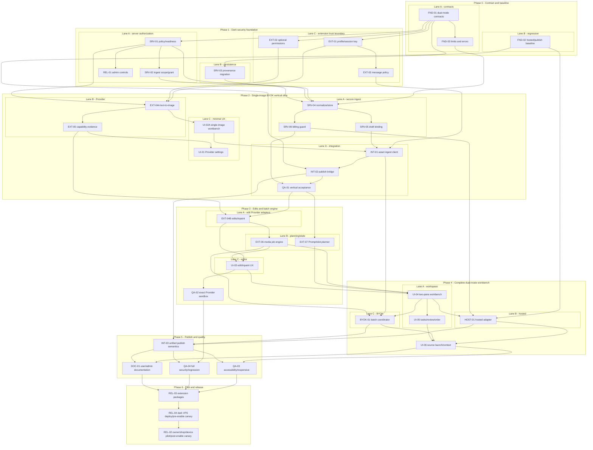

# Dual-Mode Extension AI Image Workflow: Dependency Graph



## Critical Path

```text
FND-01
-> SRV-01/SRV-02/SRV-03
-> SRV-04
-> SRV-05
-> INT-01
-> INT-02
-> QA-01
-> EXT-04B/EXT-06
-> UI-04
-> HOST-01 and BYOK-01
-> INT-03
-> QA-04
-> REL-03/REL-04/REL-02
```

## Merge Ownership Hotspots

The following surfaces are serialized even when surrounding lanes run in parallel:

| Hotspot | Required ownership |
| --- | --- |
| `apps/server/prisma/schema.prisma` and migration order | One server-data owner |
| Extension device scopes and command-grant operations | One authorization owner |
| `apps/server/src/config/system-config-schema.ts` and admin settings | One configuration owner |
| `apps/server/src/index.ts` route registration | One integration owner |
| `extensions/ss-erp/background/service-worker.js` | Thin-dispatch owner only |
| `runtime-message-policy.js` | One message-security owner |
| Manifest, package builder, and package verifier | One extension-release owner |
| Existing source workbench/costing panel | Launcher-only owner |

New Provider, profile, job-engine, ingest, provenance, coordinator, and standalone workbench
logic stays in focused modules so parallel lanes do not grow existing monoliths.
