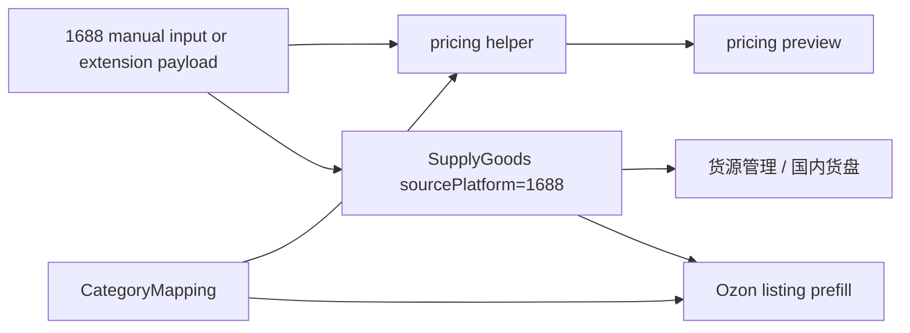

# Business Mainline Development Plan

## Overview

This plan reorders SS ERP development around visible ERP business value first. The immediate objective is to make the local dashboard show the product flows that were already discussed in earlier planning: 1688 collection and pricing, category mapping, Ozon collection/listing enhancements, and extension-to-ERP continuity.

Payment/recharge integration stays out of the current execution scope by user request. SaaS hardening work remains important, but it should not hide the missing product workflow in the user-facing ERP.

## Problem Frame

Recent work delivered several SaaS foundation items, but the visible ERP did not reflect the larger business roadmap. The user expects previously discussed functionality such as 1688 collection/pricing and category mapping to appear in the dashboard. Current code has partial foundations:

- Ozon collection, listing, batch snapshot, category attribute resolution, and publishing live in `apps/server/src/routes/collect.ts` and `apps/web/src/app/(dashboard)/collect/page.tsx`.
- Ozon analytics cache and list overlay support exist through `apps/server/src/routes/ozon-analytics.ts`, `extensions/ss-erp/content/ozon-list-overlay.js`, and `extensions/ss-erp/background/service-worker.js`.
- 1688 appears in extension match rules, logistics tracking, order purchase fields, and manual supply goods forms, but not as a complete ERP page or pricing workflow.
- Category handling exists for Ozon publishing, but not as a reusable mapping table from 1688/source categories to Ozon categories/type IDs/default attributes.

The optimized plan prioritizes features the user can open and test locally on the ERP dashboard.

## Requirements Trace

- R1. Add a visible `1688采集核价` workflow in the ERP dashboard.
- R2. Support manual 1688 product entry/import without requiring live 1688 API credentials.
- R3. Provide deterministic pricing/核价 output using purchase cost, domestic freight, weight, packaging, exchange rate, commission, logistics, and target margin.
- R4. Persist 1688 collected items into existing supply goods data so they are visible in `货源管理` and can later flow into Ozon listing.
- R5. Add category mapping management for source platform/category to Ozon `descriptionCategoryId` and `typeId`.
- R6. Use category mappings during 1688 pricing/import and Ozon listing prefill where available.
- R7. Keep Ozon collection/listing and extension overlay behavior stable while adding the new business flows.
- R8. Skip self-service payment/recharge integration in this plan.
- R9. Keep local development off port 3000; use the project-local web port `3003` when starting this ERP beside the user's MKD ERP.

## Scope Boundaries

- No payment gateway, recharge page, or payment webhook work in this plan.
- No live authenticated 1688 scraping requirement for the first 1688 ERP release. Manual URL/title/price inputs are enough for the first visible workflow.
- No third-party paid market data service integration.
- No remote code hot update for the Chrome extension.
- No destructive migration against the broken original local `sserp` database; development migration checks should target the separate working database used for this repo.

### Deferred to Separate Tasks

- Full 1688 detail-page auto extraction in the extension: after the ERP-side import/pricing contract is stable.
- Ozon Premium advanced market analytics: after visible ERP-side workflows are complete.
- Email system and mobile layout: after business workflow visibility is restored.
- Payment/recharge: when the user explicitly resumes that work.

## Context & Research

### Relevant Code and Patterns

- `apps/server/src/routes/supply.ts` already provides authenticated CRUD for `SupplyGoods` and accepts `sourcePlatform='1688'`.
- `apps/web/src/app/(dashboard)/supply/goods/page.tsx` already has manual supply entry patterns and 1688 source labels.
- `apps/server/src/routes/collect.ts` contains Ozon collection, batch snapshot, clone prefill, publish pricing helpers, attribute resolution, and `calcPublishPrice`.
- `apps/server/src/services/collect-pricing.ts` handles collected price normalization and should remain the pattern for pricing helpers.
- `apps/server/src/routes/listing.ts` exposes Ozon category tree and category attributes.
- `apps/server/prisma/schema.prisma` has `SupplyGoods.metadata`, `sourcePlatform`, `sourceUrl`, `sourceProductId`, `purchasePrice`, `supplier`, `variants`, and `images`, which can support 1688 MVP data without a new goods table.
- `apps/web/src/components/layout/sidebar.tsx` controls visible dashboard entry points.
- `extensions/ss-erp/content/collect-content-script.js` contains partial 1688 extraction, but current priority is ERP-side visibility before expanding extraction reliability.
- `docs/archive/extension-enhancement-plan.md` and `docs/archive/ozon-premium-data-plan.md` define the previously discussed extension/list overlay roadmap.

### Institutional Learnings

- Existing project docs emphasize keeping local/offline ERP usable without cloud dependencies.
- Launch docs show SaaS foundation tasks, but those should be sequenced after visible business workflows when the user is validating local progress.
- Extension docs show the right direction: degrade gracefully when Premium or external data is unavailable.

### External References

- Not needed for this planning pass. The repo already has direct local patterns for Fastify routes, Prisma migrations, Next.js dashboard pages, and Chrome extension integration.

## Key Technical Decisions

- Build ERP-visible 1688 workflows before deep extension automation: the user can test immediately in the local dashboard, and the extension can later submit into a stable API.
- Reuse `SupplyGoods` for 1688 MVP storage: avoids introducing a parallel product table before the workflow proves its shape.
- Add a dedicated `CategoryMapping` model: category mapping is durable user/admin configuration, not transient `metadata`.
- Keep pricing logic in a backend helper with tests: frontend displays results, backend owns formulas and validation so extension/web/API stay consistent.
- Add sidebar entries early in the implementation sequence: visible navigation is the primary proof that features landed.
- Treat Ozon category IDs/type IDs as target fields in the mapping, not as source goods fields: one 1688 item can later be remapped without rewriting the original collected item.

## Open Questions

### Resolved During Planning

- Should payment/recharge be included now? No. It is explicitly skipped.
- Should 1688 MVP require live API scraping? No. Manual import/pricing must work first.
- Should category mapping be global or user-owned? Support both by allowing `userId` nullable in the model; user-owned mappings override global defaults.

### Deferred to Implementation

- Exact formula defaults for commission/logistics: start with editable defaults in the pricing form and tested deterministic calculations; tune defaults after user validation.
- Whether category mapping lives under `一键上货` or `供货平台`: add entries where operators expect them first, likely `一键上货 -> 类目映射` and `一键上货 -> 1688采集核价`.
- Exact UI component split: follow existing dashboard page patterns during implementation.

## Output Structure

Expected new or changed surface:

```text
apps/server/src/lib/1688-pricing.ts
apps/server/src/lib/category-mapping.ts
apps/server/src/routes/supply.ts
apps/server/prisma/migrations/<timestamp>_add_category_mappings/migration.sql
apps/server/prisma/schema.prisma
apps/server/src/__tests__/1688-pricing.test.ts
apps/server/src/__tests__/category-mapping.test.ts
apps/server/src/__tests__/supply-1688.test.ts
apps/web/src/app/(dashboard)/collect/1688/page.tsx
apps/web/src/app/(dashboard)/collect/category-mapping/page.tsx
apps/web/src/components/layout/sidebar.tsx
```

## High-Level Technical Design

This is directional guidance, not implementation specification.



Data flow:

1. User enters a 1688 URL/title/cost/weight/category hint on `/collect/1688`.
2. Backend validates and returns a pricing preview.
3. User saves the item into `SupplyGoods` with metadata containing pricing inputs, mapped target category, and calculated pricing output.
4. Category mapping can be managed separately and reused on future imports/listings.
5. Existing Ozon collect/listing flows keep working; they optionally read mapping defaults where available.

## Implementation Units

- [x] **Unit 1: 1688 Pricing Domain Helper**

**Goal:** Add deterministic backend pricing/核价 logic independent of UI and external services.

**Requirements:** R1, R2, R3

**Dependencies:** None

**Files:**
- Create: `apps/server/src/lib/1688-pricing.ts`
- Test: `apps/server/src/__tests__/1688-pricing.test.ts`

**Approach:**
- Accept purchase price, domestic shipping, weight, package fee, commission percent, logistics fee, exchange rate, and target margin.
- Return a cost breakdown, suggested CNY sale price, suggested RUB sale price, gross profit, margin, and warnings for missing/unsafe inputs.
- Keep formulas deterministic and side-effect free.

**Execution note:** Implement test-first because pricing behavior must be trusted and easy to adjust.

**Patterns to follow:**
- `apps/server/src/services/collect-pricing.ts`
- `apps/server/src/__tests__/collect-pricing.test.ts`

**Test scenarios:**
- Happy path: CNY 20 purchase, CNY 5 domestic shipping, 500g weight, CNY 2 packaging, 12% commission, CNY 18 logistics, target 30% margin -> returns positive suggested price and line-item costs.
- Edge case: zero or missing weight still returns a preview with a warning and does not crash.
- Edge case: target margin above 90% is capped or rejected with a clear validation result.
- Error path: negative purchase price or exchange rate <= 0 is rejected.

**Verification:**
- Pricing helper tests prove formula output, warnings, and invalid input handling.

- [x] **Unit 2: Category Mapping Data Model and API**

**Goal:** Persist source-to-Ozon category mappings and expose CRUD/search APIs.

**Requirements:** R5, R6

**Dependencies:** None

**Files:**
- Modify: `apps/server/prisma/schema.prisma`
- Create: `apps/server/prisma/migrations/<timestamp>_add_category_mappings/migration.sql`
- Create: `apps/server/src/lib/category-mapping.ts`
- Modify: `apps/server/src/routes/supply.ts` or create a small dedicated route file if cleaner
- Test: `apps/server/src/__tests__/category-mapping.test.ts`

**Approach:**
- Add `CategoryMapping` with nullable `userId`, source platform/category ID/name/path, target platform, target `descriptionCategoryId`, target `typeId`, target category name/path, defaults for weight/dimensions, notes, and timestamps.
- User-owned mappings should override global mappings for the same source platform/category.
- Keep permission behavior simple: authenticated users can manage their own mappings; admins can later manage global mappings.

**Execution note:** Start with failing behavior tests for lookup priority and validation.

**Patterns to follow:**
- Authenticated route style in `apps/server/src/routes/supply.ts`
- Admin/user scoping patterns in `apps/server/src/routes/user-service-tag.ts`

**Test scenarios:**
- Happy path: create a 1688 category mapping and retrieve it by source category name.
- Happy path: user-specific mapping overrides a global mapping with the same source key.
- Edge case: missing source category ID but present source category name is allowed.
- Error path: missing target Ozon category/type is rejected.
- Error path: user cannot update another user's mapping.

**Verification:**
- Migration applies cleanly to the development database and tests cover create, list, update, delete, and lookup priority.

- [x] **Unit 3: 1688 Import and Save API**

**Goal:** Add backend endpoints that preview and save 1688 goods into `SupplyGoods`.

**Requirements:** R1, R2, R3, R4, R6

**Dependencies:** Unit 1, Unit 2

**Files:**
- Modify: `apps/server/src/routes/supply.ts`
- Test: `apps/server/src/__tests__/supply-1688.test.ts`

**Approach:**
- Add a preview endpoint for pricing calculation without persistence.
- Add a save/import endpoint that creates `SupplyGoods` with `sourcePlatform='1688'`, parsed or provided `sourceProductId`, source URL, supplier, images, purchase price, and metadata containing pricing and category mapping data.
- If a category hint matches a mapping, include mapped Ozon category/type defaults in metadata.
- Preserve existing `/api/supply` CRUD behavior.

**Execution note:** Add integration-style route tests before changing the route.

**Patterns to follow:**
- `apps/server/src/routes/supply.ts`
- `apps/server/src/routes/collect.ts` metadata usage

**Test scenarios:**
- Happy path: preview returns a pricing breakdown for a complete 1688 input.
- Happy path: save creates a `SupplyGoods` row with `sourcePlatform='1688'` and metadata pricing output.
- Happy path: save with category hint attaches mapped Ozon target fields.
- Edge case: source URL without product ID still saves with provided SKU or null source product ID.
- Error path: invalid URL or invalid price returns 400.
- Integration: saved item appears in normal `/api/supply` listing.

**Verification:**
- The API can be used by web UI and later by the extension without duplicating pricing logic.

- [x] **Unit 4: Visible 1688 Collection/Pricing Page**

**Goal:** Add a dashboard page where the user can input 1688 goods, calculate pricing, and save to goods.

**Requirements:** R1, R2, R3, R4, R9

**Dependencies:** Unit 1, Unit 3

**Files:**
- Create: `apps/web/src/app/(dashboard)/collect/1688/page.tsx`
- Modify: `apps/web/src/components/layout/sidebar.tsx`

**Approach:**
- Add sidebar entry `一键上货 -> 1688采集核价`.
- Page layout should match existing dashboard pages: compact heading, form area, result breakdown, save action, recent saved goods.
- Inputs should include title, 1688 URL, supplier, purchase price, domestic shipping, weight, package fee, commission, logistics fee, exchange rate, target margin, and category hint.
- Show pricing breakdown before save; saving should immediately create a visible supply goods row.

**Patterns to follow:**
- `apps/web/src/app/(dashboard)/supply/goods/page.tsx`
- `apps/web/src/app/(dashboard)/collect/page.tsx`
- Existing UI components under `apps/web/src/components/ui/`

**Test scenarios:**
- Test expectation: no new frontend unit test required unless the repo already has page tests; verify through build and manual local browser smoke.

**Verification:**
- User can open `/collect/1688`, calculate a preview, save a 1688 item, and then see the item in `货源管理`.

- [x] **Unit 5: Category Mapping Management Page**

**Goal:** Add visible management UI for source-to-Ozon category mappings.

**Requirements:** R5, R6

**Dependencies:** Unit 2

**Files:**
- Create: `apps/web/src/app/(dashboard)/collect/category-mapping/page.tsx`
- Modify: `apps/web/src/components/layout/sidebar.tsx`

**Approach:**
- Add sidebar entry `一键上货 -> 类目映射`.
- UI should list mappings, filter by source platform/category, create/edit mappings, and delete mappings.
- Target fields should accept Ozon category ID/type ID now; a later enhancement can add tree selectors.
- Show whether a mapping is global or user-owned if the API exposes that distinction.

**Patterns to follow:**
- `apps/web/src/app/(dashboard)/admin/service-tags/page.tsx`
- `apps/web/src/app/(dashboard)/admin/warehouse-templates/page.tsx`

**Test scenarios:**
- Test expectation: no new frontend unit test required unless page tests exist; verify through build and manual local browser smoke.

**Verification:**
- User can create a 1688-to-Ozon mapping and see it reused by the 1688 pricing/import page.

- [x] **Unit 6: Ozon Listing Prefill Uses Mappings**

**Goal:** Connect category mappings to existing Ozon listing prefill where it can reduce manual category work.

**Requirements:** R6, R7

**Dependencies:** Unit 2, Unit 3

**Files:**
- Modify: `apps/server/src/routes/collect.ts`
- Test: `apps/server/src/__tests__/collect-category-mapping.test.ts`

**Approach:**
- When clone prefill or save customization sees a 1688-backed `SupplyGoods` item with mapping metadata, prefer mapped `descriptionCategoryId` and `typeId` as defaults.
- Do not override explicit user-entered category/type.
- Keep existing Ozon-collected goods behavior unchanged.

**Execution note:** Add characterization tests for existing prefill behavior before adding mapping defaults if direct route tests already exist.

**Patterns to follow:**
- Existing `clone-prefill` and `save-customization` metadata handling in `apps/server/src/routes/collect.ts`

**Test scenarios:**
- Happy path: 1688 item with mapping defaults returns category/type in prefill.
- Edge case: explicit customized category/type remains unchanged.
- Regression: Ozon-collected item without mapping keeps current behavior.

**Verification:**
- Existing collect/listing tests remain green, and mapped 1688 goods reduce manual category entry.

- [x] **Unit 7: Extension-to-ERP 1688 Payload Alignment**

**Goal:** Align existing 1688 extraction with the ERP import API after the dashboard workflow is stable.

**Requirements:** R1, R2, R4, R7

**Dependencies:** Unit 3, Unit 4

**Files:**
- Modify: `extensions/ss-erp/content/collect-content-script.js`
- Modify: `extensions/ss-erp/shared/erp-adapter/collect-product.js`
- Test: `scripts/extension-ozon-regressions.test.mjs` or create a targeted extension regression test if needed

**Approach:**
- Keep Ozon extension behavior unchanged.
- For 1688 detail pages, submit normalized payloads to the new ERP import path or existing `/api/collect` only if response shape compatibility is preserved.
- Add a clear extension success message that the item was saved to 1688 goods/pricing workflow.

**Patterns to follow:**
- Existing extension ERP adapter and `collect-content-script.js` extraction helpers.

**Test scenarios:**
- Happy path: a synthetic 1688 extraction payload maps to the expected API payload.
- Regression: Ozon collection message types and endpoints remain unchanged.
- Error path: missing ERP token or API failure produces a visible extension error.

**Verification:**
- Local extension package still verifies, and 1688 pages can push data into the visible ERP flow.

- [x] **Unit 8: Ozon List Overlay and Premium Data Polish**

**Goal:** Resume the earlier extension enhancement roadmap after 1688/category gaps are closed.

**Requirements:** R7

**Dependencies:** Unit 4 and Unit 5 should be visible first

**Files:**
- Modify: `extensions/ss-erp/content/ozon-list-overlay.js`
- Modify: `extensions/ss-erp/background/service-worker.js`
- Modify: `apps/server/src/routes/ozon-analytics.ts`
- Test: `scripts/extension-ozon-regressions.test.mjs`

**Approach:**
- Keep the already implemented `batch-snapshot` and analytics cache contracts.
- Improve visible fields, empty states, retry states, and actions: view ERP, recollect, and pricing status.
- Do not depend on Premium availability; show graceful fallback.

**Patterns to follow:**
- `docs/archive/extension-enhancement-plan.md`
- `docs/archive/ozon-premium-data-plan.md`

**Test scenarios:**
- Happy path: overlay shows collected status and ERP action when `batch-snapshot` returns data.
- Edge case: no Premium data still shows basic ERP status.
- Error path: ERP unreachable does not break the Ozon product grid.

**Verification:**
- Extension regression tests pass and manual Ozon list page check shows stable overlay behavior.

- [ ] **Unit 9: Resume SaaS Foundation Backlog**

**Goal:** Continue remaining non-payment SaaS tasks after the missing business workflows are visible.

**Requirements:** R8, R9

**Dependencies:** Units 1-5 at minimum

**Files:**
- Modify as needed from `docs/plans/saas-remaining-tasks.md`

**Approach:**
- Keep completed foundation items intact: password reset, legal consent, landing page, change password, audit logs, onboarding, queue monitoring.
- Next non-payment candidates: email abstraction, mobile critical views, extension cloud-mode hardening, deployment runbook evidence.
- Payment/recharge remains skipped.

**Progress:**
- 2026-06-08: Started the non-payment SaaS backlog with B6 email foundation: `lib/email` provider abstraction, transactional templates, env examples, env validation, and integration status check. Payment/recharge remains skipped.
- 2026-06-08: Continued C3 mobile adaptation with a dashboard mobile navigation drawer, responsive top bar, mobile order cards, and local development/Web runtime defaults moved from port `3000` to `3003` to avoid the MKD ERP conflict.
- 2026-06-09: Continued C3 mobile adaptation by adding product-list mobile cards and responsive product filters, preserving desktop table editing and batch actions. Payment/recharge remains skipped.
- 2026-06-09: Continued D1/D2 extension cloud/local hardening by expanding `/api/extension/runtime` with auth/capability/endpoints metadata, adding extension fallback to clear stale cloud mode when runtime probing fails, and showing runtime mode/capabilities in the extension settings connection test.
- 2026-06-09: Continued C3 mobile adaptation across visible 1688/category workflows by adding mobile card views and responsive actions for `货源管理`, `1688采集核价` recent goods, and `类目映射` while preserving desktop tables.
- 2026-06-09: Continued B6 email foundation by exposing `User.email` through `/api/user/me`, adding `PATCH /api/user/profile` for self-service notification email/nickname maintenance, and surfacing the form on `账号安全` so later transactional email notifications have a real user-managed recipient.
- 2026-06-09: Continued B6 email foundation by adding authenticated `/api/user/test-email`, provider failure handling, and a `账号安全` test-send button so local users can verify the saved notification mailbox before broader transactional notifications are enabled.
- 2026-06-09: Continued C1 onboarding by extracting a shared dashboard onboarding guide, adding tested step-state logic, keeping the orders page sync action intact, and surfacing the same next-step guide on the ERP home page.
- 2026-06-09: Continued E3/E4 operational evidence by adding route coverage for `/api/admin/ops/backup-status` and surfacing backup availability, latest backup time, filename, size, and error state on the super-admin ops page.
- 2026-06-09: Continued B6 email foundation by adding super-admin `/api/admin/system-status/test/email` provider testing and exposing it from `接口与集成`, distinct from the end-user notification mailbox test on `账号安全`.
- 2026-06-09: Tightened the 1688 import workflow by making `/api/supply/1688/import` update an existing user/sourceProductId match instead of creating duplicate `SupplyGoods` rows, with the 1688 page showing the backend save/update result.
- 2026-06-09: Tightened the 1688 pricing page by tracking preview input signatures and clearing stale pricing results when cost/category/pricing inputs change, preventing operators from saving against an out-of-date visible核价 panel.
- 2026-06-09: Tightened the 1688 duplicate workflow by making preview return create/update intent and matched supply-good metadata, showing `更新已有货源` directly in the核价 panel, and sorting the 1688 recent list by `updatedAt` so refreshed goods move back to the top.
- 2026-06-09: Improved first-screen ERP visibility by replacing the generic dashboard quick actions with a tested `业务工作台` configuration that links directly to `1688采集核价`, `类目映射`, `货源管理`, and `Ozon上货`.
- 2026-06-09: Added `/api/dashboard/business-status` and homepage status summaries for the 1688/category workflow, showing current 1688 supply count, mapping count, latest goods, and latest mapping without exposing other users' private data.
- 2026-06-09: Improved `货源管理` visibility by adding tested 1688 metadata summaries that show saved核价 status, suggested CNY/RUB price, estimated margin, and matched Ozon category/type in both desktop rows and mobile cards.
- 2026-06-09: Product direction correction from user review: the ERP `/collect/1688` page should be treated as manual fallback/debug entry only. The primary 1688 collection and pricing workflow belongs in the Chrome extension on Ozon/1688 pages: Ozon image-search-to-1688 pricing, 1688 detail-page collection, and ERP persistence of full source product data plus pricing metadata.
- 2026-06-09: Started extension-first 1688 workflow by injecting a `SS ERP 1688核价采集` panel on `detail.1688.com` pages. The panel reads current page product data, lets the operator adjust cost/logistics/pricing inputs, calls ERP `/api/supply/1688/preview`, and saves through `/api/supply/1688/import`. ERP dashboard copy/sidebar now labels `/collect/1688` as `1688手工补录` fallback rather than the primary collection flow.

**Test scenarios:**
- Test expectation: depends on each resumed task; add or update tests per behavior touched.

**Verification:**
- Foundation work resumes only after the dashboard shows the business features the user expects.

## System-Wide Impact

- **Interaction graph:** New 1688 page calls supply routes; supply routes call pricing helper and category mapping lookup; category mapping can later feed collect/listing prefill.
- **Error propagation:** Pricing validation errors should return user-actionable 400 messages; mapping lookup misses should degrade to manual input, not fail import.
- **State lifecycle risks:** Save/import should avoid duplicate rows for the same user/source product when a product ID is available. If dedupe is deferred, the UI must make duplicates visible.
- **API surface parity:** Web and extension should share the same import/pricing contract after Unit 7.
- **Integration coverage:** Route tests must prove saved 1688 goods appear through existing supply listing and mappings are applied.
- **Unchanged invariants:** Existing Ozon collect, batch snapshot, publish, analytics cache, and order logistics behavior must continue to work.

## Risks & Dependencies

| Risk | Mitigation |
|------|------------|
| User still sees no change after backend-only work | Add sidebar/page work as early as possible, not after all backend internals are complete. |
| Pricing formula disputes | Keep formula centralized, tested, and visible as line items so defaults can be tuned. |
| Category mapping model overfits early assumptions | Store both IDs and human-readable names/paths; allow nullable source IDs and user overrides. |
| Migration hits wrong local DB | Apply/check migrations only against the known working development database for this repo. |
| Extension changes break Ozon collection | Defer extension 1688 wiring until ERP APIs are stable and run extension regression tests. |
| 3000 port conflict with MKD ERP | Use `3003` for this project's web dev server and document it in run/start notes. |

## Phased Delivery

### Phase 1: Visible ERP Business MVP

1. Unit 1: 1688 pricing helper.
2. Unit 2: category mapping model/API.
3. Unit 3: 1688 preview/save API.
4. Unit 4: visible 1688 pricing page.
5. Unit 5: visible category mapping page.

This phase is the highest priority because it addresses the user's current concern directly.

### Phase 2: Workflow Integration

1. Unit 6: apply mappings to listing prefill.
2. Unit 7: align extension 1688 payloads.
3. Unit 8: polish Ozon overlay/Premium data.

This phase turns the visible pages into a smoother acquisition-to-listing workflow.

### Phase 3: Non-Payment SaaS Backlog

1. Resume email abstraction, mobile critical views, extension cloud mode, and deployment evidence.
2. Continue skipping payment/recharge until explicitly resumed.

## Documentation / Operational Notes

- Update `docs/PROJECT-OVERVIEW.md` after Phase 1 to include 1688 collection/pricing and category mapping as first-class business flows.
- Update `docs/local-development.md` to document the local web port `3003` when running beside the user's MKD ERP on `3000`.
- Update `docs/archive/extension-enhancement-plan.md` only if extension work changes the previous roadmap assumptions; otherwise keep this new plan as the active execution source.

## Sources & References

- Origin document: `docs/PROJECT-OVERVIEW.md`
- Origin document: `docs/archive/extension-enhancement-plan.md`
- Origin document: `docs/archive/ozon-premium-data-plan.md`
- Origin document: `docs/plans/saas-remaining-tasks.md`
- Related code: `apps/server/src/routes/supply.ts`
- Related code: `apps/server/src/routes/collect.ts`
- Related code: `apps/server/src/routes/listing.ts`
- Related code: `apps/web/src/app/(dashboard)/supply/goods/page.tsx`
- Related code: `apps/web/src/components/layout/sidebar.tsx`
- Related code: `extensions/ss-erp/content/collect-content-script.js`
- Related code: `extensions/ss-erp/content/ozon-list-overlay.js`
