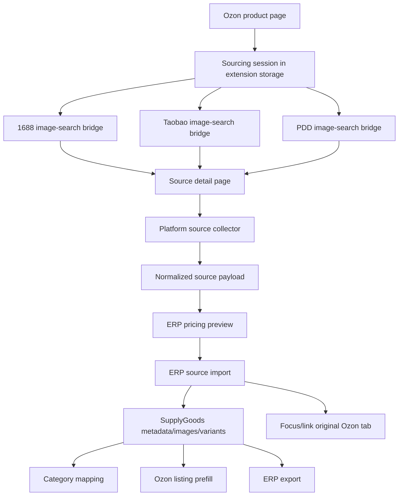

# 1688/Taobao/PDD Sourcing Extension Integration

## Overview

This plan turns SS ERP's sourcing flow into an extension-first workflow. The ERP web pages should remain the record management, fallback entry, mapping, listing, and export surfaces. Live sourcing behavior should happen in the browser extension on Ozon, 1688, Taobao/Tmall, and Pinduoduo pages because those pages provide the user's login context, page data, image-search widgets, and SKU/detail state.

The current SS ERP local extension already has an Ozon product panel, a `搜1688` action, a 1688 detail-page pricing panel, `/api/supply/1688/preview`, `/api/supply/1688/import`, category mappings, and Ozon listing prefill from saved 1688 pricing metadata. The gap is that the flow is still shallow: 1688 image search uses a weaker URL-parameter path, the parser does not yet capture enough multi-SKU/detail attributes, Taobao/PDD are not integrated, export is not unified, and the Ozon search session does not yet return cleanly to the source Ozon product with saved sourcing candidates.

## Problem Frame

The user has several existing local browser extensions with overlapping capabilities:

| Reference Project | Observed Capability | Reuse Direction | Risk |
|---|---|---|---|
| `AliPrice - TB以图搜同款 Beta` | Mature image-search UX and context-menu behavior for Taobao-like sourcing. Most logic is bundled/minified/obfuscated. | Use as product/UX reference only. Do not copy opaque commercial code into SS ERP. | High maintainability and ownership risk. |
| `ozon-selection-capture` | Ozon product capture, Ozon main-image to 1688/Taobao/PDD image-search jobs, base64 image upload bridges, local `.xls` export. | Reuse the image-search job model and page-context upload bridges as the main technical reference. | Private/unofficial APIs can break and require login/cookies. |
| `test-extension` | 1688/Taobao/PDD detail parsers with richer SKU, price, weight, dimensions, category path, images, attributes, and fallback DOM logic. | Port parser logic into SS ERP as normalized source collectors, with tests and schema mapping. | Parser is standalone/prototype code and needs normalization before production use. |
| `上品帮插件-自研版` | Ozon seller API bridge, logistics tracking, multi-platform product panel, ERP connection config, API reference notes. | Reuse Ozon session/insight patterns where already aligned with SS ERP, and use API notes for payload shape. Do not expand unrelated Premium-bypass behavior as part of this sourcing plan. | Broad permissions and mixed concerns increase review risk. |

The target workflow is:

1. On an Ozon product page, collect Ozon context and main image.
2. Start image-search jobs for 1688, Taobao, and/or PDD from the extension.
3. Open platform search pages, upload the Ozon image in page context, and navigate to search results.
4. On a chosen source detail page, collect full product data including multi-SKU, attributes, images, price tiers, weight, and dimensions.
5. Calculate cost/pricing using SS ERP's Ozon logistics and pricing rules.
6. Save normalized source product data and pricing metadata into ERP.
7. Optionally focus the original Ozon tab and collect/link the Ozon product so the source item and target product stay connected.
8. Export saved sourcing records from ERP or extension in a consistent spreadsheet format.

## Requirements Trace

- R1. Primary collection and pricing must run in the local/test extension first, not on VPS.
- R2. Ozon product pages must support image-search handoff to 1688/Taobao/PDD using the Ozon main image and saved source context.
- R3. 1688 detail pages must collect detailed product data, including multi-SKU, SKU prices, attributes, category hints, images, weight, and dimensions.
- R4. Taobao/Tmall and PDD detail pages must be normalized into the same ERP supply-source payload shape.
- R5. Pricing must use ERP-side Ozon logistics/pricing configuration where possible, with manual overrides in the extension panel.
- R6. Saved source products must persist to ERP with enough metadata to support later Ozon listing prefill and category mapping.
- R7. Category mapping must support source platform + category ID/name/path to Ozon category/type/default dimensions, and be applied during import/listing prefill.
- R8. Export should include source product details, Ozon context, SKU pricing, and mapping state, rather than being a separate isolated old-plugin record format.
- R9. Existing Ozon collection, current 1688 local testing, and local web/API ports must not regress.

## Scope Boundaries

- This plan does not deploy to VPS and does not change the cloud production service.
- This plan does not resume payment/recharge.
- This plan does not attempt to clone opaque/minified AliPrice internals.
- This plan does not add a full installer/runtime package.
- This plan does not require a new primary product table unless implementation proves `SupplyGoods.metadata` is insufficient.
- This plan treats unofficial 1688/Taobao/PDD page APIs as best-effort browser automation using the user's own logged-in browser session.

### Deferred to Separate Tasks

- Bulk automated supplier ranking across search results.
- Order procurement and logistics tracking beyond source-product collection.
- Fully automated Ozon listing publish from Taobao/PDD source data.
- Cloud extension mode parity after the local workflow is stable.

## Context & Research

### Current SS ERP Patterns

- `extensions/ss-erp/manifest.json` already grants local, Ozon, 1688, Taobao/Tmall, JD, and all-url bridge permissions in the local build.
- `extensions/ss-erp/content/collect-content-script.js` currently owns source detail collection, Ozon data overlay, Ozon-to-1688 context, and the 1688 pricing panel.
- `extensions/ss-erp/background/service-worker.js` currently stores `ss-erp:ozon-1688-context` and opens 1688 search pages.
- `extensions/ss-erp/shared/adapters/local-adapter.js`, `extensions/ss-erp/shared/adapters/cloud-adapter.js`, and `extensions/ss-erp/shared/erp-adapter/collect-product.js` already route 1688 payloads to `/api/supply/1688/import`.
- `apps/server/src/routes/supply.ts` already has category mapping CRUD, `/api/supply/1688/preview`, and `/api/supply/1688/import`.
- `apps/server/src/lib/1688-pricing.ts` already supports item-level and SKU-level pricing, but SKU-level logistics/weight handling is still coarse.
- `apps/web/src/app/(dashboard)/supply/goods/page.tsx` and `apps/web/src/app/(dashboard)/listing/page.tsx` already surface 1688 pricing summaries and Ozon-source context.
- `scripts/extension-ozon-regressions.test.mjs` already verifies extension behavior with static regression checks.

### Existing Plan Continuity

- `docs/plans/2026-06-08-001-feat-business-mainline-development-plan.md` already records the direction correction: `/collect/1688` in ERP is a manual fallback/debug surface; primary collection/pricing belongs in the extension on Ozon/1688 pages.
- The current plan narrows the next phase to extension sourcing integration and avoids re-litigating the back-office page direction.

## Key Technical Decisions

- Extension-first source collection: image search, page parsing, and live pricing panels belong in the extension because the required data and login state are in the browser page.
- ERP as normalized persistence and pricing authority: ERP receives normalized payloads, calculates/validates pricing, stores metadata, maps categories, and exports records.
- Replace weak 1688 image-search URL handoff with job-based page upload: use the `ozon-selection-capture` pattern of storing an image-search job, opening the platform page, injecting a page-context upload bridge, and using the platform's own page APIs.
- Keep 1688 stable first: improve 1688 search/collection before broadening Taobao/PDD, because the user wants near-term 1688采集/核价 testing.
- Normalize source product payloads before saving: old plugin fields like `titleZh`, `imageUrls`, `skus`, `allAttributes`, and `priceTiers` need explicit mapping to SS ERP names and metadata.
- Store rich details in metadata initially: `SupplyGoods` already supports `metadata`, `images`, `sourcePlatform`, `sourceProductId`, `purchasePrice`, and `variants`; this avoids schema churn before the workflow proves its final shape.
- Do not integrate unrelated Premium spoofing/bypass behavior into this sourcing work: it is not needed for 1688/Taobao/PDD sourcing and expands risk.

## High-Level Technical Design

> This illustrates the intended approach and is directional guidance for review, not implementation specification.

## Normalized Payload Direction

The implementation should normalize each platform into one source-product shape:

| Field Group | Examples |
|---|---|
| Identity | `sourcePlatform`, `sourceProductId`, `sourceUrl`, `sourceHost`, `sku` |
| Display | `title`, `supplier`, `brand`, `material`, `notes` |
| Category | `sourceCategoryId`, `sourceCategoryName`, `sourceCategoryPath` |
| Cost | `purchasePriceCny`, `standardPriceCny`, `newUserPriceCny`, `priceTiers`, `domesticShippingCny` |
| Physical | `weightG`, `lengthMm`, `widthMm`, `heightMm` |
| Media | `images`, `detailImages`, `skuImages` |
| SKU | `skuItems[]` with `skuId`, `name`, `specText`, `attributes`, `price`, `stock`, `imageUrl`, `grossWeightGrams` |
| Context | `metadata.ozonSourceContext`, `metadata.sourcingSession`, parser warnings, raw debug snippets |

## Implementation Units

- [x] **Unit 1: Sourcing Session And Image Search Jobs**

**Goal:** Replace the current one-off 1688 URL handoff with a reusable source-search job model for 1688 first, then Taobao/PDD.

**Requirements:** R1, R2, R9

**Dependencies:** Current Ozon product panel and `ss-erp:open-1688-image-search`.

**Files:**
- Create: `extensions/ss-erp/content/source-search-content.js`
- Create: `extensions/ss-erp/content/source-search-1688-page.js`
- Modify: `extensions/ss-erp/background/service-worker.js`
- Modify: `extensions/ss-erp/content/collect-content-script.js`
- Modify: `extensions/ss-erp/manifest.json`
- Test: `scripts/extension-ozon-regressions.test.mjs`

**Approach:**
- Add a `sourcingSearchJobs` storage entry keyed by token/session ID.
- Store Ozon context, original Ozon tab ID, target platform, image URL, base64 image data or a bounded image blob representation, creation timestamp, and status.
- Resize/compress job images before storage and prune expired jobs so extension storage cannot grow without bound.
- For 1688, use a page-context bridge similar to `ozon-selection-capture` to call MTOP and navigate to the `imageId` result URL.
- Inject only a thin content bridge on 1688 search pages; the MTOP call itself should run in page context via a web-accessible bridge file because page globals/cookies are required.
- Keep the existing `imageAddress` search path as fallback if upload fails.
- Preserve current `ss-erp:ozon-1688-context` behavior so tomorrow's 1688 test does not lose context.

**Patterns to follow:**
- `extensions/ss-erp/background/service-worker.js`
- `extensions/ss-erp/content/erp-collect-bridge.js`
- `scripts/extension-ozon-regressions.test.mjs`

**Test scenarios:**
- Happy path: Ozon product panel creates a 1688 search job with Ozon SKU/title/image and opens the 1688 upload page.
- Happy path: 1688 page bridge receives base64 image, returns image ID, and navigates to image-search results.
- Edge case: missing Ozon image returns a user-actionable error and does not create a job.
- Edge case: expired search jobs are ignored and pruned before new jobs are saved.
- Error path: 1688 MTOP upload failure falls back to the existing search URL behavior or shows an actionable status.
- Regression: Ozon product collection and 1688 detail-page pricing panel still load.

**Verification:**
- The local extension can start 1688 image search from an Ozon product page without relying only on `imageAddress`.
- Implemented in local/test extension on 2026-06-10 with a source-search job stored in `chrome.storage.local`, 1688 page bridge upload, expiry/pruning, and fallback to the old `imageAddress` URL.
- Verified with `node --test scripts/extension-ozon-regressions.test.mjs`, `pnpm build:extension:local`, `EXTENSION_DIR=build/extensions/ss-erp-local pnpm verify:extension`, `pnpm test:repo`, and `pnpm typecheck`.
- Remaining manual QA: test on a logged-in 1688 browser session because MTOP image upload depends on 1688 page cookies/runtime.

- [x] **Unit 2: Rich 1688 Detail Collector**

**Goal:** Port the stronger 1688 parser behavior into SS ERP's collector and normalize it to the ERP import schema.

**Requirements:** R3, R5, R6, R7, R9

**Dependencies:** Unit 1 for better search handoff is helpful but not required.

**Files:**
- Modify: `extensions/ss-erp/content/collect-content-script.js`
- Modify: `extensions/ss-erp/shared/erp-adapter/collect-product.js`
- Modify: `extensions/ss-erp/shared/adapters/local-adapter.js`
- Modify: `extensions/ss-erp/shared/adapters/cloud-adapter.js`
- Modify: `apps/server/src/routes/supply.ts`
- Test: `apps/server/src/__tests__/supply-1688.test.ts`
- Test: `scripts/extension-ozon-regressions.test.mjs`

**Approach:**
- Add characterization coverage for current 1688 normalized payload fields before changing parsing behavior.
- Port the useful `test-extension` 1688 parsing ideas: `offerDetail` discovery, `priceModel`, standard vs new-user price, price tiers, SKU props/maps, category path, attributes, dimensions, weight, main/detail/SKU images.
- Convert old fields into SS ERP names: `sourceId -> sourceProductId`, `titleZh -> title`, `imageUrls -> images`, `skus -> skuItems`, `allAttributes -> metadata.attributes`, `priceTiers -> metadata.priceTiers`.
- Extend accepted SKU metadata deliberately: `skuItems` should preserve `attributes`, `stock`, and `imageUrl` either as accepted schema fields or under a bounded `metadata.skuRaw`/`metadata.skuExtras` structure. Do not silently drop these fields because they are required for SKU mapping and export.
- Do not send massive raw page objects by default. Store bounded raw/debug snippets only when debug mode is active.
- Keep the panel editable so operators can correct weight, logistics, price, and margin before saving.

**Patterns to follow:**
- `extensions/ss-erp/content/collect-content-script.js`
- `extensions/ss-erp/shared/erp-adapter/collect-product.js`
- `apps/server/src/lib/1688-pricing.ts`

**Test scenarios:**
- Happy path: a normalized 1688 payload with SKU prices imports and stores SKU pricing metadata.
- Happy path: SKU `attributes`, `stock`, and `imageUrl` survive normalization and can be shown/exported later.
- Happy path: standard price is preferred over obvious new-user/promotional price for base cost.
- Happy path: source category path is saved and matched against category mapping.
- Edge case: no SKU map but visible DOM SKU options creates bounded fallback SKU items.
- Edge case: no weight uses pricing helper default warning but still allows manual override.
- Error path: invalid purchase price returns a pricing validation message and does not create/update a record.
- Regression: existing 1688 import updates the same `sourceProductId` instead of duplicating rows.

**Verification:**
- A real 1688 detail page can show richer SKU/detail data in the extension panel and save it to ERP.
- Implemented in local/test extension on 2026-06-10 with `offerDetail` discovery, price tiers, source category path, detail images, dimensions, SKU `attributes`/`stock`/`imageUrl` preservation, and bounded `metadata.sourceDetails` persistence.
- Verified with `node --test scripts/extension-ozon-regressions.test.mjs`, `pnpm --filter server test -- src/__tests__/supply-1688.test.ts`, `pnpm test:repo`, `pnpm typecheck`, `pnpm build:extension:local`, and `EXTENSION_DIR=build/extensions/ss-erp-local pnpm verify:extension`.
- Remaining manual QA: load `build/extensions/ss-erp-local` in the logged-in browser and test several real 1688 detail pages because live page globals and 1688 cookies vary by account/session.

- [x] **Unit 3: SKU-Level Pricing Refinement**

**Goal:** Make pricing useful at SKU level, not only product level.

**Requirements:** R3, R5, R6

**Dependencies:** Unit 2 provides richer SKU input.

**Files:**
- Modify: `apps/server/src/lib/1688-pricing.ts`
- Modify: `apps/server/src/routes/supply.ts`
- Modify: `apps/web/src/lib/listing-prices.ts`
- Modify: `apps/web/src/app/(dashboard)/listing/page.tsx`
- Test: `apps/server/src/__tests__/1688-pricing.test.ts`
- Test: `apps/server/src/__tests__/supply-1688.test.ts`
- Test: `apps/web/src/lib/listing-prices.test.mjs`

**Approach:**
- Allow each SKU to carry its own purchase price and optional gross weight.
- Use SKU weight when present; otherwise use product weight; otherwise mapping default; otherwise pricing default.
- Preserve current product-level pricing output for simple products.
- Keep 1688 SKU IDs distinct from Ozon SKU/product IDs during listing prefill.
- Surface min/max SKU suggested prices and per-SKU suggested RUB/CNY prices in saved metadata.

**Patterns to follow:**
- `apps/server/src/lib/1688-pricing.ts`
- `apps/web/src/lib/listing-prices.ts`

**Test scenarios:**
- Happy path: two SKUs with different prices produce different suggested sale prices.
- Happy path: SKU weight overrides product weight for that SKU only.
- Edge case: SKU without price is skipped from SKU pricing but product pricing still succeeds.
- Regression: Ozon listing prefill does not use 1688 SKU ID as Ozon product ID.

**Verification:**
- Saved source goods show meaningful SKU pricing summaries and listing prefill uses the right prices.
- Implemented in local/test extension and ERP pricing on 2026-06-10 with SKU-level purchase price, weight, `logisticsFeeCny`, `totalBaseCostCny`, suggested CNY/RUB prices, and min/max SKU pricing summaries.
- The 1688 extension panel now calculates SKU-level logistics fees from the synced Ozon logistics snapshot when SKU weights are available, while preserving the operator's manual product-level logistics override by clearing stale automatic SKU logistics fees on submit.
- Verified with `pnpm --filter server test -- src/__tests__/1688-pricing.test.ts src/__tests__/supply-1688.test.ts`, `node --test scripts/extension-ozon-regressions.test.mjs`, `node --check extensions/ss-erp/content/collect-content-script.js`, `pnpm test:repo`, `pnpm typecheck`, `pnpm build:extension:local`, and `EXTENSION_DIR=build/extensions/ss-erp-local pnpm verify:extension`.

- [ ] **Unit 4: Taobao/Tmall And PDD Source Collectors**

**Goal:** Add Taobao/Tmall and PDD detail collection into the same extension and ERP supply-source contract after 1688 is stable.

**Requirements:** R2, R4, R5, R6, R8

**Dependencies:** Unit 1 session model and Unit 2 normalized payload mapping.

**Files:**
- Create: `extensions/ss-erp/content/source-search-taobao-page.js`
- Create: `extensions/ss-erp/content/source-search-pdd-page.js`
- Modify: `extensions/ss-erp/manifest.json`
- Modify: `extensions/ss-erp/content/collect-content-script.js`
- Modify: `extensions/ss-erp/background/service-worker.js`
- Modify: `extensions/ss-erp/shared/erp-adapter/collect-product.js`
- Modify: `extensions/ss-erp/shared/adapters/local-adapter.js`
- Modify: `extensions/ss-erp/shared/adapters/cloud-adapter.js`
- Modify: `apps/server/src/routes/supply.ts`
- Test: `apps/server/src/__tests__/supply-source-import.test.ts`
- Test: `scripts/extension-ozon-regressions.test.mjs`

**Approach:**
- Add platform detection and normalized collectors for `taobao`, `tmall`, and `pdd`.
- Port only maintainable parser logic from `test-extension`, not UI scaffolding.
- Port the `ozon-selection-capture` Taobao/PDD image upload bridge approach after 1688 succeeds, keeping each platform bridge isolated behind the shared search-job model.
- Introduce a generic source import/preview route if extending `/api/supply/1688/import` becomes semantically misleading. Keep `/api/supply/1688/import` as a compatibility alias for existing 1688 tests.
- Add platform labels and sourcePlatform filtering in `货源管理` if current UI cannot distinguish Taobao/PDD source goods clearly enough.

**Patterns to follow:**
- `apps/server/src/routes/supply.ts`
- `apps/web/src/app/(dashboard)/supply/goods/page.tsx`

**Test scenarios:**
- Happy path: Taobao payload imports with source platform, source ID, images, SKU items, and purchase price.
- Happy path: PDD payload imports with source platform, source ID, images, SKU items, and purchase price.
- Edge case: unsupported platform returns an actionable error instead of hitting 1688-only validation.
- Regression: current 1688 import and preview APIs remain compatible.

**Verification:**
- Taobao/Tmall and PDD detail pages can be collected into ERP as source goods using the same normalized metadata shape.

- [x] **Unit 5: Ozon Return And Linked Candidate UX**

**Goal:** Make the search-to-source-to-Ozon loop explicit so operators can save a source product and return to the originating Ozon product.

**Requirements:** R1, R2, R6, R9

**Dependencies:** Unit 1 session model and Unit 2 import metadata.

**Files:**
- Modify: `extensions/ss-erp/background/service-worker.js`
- Modify: `extensions/ss-erp/content/collect-content-script.js`
- Modify: `extensions/ss-erp/content/collect-1688-panel.css`
- Modify: `apps/server/src/routes/supply.ts`
- Test: `apps/server/src/__tests__/supply-1688.test.ts`
- Test: `scripts/extension-ozon-regressions.test.mjs`

**Approach:**
- Store original Ozon tab ID and Ozon product context in the sourcing session.
- After source import succeeds, show actions: `返回Ozon`, `采集Ozon商品`, and `查看ERP货源`.
- When returning, focus the original tab if it still exists; otherwise open the saved Ozon source URL.
- Save links both ways in metadata: source good contains `ozonSourceContext`; Ozon collect payload can contain selected source IDs when collected from the same session.
- Keep this as operator-controlled behavior, not silent automatic tab switching after every save.

**Patterns to follow:**
- `extensions/ss-erp/background/service-worker.js`
- `apps/server/src/routes/collect.ts`

**Test scenarios:**
- Happy path: saving a 1688 source item linked to Ozon context exposes a return action and focuses the original Ozon tab.
- Happy path: collecting the Ozon product after source import preserves source context in metadata.
- Edge case: original tab closed opens the saved Ozon URL instead of failing.
- Regression: direct 1688 collection without Ozon context still works.

**Verification:**
- Operators can complete the full Ozon-to-source-to-ERP-to-Ozon loop from the extension.
- Implemented in local/test extension on 2026-06-10 with post-import actions on the 1688 panel, source Ozon tab focusing, saved Ozon URL fallback when the original tab is closed, ERP supply-good deep links, and `/supply/goods?id=...` filtering.
- Verified with `pnpm --filter server test -- src/__tests__/supply-1688.test.ts`, `node --test scripts/extension-ozon-regressions.test.mjs`, `node --check extensions/ss-erp/content/collect-content-script.js`, `node --check extensions/ss-erp/background/service-worker.js`, `pnpm test:repo`, `pnpm typecheck`, `pnpm build:extension:local`, `pnpm --filter web build`, and `EXTENSION_DIR=build/extensions/ss-erp-local pnpm verify:extension`.
- Remaining manual QA: reload `build/extensions/ss-erp-local`, start from an Ozon product, open 1688 image search, save a real 1688 item, then test `返回Ozon` and `查看ERP货源` in the live browser session.

- [x] **Unit 6: Category Mapping Completeness**

**Goal:** Improve mapping from source categories to Ozon category/type/default attributes so saved source products are useful for listing.

**Requirements:** R6, R7, R9

**Dependencies:** Unit 2 for richer category path extraction.

**Files:**
- Modify: `apps/server/src/lib/category-mapping.ts`
- Modify: `apps/server/src/routes/supply.ts`
- Modify: `apps/server/src/routes/collect.ts`
- Modify: `apps/web/src/app/(dashboard)/collect/category-mapping/page.tsx`
- Modify: `apps/web/src/lib/category-mapping-targets.ts`
- Test: `apps/server/src/__tests__/supply-category-mapping.test.ts`
- Test: `apps/server/src/__tests__/collect-category-mapping.test.ts`
- Test: `apps/web/src/lib/category-mapping-targets.test.mjs`

**Approach:**
- Treat source category path matching as more important than a single category name when available.
- Preserve source platform in mapping so 1688, Taobao, and PDD can map differently even with similar names.
- Add visible mapping confidence/status in source goods summaries.
- Ensure listing prefill falls back cleanly when no mapping exists.
- Defer a larger attribute-template mapper until source category extraction and target category lookup are stable.

**Patterns to follow:**
- `apps/server/src/lib/category-mapping.ts`
- `apps/web/src/app/(dashboard)/collect/category-mapping/page.tsx`

**Test scenarios:**
- Happy path: exact source category ID match wins.
- Happy path: source path match beats loose name match.
- Happy path: user-owned mapping overrides global mapping.
- Edge case: no source ID but category path exists still maps.
- Regression: Ozon-collected items without source mapping keep existing category behavior.

**Verification:**
- Saved source goods show mapping status, and Ozon listing prefill uses mapped category/type when available.
- Implemented on 2026-06-10 with source category match specificity changed to `ID > path > name` within the same ownership scope, while keeping user-owned mappings ahead of global mappings.
- 1688 import metadata now stores mapping match details (`matchType`, `matchValue`, `scope`) so the ERP goods list can show whether the saved mapping came from source ID, full path, or leaf name, and whether it was a user mapping or global default.
- Ozon category target flattening now supports type-only child nodes by inheriting the parent `description_category_id`, which makes the category mapping page more reliable with Ozon category trees.
- Verified with `pnpm --filter server test -- src/__tests__/category-mapping.test.ts src/__tests__/supply-category-mapping.test.ts src/__tests__/supply-1688.test.ts`, `node --test apps/web/src/lib/supply-goods.test.mjs apps/web/src/lib/category-mapping-targets.test.mjs`, `pnpm --filter server test`, `pnpm test:repo`, `pnpm typecheck`, `pnpm --filter web build`, `pnpm build:extension:local`, and `EXTENSION_DIR=build/extensions/ss-erp-local pnpm verify:extension`.

- [x] **Unit 7: Export From ERP Source Records**

**Goal:** Replace isolated old-plugin export records with ERP-backed sourcing export.

**Requirements:** R6, R8

**Dependencies:** Units 2-6 provide saved metadata.

**Files:**
- Modify: `apps/server/src/routes/supply.ts`
- Modify: `apps/web/src/app/(dashboard)/supply/goods/page.tsx`
- Create: `apps/web/src/lib/supply-export.ts`
- Test: `apps/server/src/__tests__/supply-export.test.ts`
- Test: `apps/web/src/lib/supply-export.test.mjs`

**Approach:**
- Add an export endpoint or front-end export helper that reads saved `SupplyGoods` rows and flattens metadata into spreadsheet columns.
- Include Ozon source SKU/title, source platform, source URL, supplier, category path, mapping target, base price, SKU count, min/max SKU price, suggested CNY/RUB prices, margin, dimensions, weight, and timestamps.
- Prefer ERP-backed export so local extension and web dashboard show the same records.
- Prefer a simple UTF-8 CSV/HTML-XLS export first unless existing project dependencies already provide a maintained XLSX writer.
- Keep extension-side download as a convenience later, using the same export schema.

**Patterns to follow:**
- `apps/web/src/lib/supply-goods.ts`
- `apps/web/src/app/(dashboard)/supply/goods/page.tsx`

**Test scenarios:**
- Happy path: 1688 saved item exports Ozon context and SKU pricing columns.
- Happy path: Taobao/PDD saved items export platform-specific source fields.
- Edge case: missing metadata exports blank cells rather than crashing.
- Error path: unauthenticated export request is rejected.

**Verification:**
- The user can export ERP-saved source records without relying on the old standalone extension storage.
- Implemented on 2026-06-10 with `/api/supply/export` exporting current user's `SupplyGoods` records as UTF-8 BOM CSV, using the same `id/search/status/sourcePlatform` filters as the ERP goods list.
- Export columns now include source identity, supplier/SKU/cost, Ozon source context, source category, mapped Ozon category/type, mapping match/scope, suggested CNY/RUB pricing, SKU suggested price ranges, dimensions, weight, and timestamps.
- The ERP `货源管理` page now has a `导出货源` action that downloads the filtered ERP-backed export through the shared API helper. Extension-side standalone export remains deferred as a convenience layer on top of the same schema.
- Verified with `pnpm --filter server test -- src/__tests__/supply-export.test.ts`, `node --test apps/web/src/lib/supply-export.test.mjs`, `node --test scripts/extension-ozon-regressions.test.mjs`, `pnpm --filter server test`, `pnpm test:repo`, `pnpm --filter web build`, and `pnpm typecheck`.

## System-Wide Impact

- **Interaction graph:** Ozon content script creates search jobs; platform search bridges upload images; source detail collectors normalize payloads; adapters submit to supply APIs; pricing/mapping writes metadata; web UI lists and exports saved goods.
- **Error propagation:** Page upload failures should surface in the extension panel; ERP validation failures should preserve user-entered data and show exact field issues.
- **State lifecycle risks:** Search jobs must expire; original Ozon tab references can become stale; duplicate imports must update existing source goods when source product ID is available.
- **API surface parity:** Local adapter, cloud adapter, and legacy collect adapter must agree on normalized source payloads even while local mode is tested first.
- **Integration coverage:** Static extension regression tests need to prove key hooks exist; server route tests need to prove payload persistence and pricing/mapping metadata.
- **Unchanged invariants:** Port 3000 remains untouched; local SS ERP web/API remain on the configured local ports; existing Ozon collect/listing behavior continues to pass tests.

## Risks & Dependencies

| Risk | Likelihood | Impact | Mitigation |
|---|---:|---:|---|
| 1688/Taobao/PDD private page APIs change | Medium | High | Keep page-upload bridges isolated, add fallbacks, and show manual correction UI. |
| Parser captures too much raw data | Medium | Medium | Store bounded metadata and debug snippets only, not full page state by default. |
| SKU price/weight mapping is wrong | Medium | High | Keep SKU pricing visible and editable; add tests for SKU-level price/weight precedence. |
| Extension permissions become too broad | Medium | Medium | Keep platform matches explicit where possible and preserve local warning review. |
| Taobao/PDD work destabilizes near-term 1688 test | Medium | High | Deliver 1688 upgrades first, then add Taobao/PDD behind the same normalized contract. |
| Export duplicates old standalone records | Low | Medium | Make ERP saved records the source of truth; old export format becomes reference only. |

## Phased Delivery

### Phase 1: 1688 Local Test Hardening

1. Unit 1: Sourcing session and 1688 image-search jobs.
2. Unit 2: Rich 1688 detail collector.
3. Unit 3: SKU-level pricing refinement.

This phase supports the next 1688采集/核价 test without waiting for Taobao/PDD.

### Phase 2: Multi-Platform Expansion

1. Unit 4: Taobao/Tmall and PDD source collectors.
2. Unit 5: Ozon return and linked candidate UX.
3. Unit 6: Category mapping completeness.

This phase turns the workflow into a broader sourcing tool.

### Phase 3: Record Operations

1. Unit 7: ERP-backed source export.
2. Extension-side export convenience can follow using the same schema.

## Open Questions

### Resolved During Planning

- Should the ERP `/collect/1688` page be the main workflow? No. It remains manual fallback/debug; the extension is the main live sourcing surface.
- Should old extension packages be merged wholesale? No. Reuse specific maintainable concepts and parsers, not whole packages.
- Should AliPrice internals be copied? No. Treat it as UX reference only because the JS is bundled/obfuscated.

### Deferred to Implementation

- Exact 1688 MTOP stability on the user's logged-in browser session: verify during local extension QA.
- Whether generic source import should be a new route or an extension of existing `/api/supply/1688/import`: decide while implementing Unit 4, preserving 1688 compatibility.
- Final spreadsheet column order: derive from the first real saved records after Unit 2/3.

## Documentation / Operational Notes

- Update `docs/PROJECT-OVERVIEW.md` after Phase 1 to describe extension-first sourcing accurately.
- Update local extension loading notes to point to `build/extensions/ss-erp-local` after each rebuild.
- Document that the workflow depends on the user's browser login state for 1688/Taobao/PDD image search and detail pages.
- Keep VPS/deployment notes untouched until the user explicitly resumes cloud work.

## Sources & References

- Origin plan: `docs/plans/2026-06-08-001-feat-business-mainline-development-plan.md`
- Related code: `extensions/ss-erp/manifest.json`
- Related code: `extensions/ss-erp/background/service-worker.js`
- Related code: `extensions/ss-erp/content/collect-content-script.js`
- Related code: `extensions/ss-erp/shared/erp-adapter/collect-product.js`
- Related code: `extensions/ss-erp/shared/adapters/local-adapter.js`
- Related code: `apps/server/src/routes/supply.ts`
- Related code: `apps/server/src/lib/1688-pricing.ts`
- Related code: `apps/server/src/lib/category-mapping.ts`
- Related code: `apps/web/src/app/(dashboard)/supply/goods/page.tsx`
- Related code: `apps/web/src/app/(dashboard)/listing/page.tsx`
- External reference project: `AliPrice - TB以图搜同款 Beta`
- External reference project: `ozon-selection-capture`
- External reference project: `test-extension`
- External reference project: `上品帮插件-自研版`
