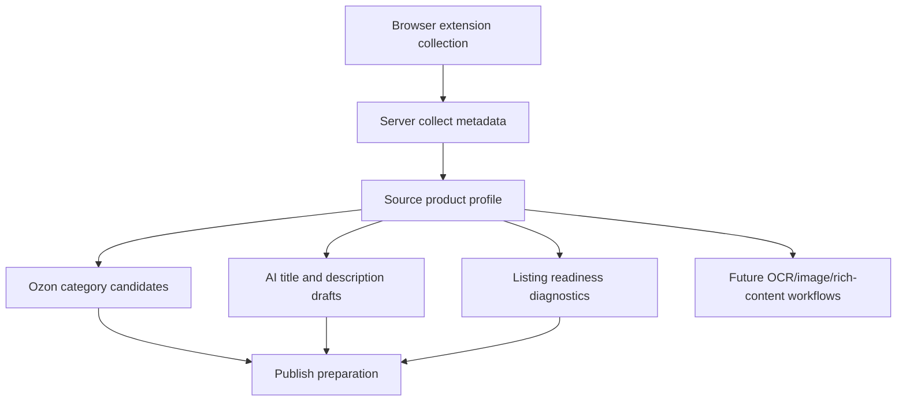
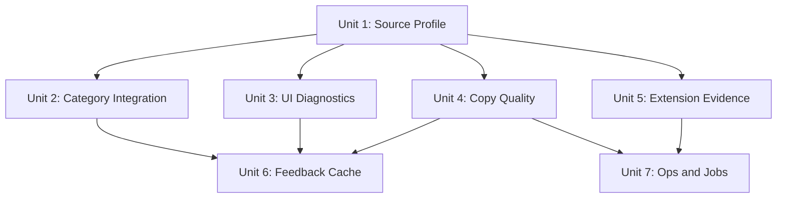

# 1688 to Ozon Source Product Profile Plan

## Overview

Build a reusable "source product profile" layer for the 1688-to-Ozon workflow. The profile turns messy 1688 collection output into a normalized fact model that can be reused by Ozon category matching, required attribute checks, AI title/description generation, packaging diagnostics, and future image/rich-content workflows.

The immediate goal is to stabilize the current foundation work: category hit quality and Russian title/description drafts. The broader goal is to avoid fixing the same 1688 parsing problem separately in category ranking, AI prompts, readiness checks, and publish validation.

## Problem Frame

1688 and Ozon optimize for different data models:

| Area | 1688 reality | Ozon requirement | Current risk |
|---|---|---|---|
| Category | Seller-facing Chinese category, noisy title keywords, sometimes misleading marketing words | Ozon category/type IDs, required attributes tied to type | Keyword expansion can over-match, for example sleepwear or bra products drifting into adult goods or bedding |
| Title | Long Chinese SEO title with stacked modifiers | Concise Russian buyer-facing title with marketplace-safe wording | AI drafts become generic or invent facts when source facts are incomplete |
| Description | Often image-heavy rich content, sparse structured text | Russian factual description, no unsupported claims | If the pipeline ignores raw description/rich content, AI only rewrites the title |
| Attributes | Mixed SKU dimensions, Chinese labels, source-specific terms | Ozon attribute dictionary values and required coverage | Required attribute checks can disagree with candidate category scoring |
| Packaging | Variant tables can be absent, lazy-loaded, malformed, or weight-only | Weight and package dimensions needed for listing/logistics | Missing data can look like a parser bug unless the system records evidence and confidence |
| Operations | Collection happens in browser extension, normalization happens on server, publish checks in UI | Repeatable, auditable, reusable behavior | Multiple surfaces infer facts independently and drift over time |

The current system already has many useful pieces:

- Extension collection captures source title, attributes, SKU variants, detail images, description, rich content draft, packaging rows, extraction diagnostics, and extension version.
- Server collection metadata normalizes source packaging rows and source standard attributes.
- Ozon category catalog and attribute dictionary are cached.
- AI title/description generation has provider config, cache, daily quota, and draft storage.
- Readiness checks report blockers such as Ozon category/type, title/description, SKU inventory, weight, package dimensions, and rich content.

The missing layer is a shared, versioned interpretation of source facts. Without it, each feature keeps rediscovering product type, material, gender, packaging state, text evidence, and confidence on its own.

## Requirements Trace

- R1. Normalize 1688 collection data into one reusable source product profile for category matching, AI copy, and readiness diagnostics.
- R2. Keep category selection deterministic: Ozon IDs/types come from Ozon catalog, confirmed history, scoring, and user confirmation, not direct AI invention.
- R3. Improve title/description generation by feeding AI structured facts and cleaned source evidence instead of only raw title text.
- R4. Make packaging failures explainable: distinguish "not collected", "weight only", "dimensions missing", "invalid table", and "parser uncertain".
- R5. Preserve cacheability: profile hash, prompt hash, model, and provider must separate drafts generated from different inputs.
- R6. Make the workflow reusable across collect detail, batch collect, publish preparation, and later background jobs.
- R7. Avoid blocking user-facing candidate generation with expensive AI category enrichment.
- R8. Keep generated text reviewable and fact-bound; no silent overwrite of source or publish fields.

## Scope Boundaries

- This plan does not make AI auto-select Ozon categories.
- This plan does not invent missing package dimensions or weights. It can surface defaults/manual-rule hooks later, but missing logistics facts remain blockers until explicitly resolved.
- This plan does not implement OCR or image editing. It prepares profile fields and evidence channels that those features can consume later.
- This plan does not replace Ozon API dictionaries or category catalog caches.
- This plan does not require Redis for correctness. Durable state remains in Postgres/Prisma-managed data and item metadata.

### Deferred to Separate Tasks

- Full image OCR and image text rewrite workflow: future image/rich-content unit after source profile is stable.
- Bulk background AI category translation: admin task/job, not user modal candidate generation.
- Manual correction UI for every profile field: planned after first profile read-only diagnostics land.

## Context & Research

### Relevant Code and Patterns

- `extensions/ss-erp/shared/collectors/source-product-core.js` extracts 1688 title, attributes, SKU combinations, packaging rows, description, rich content draft, and diagnostics.
- `extensions/ss-erp/content/collect-content-script.js` sends extension diagnostics and collection payloads to the app.
- `apps/server/src/routes/collect.ts` persists source metadata, builds source standard attributes, generates Ozon category candidates, and stores AI draft metadata.
- `apps/server/src/services/product-content-ai.ts` builds AI input and generates title/description drafts through the AI text client and translation cache.
- `apps/server/src/services/ozon-category-catalog.ts` translates and caches Ozon category display/search metadata.
- `apps/web/src/lib/source-listing-readiness.ts` calculates listing blockers and warnings shown in the UI.
- Tests already cover source packaging parsing, category candidate ranking, AI product drafts, readiness checks, and extension diagnostics.

### Local Findings

- Category ranking currently depends on hardcoded source-term expansions and catalog search text. This is useful but fragile because product intent is not modeled as a first-class object.
- Product content AI recently started reading `sourceDescriptionRaw` and `sourceRichContentDraft`, but that logic lives inside AI generation rather than a reusable normalization layer.
- Some products truly have no collected `sourcePackagingRows`. In those cases the UI should report a collection/evidence problem instead of implying a successful parse with zero rows.
- AI prompts alone cannot solve poor input quality. Better prompts help style, but factual quality depends on structured input and validation.

### External References

- No external research was needed for the first implementation batch. The work is primarily integration and normalization inside existing repo patterns.

## Key Technical Decisions

- Create a reusable source product profile service on the server: category matching, AI copy, readiness checks, and future diagnostics should consume one normalized interpretation of source facts.
- Version and hash the profile: generated drafts and future cached decisions should be tied to a profile version and input hash so prompt/model changes do not hide stale facts.
- Treat packaging as evidence with confidence, not a boolean: a product can have no packaging section, weight-only rows, dimensions-only rows, invalid rows, or complete rows.
- Keep AI prompt customization secondary to fact quality: prompts can shape Russian style, but system guardrails and profile input should prevent invented material, sizes, colors, and logistics claims.
- Keep candidate generation fast: no synchronous bulk AI translation or full Ozon refresh from the source detail modal.
- Prefer additive metadata: initially store profile snapshots in item metadata and keep existing fields intact, then later promote to a dedicated table only if query/reporting needs justify it.

## Open Questions

### Resolved During Planning

- Should category matching use AI directly? No. AI can enrich display text/search terms, but category IDs/types remain deterministic and reviewable.
- Should missing packaging be guessed from product type? No. Missing logistics facts must stay explicit unless a future manual/default-rule feature is added and clearly marked.
- Should prompts alone be the main lever for title quality? No. Prompt quality matters, but structured source facts and validation are the reusable core.

### Deferred to Implementation

- Final profile field names: implementation can adjust names to fit TypeScript/service conventions.
- Whether profile snapshots belong only in metadata or a separate table: start with metadata unless reporting/indexing needs appear.
- How many product-domain taxonomies to include in phase 1: start with apparel/underwear/sleepwear because that is the active failure cluster.

## High-Level Technical Design

This illustrates the intended approach and is directional guidance for review, not implementation specification.

## Implementation Units

- [x] **Unit 1: Source Product Profile Service**

**Goal:** Create a reusable server service that normalizes collected item facts into a versioned profile.

**Requirements:** R1, R3, R4, R5, R6

**Dependencies:** Existing collect metadata and source standard attribute normalization.

**Files:**
- Create: `apps/server/src/services/source-product-profile.ts`
- Test: `apps/server/src/__tests__/source-product-profile.test.ts`
- Modify: `apps/server/src/services/product-content-ai.ts`
- Test: `apps/server/src/__tests__/product-content-ai.test.ts`

**Approach:**
- Build the profile from title, category path/name, source attributes, SKU/variants, `sourceStandardAttributes`, `sourcePackagingRows`, `sourceDescriptionRaw`, `sourceRichContentDraft`, detail image counts, and extraction diagnostics.
- Extract reusable facts: product intent terms, category hints, colors, sizes, materials, gender/season hints, packaging coverage, text evidence, missing facts, warnings, confidence, profile version, and profile hash.
- Clean HTML, URLs, duplicated whitespace, image names, and raw JSON fragments before feeding text evidence to AI.
- Keep the service pure and dependency-free so it can be used in tests, candidate ranking, and draft generation without a database.

**Execution note:** Implement test-first. The first tests should describe source profile behavior before touching production code.

**Patterns to follow:**
- `apps/server/src/services/product-content-ai.ts` for existing copy cleaning and AI input shape.
- `apps/server/src/routes/collect.ts` metadata helpers for defensive JSON handling.
- `apps/server/src/__tests__/product-content-ai.test.ts` for cache-backed draft tests.

**Test scenarios:**
- Happy path: a 1688 bra item with source attributes, packaging row, raw description, and rich content draft produces profile facts for product intent, material, colors, sizes, text evidence, and complete/partial packaging state.
- Edge case: a sleepwear/nightdress title and category path produces sleepwear intent without incorrectly adding bra intent.
- Edge case: weight-only packaging rows report `hasWeight=true`, `hasDimensions=false`, and missing `package_dimensions`.
- Edge case: no packaging rows report explicit missing weight and dimensions plus a warning tied to collection evidence.
- Integration: product AI input uses the profile and includes cleaned source description/rich content while excluding raw HTML, URLs, and image filenames.

**Verification:**
- Category and AI tests can call one profile service and get stable facts without database access.

- [x] **Unit 2: Category Candidate Profile Integration**

**Goal:** Use the source profile as the primary source of candidate search terms and risk checks.

**Requirements:** R1, R2, R6, R7

**Dependencies:** Unit 1.

**Files:**
- Modify: `apps/server/src/routes/collect.ts`
- Test: `apps/server/src/__tests__/collect-publish-helpers.test.ts`

**Approach:**
- Replace scattered source term construction with profile product intent terms and category hints.
- Keep confirmed mapping history as a strong signal.
- Add domain risk flags that distinguish underwear, sleepwear, bedding, adult goods, and home textile categories.
- Penalize adult-product candidates unless the profile contains explicit adult-product source evidence.
- Penalize bedding categories when the profile indicates wearable apparel/sleepwear.
- Preserve the UI's recommended/optional/cautious labels, but make the selected default come from the first safe selectable candidate.

**Test scenarios:**
- Happy path: bra product ranks Ozon bra and bra accessory categories above unrelated adult goods.
- Edge case: sleepwear/nightdress product does not select bra as the top candidate only because of "吊带" or "胸" wording.
- Edge case: bedding terms from Ozon catalog do not outrank wearable sleepwear when source profile says apparel.
- Integration: confirmed history still overrides weak text score for the exact source signature.

**Verification:**
- Existing category candidate tests pass and new profile-driven cases explain candidate reasons.

- [ ] **Unit 3: Profile Diagnostics in Collect Detail**

**Goal:** Show why the system thinks an item is blocked or risky, especially for packaging and weak text evidence.

**Requirements:** R1, R4, R6

**Dependencies:** Unit 1.

**Files:**
- Modify: `apps/server/src/routes/collect.ts`
- Modify: `apps/web/src/app/(dashboard)/collect/source/page.tsx`
- Modify: `apps/web/src/lib/source-listing-readiness.ts`
- Test: `scripts/web-source-listing-readiness.test.mjs`

**Approach:**
- Store or return a profile summary with collection detail.
- Surface packaging status as evidence: complete, weight-only, dimensions-only, not collected, invalid/uncertain.
- Show extension version and extraction diagnostics when packaging/text evidence is missing.
- Keep UI language factual: "未采集到包装表" is different from "包装表解析失败".

**Test scenarios:**
- Happy path: complete packaging rows show no logistics blocker.
- Edge case: weight-only rows show `包装尺寸` blocker but not `重量` blocker.
- Edge case: no packaging rows show both missing fields and diagnostic warning.
- Integration: readiness UI uses the same missing fields as server profile.

**Verification:**
- User can tell whether to re-collect with a newer extension, manually fill logistics fields, or inspect source page.

- [ ] **Unit 4: Product Copy Quality and Validation**

**Goal:** Make Russian title/description generation feel like marketplace copy while staying fact-bound.

**Requirements:** R3, R5, R8

**Dependencies:** Unit 1.

**Files:**
- Modify: `apps/server/src/services/product-content-ai.ts`
- Modify: `apps/server/src/config/system-config-schema.ts`
- Test: `apps/server/src/__tests__/product-content-ai.test.ts`

**Approach:**
- Use profile facts as structured input to AI.
- Keep admin prompts as style/profile prompts, but prepend system guardrails that require Russian output, concise factual title, no invented certifications/materials/sizes/colors, and no unsupported shipping/logistics claims.
- Validate outputs for language, length, placeholder text, JSON leakage, and unsupported claims when possible.
- Cache by namespace, input/profile hash, effective prompt hash, provider, and model.

**Test scenarios:**
- Happy path: title/description prompts receive profile facts and text evidence.
- Edge case: AI output with JSON, empty text, or Chinese-only copy is rejected.
- Edge case: prompt changes create a new cache key.
- Integration: cached draft is reused only when profile and prompt hashes match.

**Verification:**
- Drafts are less generic because they include actual material, style, sizes, colors, and source description evidence.

- [ ] **Unit 5: Extension Collection Evidence Hardening**

**Goal:** Improve the evidence available when 1688 packaging or descriptions are missing.

**Requirements:** R4, R6

**Dependencies:** Unit 1 diagnostics format.

**Files:**
- Modify: `extensions/ss-erp/shared/collectors/source-product-core.js`
- Modify: `extensions/ss-erp/content/collect-content-script.js`
- Test: `scripts/extension-1688-collector-core.test.mjs`
- Test: `scripts/extension-erp-collect-diagnostics.test.mjs`

**Approach:**
- Add bounded diagnostics for packaging evidence: candidate table headers, section snippets, matched row count, rejected row count, and parser version.
- Avoid storing excessive raw page text or sensitive seller data.
- Keep extension version in every collection payload for support and deploy validation.

**Test scenarios:**
- Happy path: known 1688 packaging table reports matched row count and parser version.
- Edge case: no packaging table reports searched evidence without claiming parse success.
- Edge case: weight-only table reports row count and missing dimensions.

**Verification:**
- Future screenshots can be mapped to extension version and parser evidence without guessing.

- [ ] **Unit 6: Manual Correction and Feedback Cache**

**Goal:** Let confirmed user decisions improve future category and profile behavior.

**Requirements:** R2, R6, R8

**Dependencies:** Units 1-3.

**Files:**
- Modify: `apps/server/prisma/schema.prisma`
- Modify: `apps/server/src/routes/collect.ts`
- Modify: `apps/web/src/app/(dashboard)/collect/source/page.tsx`
- Test: `apps/server/src/__tests__/collect-publish-helpers.test.ts`

**Approach:**
- Record user-confirmed category mapping, corrected product intent, corrected logistics values, and copy acceptance as separate signals.
- Keep corrections scoped by source platform, category signature, profile hash, and shop when relevant.
- Do not let one item correction silently override unrelated products.

**Test scenarios:**
- Happy path: confirmed category mapping improves future candidate ranking for matching source signature.
- Edge case: correction for bra products does not alter sleepwear products with different profile intent.
- Integration: applying an AI draft records acceptance metadata without overwriting source facts.

**Verification:**
- Repeated high-frequency products require less manual correction over time without broad false positives.

- [ ] **Unit 7: Operational Metrics and Background Jobs**

**Goal:** Make expensive or slow work observable and move it out of user-blocking modals.

**Requirements:** R5, R7

**Dependencies:** Units 1, 4, and existing AI cache.

**Files:**
- Modify: `apps/server/src/services/ai-usage.ts` or create equivalent if absent
- Modify: `apps/server/src/routes/system-config.ts`
- Modify: `apps/web/src/app/(dashboard)/admin/settings/page-client.tsx`
- Test: `apps/server/src/__tests__/ai-usage.test.ts`

**Approach:**
- Track AI calls, cache hits, failures, empty responses, and daily quota use by namespace.
- Add admin actions for batch category translation and missing profile refresh.
- Ensure source detail modals only read cached catalog/profile data and fast deterministic scoring.

**Test scenarios:**
- Happy path: cache hits do not consume daily quota.
- Error path: provider failure records failure metrics and returns recoverable errors.
- Integration: candidate loading does not trigger bulk category AI translation.

**Verification:**
- Slow work is visible in admin and cannot accidentally block item detail browsing.

## Implementation Dependency Graph

## System-Wide Impact

- **Interaction graph:** Browser extension feeds collection metadata; metadata feeds profile; profile feeds category candidates, AI copy, readiness diagnostics, and future publish workflows.
- **Error propagation:** Missing or weak source facts should become warnings/blockers, not provider exceptions or silent zero values.
- **State lifecycle risks:** Cached drafts can become stale if source facts change. Profile hash and effective prompt hash must isolate drafts.
- **API surface parity:** Source detail, batch collect, publish prepare, and admin diagnostics should describe category/copy/logistics readiness consistently.
- **Integration coverage:** Cross-layer tests must cover at least one item moving from source metadata through profile, AI draft input, and readiness blockers.
- **Unchanged invariants:** Ozon IDs/types remain Ozon/API/manual-confirmed decisions. AI does not invent category IDs, logistics values, or SKU inventory.

## Risks & Dependencies

| Risk | Likelihood | Impact | Mitigation |
|---|---:|---:|---|
| Profile becomes another partial parser instead of shared source of truth | Medium | High | Integrate it immediately into product AI, then category ranking and readiness |
| AI copy sounds better but invents facts | Medium | High | Use structured facts, guardrails, validation, and review-only drafts |
| Category fixes overfit underwear examples | Medium | Medium | Model product intent/risk groups rather than one-off keyword bans |
| Packaging data is absent on source page | High | Medium | Report evidence state and do not claim parser success; add manual/default-rule workflow later |
| Profile metadata grows too large | Low | Medium | Store summary/profile hash first; defer full raw evidence to bounded diagnostics |
| User modal becomes slow again | Medium | High | Keep expensive AI/bulk translation in admin/background flows |

## Success Metrics

- New product AI drafts include actual source facts and no longer depend only on Chinese title text.
- Category candidates for apparel/underwear/sleepwear consistently avoid adult goods and unrelated bedding unless source evidence supports them.
- Packaging blockers explain whether data was absent, partial, or parse-uncertain.
- Existing category, AI draft, extension, and readiness tests stay green as the profile is adopted.
- Future fixes add facts to the profile rather than duplicating parser logic in multiple features.

## Documentation / Operational Notes

- Update this plan as units are completed.
- When extension collection evidence changes, bump and publish the extension package so newly collected records include the latest diagnostics.
- Admin AI prompts should be documented as style instructions. The backend profile/guardrail remains the factual safety layer.

## Sources & References

- `extensions/ss-erp/shared/collectors/source-product-core.js`
- `extensions/ss-erp/content/collect-content-script.js`
- `apps/server/src/routes/collect.ts`
- `apps/server/src/services/product-content-ai.ts`
- `apps/server/src/services/ozon-category-catalog.ts`
- `apps/web/src/lib/source-listing-readiness.ts`
- `apps/server/src/__tests__/product-content-ai.test.ts`
- `apps/server/src/__tests__/collect-publish-helpers.test.ts`
- `scripts/extension-1688-collector-core.test.mjs`
- `scripts/web-source-listing-readiness.test.mjs`
