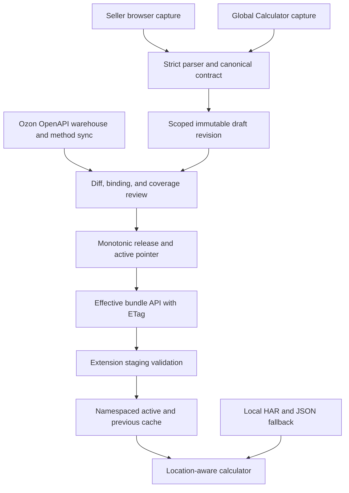
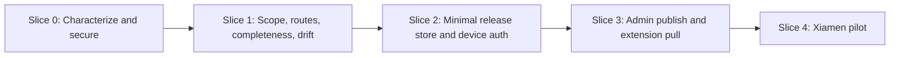
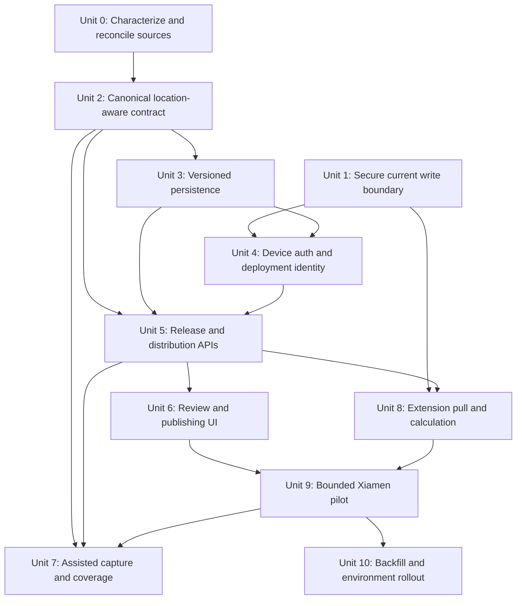
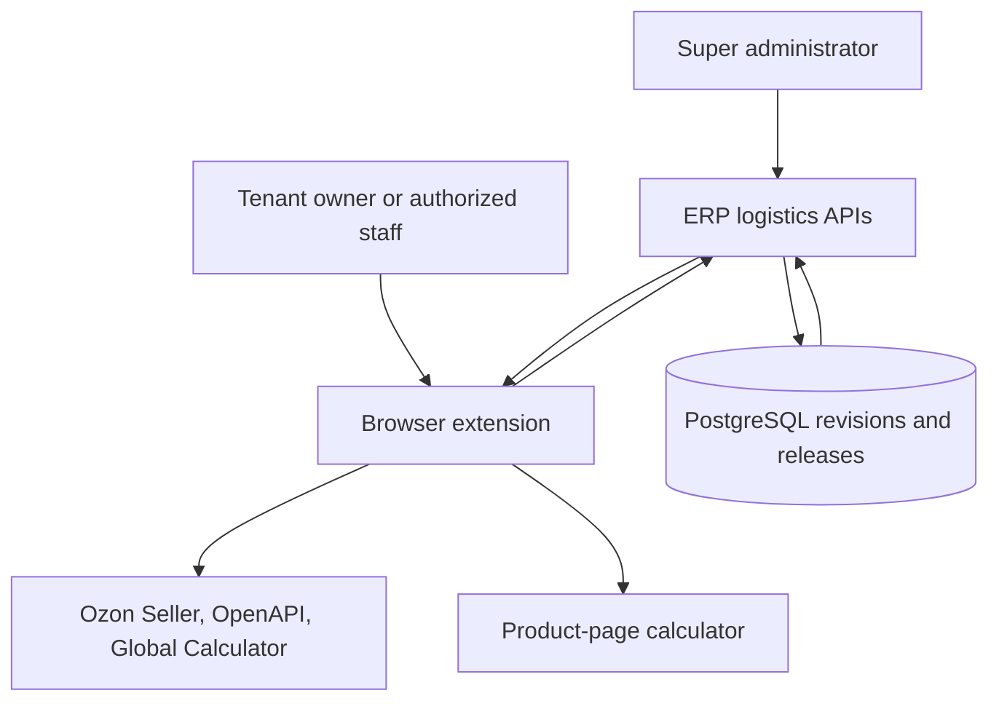

# Ozon Logistics Rule Distribution Plan

## Overview

Build a versioned Ozon logistics-rule pipeline that first proves one shop-private release for one verified Xiamen warehouse and Russia/Moscow. An administrator imports and verifies Seller/Official captures, publishes a controlled rule bundle, and the matching browser extension automatically receives it for the correct ERP tenant, shop, Ozon company, warehouse/origin location, and destination. Public baselines and broader coverage follow only after this path is reliable.

The design deliberately separates three sources that answer different questions:

| Source | Authoritative for | Not authoritative for |
|---|---|---|
| Ozon OpenAPI warehouse/delivery-method sync | The warehouses and delivery methods actually configured for a shop | Seller tariff formulas or Global Calculator city availability |
| Seller `provider/template/by-location/list` plus category/speed responses | Candidate templates and calculation formulas for one company and query location | All shops, all warehouses, or all origin cities |
| Global Calculator `/v1/calculator/calculate` | Official point samples and origin-city availability for one complete request fingerprint | A universal formula or a complete Seller template catalog |

The pilot extension will calculate from one published shop/origin bundle:

```text
shop/company/warehouse formulas
+ origin-city availability
+ destination route eligibility
+ confirmed ShopDeliveryMethod bindings
+ user's selected logistics methods
-> eligible methods and local freight calculation
-> exact-fingerprint Official sample comparison when available
```

Existing manual Seller capture, HAR import, sync JSON import, and method re-selection remain available as administrator tools and emergency fallback. They stop being the normal end-user setup path.

## Problem Frame

The current extension can already turn a Seller capture into approximately 267 catalog entries and rules and preserve a user's selected subset. That proves the parser and local calculator are useful, but the resulting snapshot loses key request context and is stored as one global browser value. It therefore cannot safely answer which shop, warehouse, origin city, or destination the rules belong to.

The latest HAR and live-CDP checks show why the context matters:

- The cumulative Official HAR contains 25 freight requests covering 15 origin-city UIDs; the first 17 responses are unchanged and the newer capture adds 8 requests.
- The public location endpoints return 5 origin countries, 4,226 origin cities, 766 China cities across 29 region labels, and 7 destination locations without requiring Seller authentication.
- Every sampled request returns 63 raw tariffs from 30 providers. The page-visible count of 54 is the subset with non-empty `clusterDeliverySpeeds`, not a different formula catalog.
- Xiamen, Shenzhen, Yanbian, Beijing, Shanghai, Urumqi, Lhasa, and Chengdu return identical prices, providers, and non-drop-off fields for the same input. Only city availability changes; visible local drop-off counts range from 0 to 40.
- A single request accepts only one origin city, one destination, and one product fingerprint. China-city x destination coverage would already require 5,362 requests per fingerprint, so exhaustive point-price scraping is neither finite nor the source of formula truth.
- Repeated responses reorder tariff rows and regenerate response `id` values, so response `id` and array position are not stable service identities.

The current Seller snapshot is structurally useful but demonstrably stale and unscoped:

- It contains 267 templates across 159 provider IDs: 209 actual-weight rules, 55 max(actual, volumetric) rules, and 3 hybrid rules.
- Replaying all 25 Official requests against the current formulas matches 57 of 63 raw tariff rows exactly to the cent. The 6 mismatches are paired pickup/courier rows from 3 ATC providers whose June 14 Seller rates differ from the July 12 Official samples.
- The pickup collector reports 158 attempted providers and 9,973 unique `providerId:externalId` relationships. That is not 9,973 unique physical addresses, and it leaves a 158-versus-159 provider coverage discrepancy.
- `158/158` means every provider request finished, including failures incremented in `finally`; publication readiness must use a separate zero-error and expected-provider coverage check.

This evidence supports a public rule layer plus location availability overlays. It does not prove that prices never vary by city, shop contract, destination, or future Ozon revision. The system must retain complete scope and input fingerprints so a future difference can be represented as an override instead of silently corrupting a global rule.

Several current implementation details must be corrected before central distribution is safe:

- An arbitrary webpage can currently send `ozon-calc:sync-config` through the web-accessible sync receiver and overwrite the extension snapshot.
- Raw schema is normalized to the current version before validation, allowing an unknown schema to appear valid.
- Official import keeps only the latest calculate response, losing the location matrix.
- URL substring matching can classify `calculate-tax` as a freight calculation.
- Official sample matching checks only weight and dimensions, ignoring location, currency, and declared price.
- Platform rules and user preferences are stored in one snapshot, so a server update can overwrite selected methods and fee preferences.
- The 30-day extension JWT has the same authority as a normal account token and has no device identity, audience, scope, or independent revocation.

## Requirements Trace

- **R1. Secure the write boundary:** no arbitrary webpage, untrusted sender, hash payload, unknown schema, or malformed bundle can replace the extension's active logistics rules.
- **R2. Preserve complete source context:** Seller and Official imports retain tenant/shop/company/location, destination, currency, input fingerprint, capture time, parser version, and source checksum without retaining cookies or authorization headers.
- **R3. Use stable identities:** service identity excludes response order, unstable response IDs, and city-dependent `isDropOff`; Seller template identity remains scoped to shop/company/location.
- **R4. Model source roles correctly:** OpenAPI delivery methods remain the truth for configured methods, Seller is the formula/candidate source, and Global Calculator is an availability and point-sample source.
- **R5. Version all published content:** revisions are immutable, publication is atomic, rollback is auditable, and clients consume monotonically increasing release sequences.
- **R6. Isolate every scope:** formula revisions and release channels include ERP origin/tenant, shop, company, warehouse/origin, and schema major; each service carries a reviewed destination route condition, and Official samples retain destination in their full fingerprint.
- **R7. Support administrator workflows:** import current JSON/HAR, validate, preview differences, resolve method bindings, choose defaults, publish, export/import between deployments, and roll back.
- **R8. Automate the normal extension workflow:** the extension pulls the effective bundle with ETag, validates into staging, atomically switches active/previous, submits an idempotent apply receipt, preserves last-known-good for transient failures within policy, and handles authorization revocation separately.
- **R9. Keep manual recovery paths:** local Seller/Official capture, HAR import, sync JSON import, and manual logistics selection remain usable without silently replacing a healthy server bundle.
- **R10. Make calculation location-aware:** the rule engine uses the selected shop and warehouse/origin scope and only compares an Official sample when the full request fingerprint matches.
- **R11. Provide a bounded supplementation workflow:** coverage is collected for real shops, real warehouses/origin cities, relevant destinations, and representative product fingerprints rather than attempting an all-city Cartesian scrape.
- **R12. Enforce least privilege and auditability:** extension devices use revocable scoped credentials; publishing, rollback, capture acceptance, and binding changes produce mandatory sanitized domain audit events.
- **R13. Roll out across all product variants:** the same code and schema ship to local, international VPS, and domestic deployments, while each environment imports or captures sanitized checksummed content and publishes it independently.
- **R14. Diagnose completeness and drift:** provider discovery reports source union/success/failure/empty counts, and publication reports selected-service formula coverage, Official price deltas, validation age, and unresolved route scope.

## Scope Boundaries

- The new logistics capture/distribution flow must not upload or persist Ozon Seller cookies, bearer tokens, request authorization headers, or complete browser profiles. Existing legacy cookie-dependent capabilities remain separate and their credentials never enter logistics revisions, releases, receipts, or diagnostics.
- Do not treat Ozon's internal Seller endpoints as a guaranteed public API; all collection remains feature-flagged, observable, and replaceable.
- Do not brute-force every Chinese city, every destination, and every product input combination.
- Do not infer a warehouse or city UID from the hard-coded Xiamen fallback coordinate.
- Do not treat `158/158` as successful completion or 9,973 provider-point relationships as unique physical addresses.
- Do not publish the current 37 selected services as a Russia set: they include Belarus and Kazakhstan routes and require explicit destination classification.
- Do not bind an actual `ShopDeliveryMethod` to a formula by `providerId` alone; ambiguous matches require explicit confirmation.
- Do not promote a legacy snapshot with only `companyId` or no location to active status.
- Do not introduce city price overrides until captures demonstrate a price difference. The contract must allow them later without requiring a schema rewrite.
- Do not remove current manual capture, HAR import, JSON import, or method selection controls.
- Do not place published rule data in `SystemConfig`; it lacks immutable history and scoped atomic pointers.

### Deferred to Separate Tasks

- Replacing Seller browser capture with a documented Ozon API: research after the versioned pipeline is stable.
- Automated unattended traversal of Global Calculator: deferred due anti-automation behavior, platform terms, and limited value compared with real-warehouse coverage.
- Central cross-region control plane that automatically pushes one release to all ERP deployments: same code/migrations plus environment-local capture/publication is sufficient for the pilot.
- Asymmetric package signing, signer rotation, and replay policy: add only when releases cross an automated or untrusted handoff boundary.
- Automatic public-baseline promotion from tenant captures: defer until enough captures prove contract equivalence and confidentiality rules are established.
- Tenant self-publication and granular staff permissions: the internal pilot reserves import/review/publish/rollback for super administrators; tenant owners may only pair/revoke devices for owned shops. Delegated publication follows as a separate RBAC task.

## Context & Research

### Relevant Code and Patterns

- Current Seller/Official HAR parser: `extensions/ss-erp/shared/calculator-core/har-import.js`
- Seller normalized export: `extensions/ss-erp/shared/seller-logistics/seller-logistics-export.js`
- Official normalized export: `extensions/ss-erp/shared/official-freight/official-freight-export.js`
- Captured entry storage and sanitization: `extensions/ss-erp/shared/capture-bridge/captured-har-store.js`
- Capture URL lists: `extensions/ss-erp/content/capture-page-hook.js`, `extensions/ss-erp/shared/capture-bridge/captured-har-store.js`
- Current rule engine: `extensions/ss-erp/shared/calculator-core/rule-engine.js`
- Current Official comparison: `extensions/ss-erp/content/ozon-panel.js`
- Current global config snapshot: `extensions/ss-erp/shared/config-bridge/config-store.js`
- Current snapshot schema: `extensions/ss-erp/shared/config-bridge/sync-schema.js`
- Current extension orchestration and 30-minute alarm: `extensions/ss-erp/background/service-worker.js`
- Manual settings and HAR fallback UI: `extensions/ss-erp/pages/settings.html`, `extensions/ss-erp/pages/settings.js`
- Unsafe web-accessible receiver: `extensions/ss-erp/pages/sync-receiver.js`, `extensions/ss-erp/manifest.json`
- Existing extension API routes: `apps/server/src/routes/extension-config.ts`
- Existing extension token issue route: `apps/server/src/routes/auth.ts`
- Effective tenant authentication context: `apps/server/src/lib/auth.ts`
- Existing shop warehouse and delivery-method sync: `apps/server/src/routes/shop.ts`
- Existing Ozon client calls: `apps/server/src/services/ozon-client.ts`
- Existing warehouse/method models: `apps/server/prisma/schema.prisma` (`Warehouse`, `ShopDeliveryMethod`)
- Admin publish-like workflow to borrow UI/status ideas from: `apps/server/src/routes/warehouse-template.ts`, `apps/server/src/routes/warehouse-command.ts`
- Existing generic audit helper: `apps/server/src/lib/audit-log.ts`
- Admin page pattern: `apps/web/src/app/(dashboard)/admin/warehouse-templates/page.tsx`
- Warehouse and method display: `apps/web/src/app/(dashboard)/warehouses/page.tsx`

### Institutional Learnings

- No matching requirements document or `docs/solutions/` entry exists. This plan is grounded in the captured HAR analysis, the current extension implementation, and the existing shop/warehouse synchronization model.
- `WarehouseTemplate` and `WarehouseUpdateCommand` demonstrate dispatch and acknowledgment, but the template is mutable and commands read current template state. That model must not be reused as the immutable logistics release store.
- Local, international, and domestic deployments use separate databases. Shipping identical code does not copy rule releases; pilot portability is an explicit sanitized/checksummed import through authenticated administration with independent target approval. Signing and replay policy begin only with automated or untrusted transport.

### External Contract Constraints

- Seller and Global Calculator response fields can change without notice.
- Browser extension storage is not transactional across arbitrary multi-key writes; staging plus a small active pointer is required.
- HTTP ETag/`If-None-Match` is the appropriate distribution contract because bundles are immutable and change infrequently.
- Global Calculator samples have no response currency in the observed tariff rows; currency must come from the request.

## Key Technical Decisions

| Decision | Chosen approach | Rationale |
|---|---|---|
| Rule storage | Immutable scoped revisions plus a monotonic release/current pointer for the pilot | Prove one publish/pull/rollback path before adding multi-component manifest graphs, outbox state, or public-baseline promotion |
| Location model | Formula channel scoped by shop/company/warehouse/origin; destination is a reviewed per-service route condition | Seller `by-location` requests have no destination parameter and return mixed routes, so copying 267 rules into one channel per country would duplicate data and still hide ambiguous routes |
| Provider completeness | Always union `warehouse/list` and template providers, retaining source and per-provider result state | Fallback-only discovery produced the observed 158-versus-159 discrepancy and `done` includes failures |
| Drift validation | Full-fingerprint Official comparison with selected-service coverage, delta, age, and strict pilot exclusion | The 57/63 match and 3 stale ATC provider formulas prove freshness must be checked before publication; pilot drift cannot be waived into an authoritative release |
| Release lifecycle | Revision content separated from monotonically sequenced releases | Rollback can publish an older content hash under a newer sequence, so clients never move backward |
| Hash semantics | Portable `contentChecksum` separated from scope-bound `effectiveChecksum`/ETag | Cross-environment imports must preserve content identity, while authorization scope, component references, compatibility metadata, and release sequence must participate in conditional delivery |
| Actual method mapping | Explicit `ShopDeliveryMethod` to stable `serviceKey` binding | Provider IDs are not one-to-one and Seller templates are only candidates |
| Official data | Full-fingerprint samples and city availability overlays | A point quote must never be applied to a different product, currency, origin, or destination |
| Extension preferences | Server rule bundle and local user preference bundle stored separately | Rule refresh must not overwrite selected services, resolution mode, packing fees, or custom fees |
| Failure behavior | Staging -> validate -> active/previous; never clear last-known-good on fetch failure | An outage or bad release must not disable calculation or silently use an empty set |
| Capture ownership | Platform administrator reviews the first shop-private pilot release; tenant-authorized browser capture remains an attested candidate | Seller cookies remain on the user's device while shop-specific contract data stays isolated; public-baseline promotion is deferred |
| Device authentication | Account bootstrap and device API authentication are separate chains | A device token with an extension audience must never be accepted automatically by ordinary account routes |
| Environment parity | Same feature code; authenticated checksummed import and independent publication per environment | Separate databases remain intentional isolation boundaries; asymmetric signatures are deferred until an automated or untrusted handoff exists |

### Stable Scope and Fingerprint

The formula release channel scope must represent:

```text
ERP deployment origin
+ effective tenant ID
+ ERP shop ID
+ Ozon company ID
+ ERP warehouse ID / platform warehouse ID
+ origin country UID / origin city UID
+ schema major
```

Destination is not copied into the channel key. Each service must carry a structured destination route condition using one finite evidence type: `ozon_structured_destination`, `openapi_method_route`, or `official_exact_sample`. The record includes destination country/location UID, source checksum/revision, reviewer, and timestamp. Names, tags, and free-text comments can suggest a route but never satisfy publication preflight. Unknown destination is quarantined, and runtime filtering happens before rule evaluation.

An Official sample fingerprint additionally includes destination country/location, currency, declared price, weight, dimensions with explicit units, battery input when available, and any future request field that changes eligibility or price. Missing fields produce an unverified sample; they are not filled from assumptions.

Stable service identity uses Seller template identity within its scoped channel. For Official comparisons, candidates must first match the full request fingerprint and are then narrowed by provider ID, pickup/courier variant, normalized description, template type, and battery mode. Every stage must end in exactly one Seller formula; zero or multiple matches remain unmatched/ambiguous until an explicit reviewed mapping exists. Response `id`, array index, `isDropOff`, rating, and delivery speed never participate in stable identity.

## High-Level Technical Design

> *This illustrates the intended approach and is directional guidance for review, not implementation specification. The implementing agent should treat it as context, not code to reproduce.*



### Directional Persistence Shape

- `LogisticsRuleChannel`: non-null canonical `scopeKey`, relational ownership/scope, and current release pointer.
- `LogisticsRuleRevision`: immutable portable source payload, `contentChecksum`, source/parser metadata, ownership/confidentiality, and validation state.
- Pilot release payload: one immutable revision plus frozen route classifications, bindings, defaults, validation report, scope, schema, and minimum extension version. A separate multi-component `EffectiveLogisticsManifest` is deferred until independent baseline/override composition is needed.
- `LogisticsRuleRelease`: monotonic sequence pointing to one frozen pilot release payload; a rollback creates a new sequence pointing to older immutable content.
- `LogisticsRuleAssignment`: maps one consumer scope and required destination country/location UID plus display label to an automatic channel or pinned release. Destination stays out of the formula-channel key but participates in assignment uniqueness, effective checksum, discovery, audit, and invalidation. It does not store device application progress.
- `ShopDeliveryMethodRuleBinding`: explicit actual-method to stable-service binding with suggested/confirmed/rejected state and immutable binding revisions frozen into releases.
- `OfficialSellerFormulaResolution`: immutable reviewed resolution from one full Official sample fingerprint to exactly one scoped Seller service/variant, with candidate set, evidence, reviewer, source revisions/checksums, and confirmed/rejected state. A changed source revision, fingerprint, or candidate set invalidates the resolution.
- `ShopOzonCompanyBinding` and `WarehouseOzonOriginBinding`: verified company/origin identifiers, provenance, verification time, and invalidation state used before capture tickets can be issued.
- `ExtensionDeviceSession`: revocable device identity, actor and owner tenant, allowed shops, hashed rotating refresh credential, audience/scopes, last seen, and expiry.
- `LogisticsRuleReleaseAck`: a minimal idempotent device/release apply receipt containing checksum, extension version, success/failure code, and applied time. It is required for pilot evidence; dashboards, cohort analytics, and automated rollout decisions are deferred.
- `LogisticsRuleEvent`: mandatory sanitized facts for capture, publish, rollback, and binding transitions. A transactional integration outbox is deferred until an external consumer exists.

The portable bundle payload keeps formulas, services, selected default candidates, Official samples, and city availability overlays as canonical sorted JSON. Monetary values use decimal strings or documented minor units so object ordering and floating-point formatting cannot change `contentChecksum`. The published release payload freezes route/binding/default/validation/scope metadata; its effective checksum and ETag include the release envelope, so a binding, default selection, compatibility rule, or rollback sequence change cannot incorrectly return 304.

Pilot content is built at review/publication time, not dynamically assembled on every extension request. Any formula, route, binding, default-selection, or validation change creates a new candidate payload. Until it is reviewed and published, clients continue receiving the previous immutable release.

The pilot performs no automatic public-baseline/shop-override merge. It publishes one reviewed shop/origin payload; destination route, city availability, confirmed actual-method binding, and local user selection filter it before calculation. Restrictive deterministic baseline composition is a later extension once evidence proves formulas can be shared.

For the pilot, each environment accepts the same sanitized canonical JSON only through its authenticated administrator API, verifies schema and SHA-256, and publishes independently. Asymmetric package signatures become necessary only when transport is automated or crosses an untrusted handoff.

## Start Here: Pilot Delivery Slices

The first objective is not a nationwide data platform. It is one trustworthy formula path from administrator capture to an ordinary user's local quote for one verified Xiamen warehouse and Russia/Moscow, while retaining manual HAR/JSON fallback.



| Slice | Deliverable | Exit gate |
|---|---|---|
| 0 | Golden fixtures for the current 267 rules and Official samples; close unauthenticated config writes; union provider sources | Existing manual import still works, arbitrary pages cannot write, provider discovered/succeeded/failed/empty counts are explicit |
| 1 | Canonical origin-scoped contract, per-service destination route evidence, stable IDs, and formula drift report | Current 267 rules are classified or quarantined; the 57/63 baseline and 3 ATC provider drifts reproduce deterministically |
| 2 | Minimal immutable revision/release store, verified-binding bootstrap, assignment/method binding, and minimal revocable device session | One company/origin binding can be verified without formula self-attestation; one scoped release can publish and roll back atomically; broad legacy account-equivalent extension tokens cannot read the new endpoint |
| 3 | One admin import/diff/publish page and one extension ETag/staging/active-previous pull path | A reviewed release reaches the correct paired extension without overwriting local selections or fee preferences |
| 4 | Internal Xiamen-origin, Russia/Moscow non-battery pilot with representative actual-weight, volumetric, and price-band cases | Every selected pilot method is route-classified, bound, current, and matches an approved Official fingerprint; restart/offline/update/rollback remain correct |

### Pilot Scope

- One internal tenant, one Ozon shop/company, one independently verified Xiamen warehouse/origin, and Russia/Moscow.
- Treat the current 37 selected IDs only as an import candidate. They include Belarus and Kazakhstan routes, so the administrator must classify them and choose the actual Russia pilot subset.
- Use Global Calculator point quotes as validation evidence, never as the formula source.
- Preserve local Seller capture, Official capture, HAR import, sync JSON import, and manual method selection as explicit fallback.

### Pilot Blockers

- Arbitrary-page configuration write path remains open.
- A failed, missing, or unexpectedly empty provider intersects a selected service, confirmed delivery-method binding, or the active Russia route. Failures outside that set remain visible warnings and those providers cannot be selected.
- Formula capture lacks verified shop/company/warehouse/origin scope.
- A selected service has unknown destination route evidence or only an ambiguous provider-level binding.
- A selected formula is stale, unmatched, ambiguous, or differs from its exact Official fingerprint by more than CNY 0.01 after normalized rounding.
- Network distribution lacks isolated device audience/scope, checksum validation, atomic active/previous storage, or tenant/shop isolation.
- The legacy 30-day account-equivalent extension token is still issued or accepted after the Unit 9 cutoff gate, or a required pilot extension call has not migrated to the scoped device/session model.

### Pilot Validation and Offline Defaults

- Pin the pilot assignment to destination Russia/Moscow and display that destination beside the origin and every quote. Multi-destination selection is deferred; it must later be stored per deployment/tenant/shop/company/warehouse/schema scope.
- Treat Seller formulas and required Official fingerprints as current for 7 days from validation. The release envelope carries `validUntil`; a 24-hour stale grace follows for visibly provisional quotes.
- Use a server-controlled 24-hour authorization lease renewed only by an authenticated authorized 200/304 response. Allow at most 5 minutes of clock skew. After freshness grace or authorization lease expiry, historical values remain visible but no authoritative new quote is produced.
- A selected pilot formula must match its one-to-one Official comparison within CNY 0.01. A drifting or ambiguous service is removed from the selected pilot release; the pilot has no waiver that can bypass scope, route, binding, checksum, or price-drift checks.
- Rollback runs the current publication preflight without refreshing the original `validatedAt` or `staleAt`. If the older payload is no longer valid, use the kill switch and show unavailable/stale state instead of bypassing preflight.
- Battery freight is explicitly outside the first pilot. It enters the later coverage phase only after Global Calculator exposes a verified battery input and representative Seller rules exist.

### Explicitly Deferred Until the Pilot Passes

- Default traversal of all 766 China cities or all 4,226 origin cities.
- Automatic public-baseline promotion and city price overrides without evidence.
- Full device-management UI, every account-lifecycle automation, and broad staff RBAC.
- Signed cross-environment packages, signer rotation, replay state, and automated cross-region transport.
- Nationwide coverage automation, complex manifest component graphs, transactional outbox, and per-device rollout analytics.

## Implementation Units



- [ ] **Unit 0: Characterize current formulas and reconcile provider sources**

**Goal:** Freeze the current known behavior as evidence and make provider/drop-off completeness measurable before changing contracts or storage.

**Requirements:** R4, R11, R14

**Dependencies:** None

**Files:**
- Modify: `extensions/ss-erp/background/collect-background.js`
- Modify: `apps/server/src/services/ozon-seller-dropoff-points.ts`
- Modify: `apps/server/src/__tests__/ozon-seller-dropoff-points.test.ts`
- Create: `scripts/extension-ozon-dropoff-provider-completeness.test.mjs`
- Create: `scripts/fixtures/ozon-logistics/current-seller-267.sanitized.json`
- Create: `scripts/fixtures/ozon-logistics/official-25-request.sanitized.har.json`

**Approach:**
- Freeze the observed 267 templates/159 providers, 209 actual/55 volumetric/3 hybrid modes, route mix in the selected 37, and the 57/63 Official price-match report as characterization fixtures rather than universal production expectations.
- Always collect both `warehouse/list` providers and Seller template providers, union by `providerId`, and retain `warehouse`, `template`, or `both` provenance.
- Report discovered, attempted, succeeded, failed, and empty-response provider counts separately. Completion cannot be inferred from a counter incremented in `finally`.
- Keep point uniqueness defined as `providerId:externalId`; expose a separately normalized physical-address grouping only for display and never substitute it for the raw relationship key.
- Do not alter formula evaluation in this unit. Any difference from the golden report is investigated before contract work proceeds.

**Execution note:** Add characterization and provider-union tests before modifying either discovery implementation.

**Patterns to follow:**
- Browser-side provider collection in `extensions/ss-erp/background/collect-background.js`
- Server-side normalized collection in `apps/server/src/services/ozon-seller-dropoff-points.ts`

**Test scenarios:**
- Characterization: sanitized Seller/Official fixtures reproduce 267 templates, 159 providers, the three charge-mode counts, and the 57/63 report with exactly three drifting ATC providers.
- Completeness: warehouse providers and template providers partially overlap -> union contains every provider once with correct provenance.
- Error path: one provider request fails -> attempted reaches total, succeeded does not, failed contains the provider, and completeness is false.
- Edge case: a provider returns an empty point list -> it is distinguished from failure and retained in the provider inventory.
- Dedupe: one physical address under two provider IDs remains two raw provider-point relationships while grouped display can show one address.
- Regression: existing imported pickup points remain queryable and no unrelated calculator formula changes.

**Verification:**
- The 158-versus-159 discrepancy becomes an explained source diff or resolves to a complete union.
- Operators can distinguish finished, successful, empty, and incomplete collection without reading logs.

- [ ] **Unit 1: Close the current unauthenticated configuration write path**

**Goal:** Prevent arbitrary websites or malformed payloads from replacing the extension's calculator configuration before any server distribution feature is enabled.

**Requirements:** R1, R9, R12

**Dependencies:** None

**Files:**
- Modify: `extensions/ss-erp/manifest.json`
- Modify or remove: `extensions/ss-erp/pages/sync-receiver.html`
- Modify or remove: `extensions/ss-erp/pages/sync-receiver.js`
- Modify: `extensions/ss-erp/background/service-worker.js`
- Modify: `extensions/ss-erp/shared/config-bridge/sync-schema.js`
- Modify: `extensions/ss-erp/content/calculator-sync-bridge.js`
- Create: `scripts/extension-logistics-sync-security.test.mjs`

**Approach:**
- Remove the `<all_urls>` web-accessible configuration receiver as a write mechanism. Keep manual file import inside extension-owned pages.
- Inventory every runtime/window message handler and declare allowed `sender.id`, extension-page URL, tab origin, and payload class. Manual import is accepted only from the extension-owned import/settings page; do not rely on a nonce exposed through ordinary page DOM.
- Reject external runtime/config messages unless they originate from a specifically trusted extension-owned flow. The normal future path is an extension-initiated authenticated pull, not webpage push.
- Reduce `<all_urls>` host/content-script/web-accessible scope where existing features permit. Production ERP endpoints must be normalized HTTPS origins, and device-token audience binds a configured deployment identity rather than trusting only an origin hash.
- Validate raw schema major, size/depth limits, numeric ranges, required content, and checksum before any normalization or storage.
- Ensure the background handler repeats validation; UI validation alone is not a trust boundary.
- Keep existing local config readable during the transition, but do not let legacy sync overwrite a future server active bundle.

**Execution note:** Add characterization and exploit-regression tests before changing the receiver and service-worker handlers.

**Patterns to follow:**
- Extension-owned settings import in `extensions/ss-erp/pages/config-import.js`
- Existing sanitized capture boundary in `extensions/ss-erp/shared/capture-bridge/captured-har-store.js`

**Test scenarios:**
- Security: an arbitrary web origin opens the web-accessible receiver and posts a valid-looking snapshot -> active storage remains unchanged.
- Security: a hash payload, forged sender ID/URL/tab origin, or message from a non-import extension page -> rejected without storage changes.
- Security: non-HTTPS production ERP endpoint or deployment-audience mismatch -> connection/pull rejected before credentials are sent.
- Error path: unknown schema major is presented -> rejected before normalization can rewrite it.
- Error path: oversized, deeply nested, negative-fee, non-finite, or empty-service bundle -> rejected and last-known-good remains readable.
- Happy path: extension-owned manual JSON import with a supported schema succeeds and records its local-fallback source.
- Privacy: errors and logs contain no bearer token, Cookie, authorization header, or full payload.

**Verification:**
- No ordinary webpage can mutate calculator rules.
- Supported manual imports still work from extension-owned settings.
- A rejected payload cannot clear or partially overwrite the existing snapshot.

- [ ] **Unit 2: Define and parse a canonical location-aware logistics contract**

**Goal:** Preserve every field needed to identify Seller rules, Official location availability, and exact quote samples while producing stable canonical hashes.

**Requirements:** R2, R3, R4, R10, R11, R14

**Dependencies:** Unit 0 characterization/provider inventory and Unit 1 for the final import boundary; parser work can start after Unit 0 fixtures stabilize.

**Files:**
- Create: `packages/shared/src/ozon-logistics-rules.ts`
- Modify: `packages/shared/src/index.ts`
- Create: `packages/shared/src/ozon-logistics-validation.ts`
- Create: `extensions/ss-erp/shared/logistics-rules/distribution-schema.js`
- Modify: `extensions/ss-erp/shared/calculator-core/har-import.js`
- Modify: `extensions/ss-erp/shared/seller-logistics/seller-logistics-export.js`
- Modify: `extensions/ss-erp/shared/official-freight/official-freight-export.js`
- Modify: `extensions/ss-erp/shared/capture-bridge/captured-har-store.js`
- Modify: `extensions/ss-erp/content/capture-page-hook.js`
- Create: `scripts/extension-ozon-logistics-contract.test.mjs`
- Create: `apps/server/src/__tests__/ozon-logistics-contract.test.ts`
- Create: `apps/server/src/__tests__/ozon-logistics-validation.test.ts`
- Create: `scripts/fixtures/ozon-logistics/README.md`
- Create: `scripts/fixtures/ozon-logistics/seller-scoped.sanitized.har.json`
- Create: `scripts/fixtures/ozon-logistics/official-location-directory.sanitized.json`

**Approach:**
- Match calculator endpoints by parsed hostname and exact pathname. Treat `/v1/calculator/calculate-tax` separately and never as freight.
- Before the binding API is built, capture and freeze the exact allowlisted Official country/city directory endpoint paths and response shapes in a sanitized fixture. If the public adapter is unavailable, the pilot imports this normalized reviewed directory rather than guessing a UID or blocking on live traversal.
- Parse every matching calculate entry, not only the latest one, and group samples by full location scope and input fingerprint.
- Retain `templateType`, `clusterDeliverySpeeds`, nullable `deliverySpeed`, rating as diagnostic data, request currency, and city-dependent availability.
- Retain derived display modes separately from raw fields: the observed default list requires non-empty `clusterDeliverySpeeds`, while the optional local-pickup filter additionally requires `isDropOff=true`. Raw fields remain authoritative if Ozon changes the UI rule.
- Parse and retain Seller request `company_id`, point/coordinates, and any country/city/location identifiers present. This scopes the formula capture to its origin; it does not invent a destination that the request never carried.
- Give each service a structured destination route key and finite evidence state. Publication accepts only an explicit Ozon destination field, verified OpenAPI method-route metadata, or an exact Russia/Moscow Official fingerprint uniquely resolved to the Seller service. Persist evidence type, destination UID, source checksum/revision, reviewer, and timestamp; names/tags/free text remain non-publishable suggestions.
- Define deterministic ordering and canonical serialization shared by server and extension. Treat normalized uploads, persisted revisions, and distributed bundles as closed schemas with unknown properties rejected or dropped. Diagnostics may retain only unknown field names/counts; unknown values or raw payload fragments belong solely in the separately enabled encrypted, access-audited, short-retention diagnostic store and never in revisions/releases/extensions.
- Represent missing location as `legacy_unscoped`/`unverified`; never substitute Xiamen or another inferred city.
- Produce a deterministic validation report keyed by full Official request fingerprint and stable service characteristics: exact match, within tolerance, price drift, missing formula, new/removed service, unsupported charge mode, and duplicate delivery variant.
- Generate a deterministic required Official fingerprint matrix before Unit 5: first verify source units and the smallest supported monetary/weight/dimension increments, then cover every selected formula branch and tariff threshold with below/at/above values, actual-versus-volumetric crossover cases, declared-price bands, and pickup/courier variants. Persist branch-to-fingerprint coverage and treat any uncovered branch as not publishable.
- Apply the one-to-one matching hierarchy from `Stable Scope and Fingerprint`; zero-match and multi-match results remain unresolved. Pickup/courier pairs and duplicate normalized descriptions require explicit variant evidence or a reviewed mapping.
- Store `validatedAt`, policy-derived `staleAt`, fixture/source checksums, selected-service coverage, deltas, and ambiguity state. A selected route with unknown scope, ambiguous matching, or unresolved drift blocks publication.
- Keep a future `cityPriceOverride` slot absent by default. Current city differences populate availability only.

**Execution note:** Use the two analyzed Official HAR shapes as sanitized fixtures and add failing matrix-retention tests before changing the latest-entry parser.

**Patterns to follow:**
- Existing IIFE/plain-JavaScript shared modules under `extensions/ss-erp/shared`
- Shared TypeScript contracts exported by `packages/shared/src/index.ts`

**Test scenarios:**
- Happy path: the cumulative Official fixture retains all 25 calculate requests across 15 origin-city UIDs rather than only the latest response.
- Location directory: the exact captured country/city endpoints normalize stable UID/label/catalog-version records; an unknown path or response shape is quarantined, and the reviewed fixture remains available for the pilot binding UI.
- Happy path: each observed request retains 63 tariffs, request currency `CNY`, destination fingerprint, and its own `isDropOff`/cluster-speed overlay.
- Identity: repeated responses with reordered arrays and regenerated response IDs yield the same canonical service keys and content checksum.
- Edge case: `isDropOff` changes across cities -> service identity stays the same and only location availability differs.
- Display behavior: non-empty cluster speeds reproduce the 54-row default list; enabling the local-pickup filter additionally applies `isDropOff`, reproducing city-specific counts such as Xiamen 40, Shenzhen 38, Yanbian 4, and Urumqi/Lhasa 0.
- Error path: `/v1/calculator/calculate-tax` exists without freight calculate -> importer reports missing freight data instead of accepting tax data.
- Error path: Seller template/category/speed entries have conflicting company or capture contexts -> candidate is quarantined.
- Privacy schema: unknown source fields containing credential-like or personal values are dropped/quarantined; only unknown names/counts reach sanitized diagnostics and no unknown value reaches a revision or extension bundle.
- Matching: same weight/dimensions but different city, destination, currency, or declared price -> Official sample does not match.
- Route safety: the current 37 selected IDs include Belarus and Kazakhstan entries -> importer refuses to label the set Russia-only and requires structured classification/review.
- Route evidence: a Russia/Moscow service with one accepted evidence type can proceed; name/tag/free-text confirmation, a mismatched Official fingerprint, or an ambiguous method route remains quarantined.
- Drift: current June Seller formulas versus July Official samples -> report 57/63 exact rows and exactly three drifting ATC providers; excluding a drifting service from the pilot changes readiness without rewriting source data.
- Branch coverage: a formula with weight steps, a volumetric crossover, or a declared-price band produces all required below/at/above fingerprints using verified units; omitting one required branch keeps validation incomplete.
- Ambiguity: pickup/courier pairs or duplicate descriptions produce two Seller candidates -> the Official sample stays unmatched and the selected service cannot publish until an explicit mapping resolves it.
- Contract parity: server and extension canonicalize the same normalized fixture to the same checksum.
- Privacy: fixture/output excludes cookies, tokens, authorization headers, and unrelated HAR entries.

**Verification:**
- No city response is collapsed into a latest-only sample.
- A bundle can explain which shop/company/location and product fingerprint produced every sample.
- Stable hashes do not change when response order or unstable IDs change.

- [ ] **Unit 3: Add minimal immutable revisions, releases, assignments, and bindings**

**Goal:** Create only the persistence needed for one scoped pilot publication, rollback, actual-method binding, and mandatory domain history; device sessions remain in Unit 4.

**Requirements:** R5, R6, R12, R13, R14

**Dependencies:** Unit 2 contract decisions

**Files:**
- Modify: `apps/server/prisma/schema.prisma`
- Create: `apps/server/prisma/migrations/<timestamp>_add_ozon_logistics_rule_distribution/migration.sql`
- Create: `apps/server/src/services/logistics-rule-release.ts`
- Create: `apps/server/src/__tests__/logistics-rule-release.test.ts`
- Create: `apps/server/src/__tests__/logistics-delivery-method-binding.test.ts`
- Create: `apps/server/src/__tests__/logistics-scope-binding.test.ts`
- Create: `apps/server/src/__tests__/logistics-official-formula-resolution.test.ts`

**Approach:**
- Add explicit relational ownership/scope fields and indexes; do not rely only on a JSON scope blob.
- Back the denormalized scope with composite database invariants: tenant-to-shop, shop-to-warehouse, channel-to-scope, assignment-to-channel/destination, release-to-channel, and binding-to-shop/warehouse relations use matching composite unique keys and foreign keys. Route/service checks remain defense in depth rather than the only protection against cross-tenant tuples created by jobs, scripts, or administrator bugs.
- Keep revision payload immutable. Publishing creates a monotonic release sequence and atomically updates the channel pointer.
- Implement rollback as a new release sequence pointing to an older immutable revision payload, not by decrementing a version or editing history. Run the same current preflight as publication and retain the older payload's original validation timestamps.
- Freeze the pilot release payload with formula revision, route classifications, selected defaults, confirmed method bindings, validation report, scope, schema, and minimum extension version. Defer multi-component manifest graphs until a second source layer actually needs independent composition.
- Enforce non-null unique `scopeKey`, unique channel sequence, and revision/content idempotency constraints. Publish uses a serializable transaction and expected-sequence compare-and-swap; serialization/unique conflicts are retried within a bound or returned as 409.
- Store release, channel pointer, and a mandatory sanitized logistics event in one database transaction. A transactional integration outbox is deferred until an external consumer exists.
- Bind each actual `ShopDeliveryMethod` to a stable service key with match status and verifier. Suggested ambiguous matches cannot become effective until confirmed.
- Persist a distinct reviewed Official-to-Seller formula resolution when deterministic matching yields multiple candidates. It is separate from the actual `ShopDeliveryMethod` binding, participates in release preflight/checksum, and becomes invalid when either source revision or the candidate set changes.
- Scope assignments by shop and verified warehouse/origin, with required destination country/location UID and display label. Destination filtering still uses per-service route conditions; a shop with multiple warehouses or destinations must not share one implicit assignment.
- Add `candidate -> verified -> invalidated` shop-company and warehouse-origin bindings. ERP first proves Shop/Warehouse ownership through the configured Ozon OpenAPI connection. A short-lived company-binding probe then confirms the current Seller company context and intersects its warehouse/method evidence with the already-synced OpenAPI records; the formula capture itself cannot create the binding it claims.
- For the warehouse-origin binding, an administrator selects the exact country/city UID and display label from the Official location directory and compares it with the OpenAPI warehouse address/coordinates before confirmation. Record both evidence sources, reviewer, timestamps, and source versions.
- Invalidate bindings on shop transfer, credential/company change, warehouse address/coordinate change, or loss of the OpenAPI warehouse/method intersection. Capture payload identifiers are consistency checks only; invalid bindings block capture tasks, publication, and rollback.
- Preserve published history if a user, shop, warehouse, or method is deleted: mutable assignments/bindings soft-retire, while revisions/releases/events keep sanitized scope snapshots and use restrictive or nullable historical references rather than cascade deletion.
- Persist revision `sourceOwnerType`, source tenant, and confidentiality. Database/service constraints prohibit tenant-owned content from entering a public channel or cross-tenant export.
- Migration creates structure only. Existing browser snapshots are not guessed into a warehouse or automatically activated.

**Patterns to follow:**
- `Warehouse` and `ShopDeliveryMethod` ownership/cascade relationships in `apps/server/prisma/schema.prisma`
- Effective tenant identity in `apps/server/src/lib/auth.ts`
- Serializable/CAS transaction patterns in `apps/server/src/repositories/ai-image-job-repository.ts` and `apps/server/src/services/ai-image-application.ts`
- Atomic state transitions used by existing job models, while avoiding mutable `WarehouseTemplate` semantics

**Test scenarios:**
- Happy path: create draft revision, publish sequence 1, publish sequence 2, and observe current pointer at sequence 2 with immutable history.
- Rollback: rollback from sequence 2 to sequence-1 content creates sequence 3 and restores the older immutable payload and checksum.
- Rollback safety: an older payload with expired validation or an invalidated company/origin binding is rejected without moving the current pointer.
- Concurrency: two publishers use the same expected current sequence -> one succeeds and one receives a conflict without a split active state.
- Persistence integration: serializable/CAS conflict and unique sequence collision are exercised against PostgreSQL, not only mocked Prisma calls.
- Database isolation: direct inserts/updates that combine Tenant A with Tenant B's shop, warehouse, channel, assignment, release, or binding fail at the PostgreSQL constraint layer without relying on route authorization.
- Integrity: modifying or deleting an immutable referenced revision is rejected.
- Binding: provider-only ambiguous candidates remain suggested; an explicit actual-method binding becomes confirmed.
- Official resolution: a duplicate pickup/courier candidate set cannot publish until a reviewer confirms one candidate with evidence; changing the Official fingerprint, Seller source revision, or candidate set invalidates that resolution.
- Destination assignment: Russia/Moscow fields participate in assignment uniqueness/effective checksum and are invalidated rather than silently substituted when the destination catalog entry changes.
- Scope binding: matching OpenAPI and probe/location evidence can be confirmed; self-attested capture-only evidence, warehouse mismatch, changed coordinates, or invalidated provenance cannot authorize publication.
- Lifecycle: deleting or transferring a shop/warehouse/method stops future distribution and soft-retires mutable scope state while historical releases/events remain auditable.
- Audit: mandatory logistics-event failure rolls back the active pointer change.
- Confidentiality: a tenant-owned capture cannot be published to a public channel or exported to another tenant even by choosing a public target ID.

**Verification:**
- The database can represent one shop/origin-scoped pilot release and evolve without rewriting immutable history.
- Every active pointer transition has an immutable release record and sanitized domain event.

- [ ] **Unit 4: Add isolated extension-device authentication and deployment identity**

**Goal:** Establish a deployable, revocable device identity and pairing flow without allowing device JWTs to inherit ordinary account authority.

**Requirements:** R1, R6, R8, R12, R13

**Dependencies:** Unit 3

**Files:**
- Modify: `apps/server/prisma/schema.prisma`
- Create: `apps/server/prisma/migrations/<timestamp>_add_extension_device_sessions/migration.sql`
- Create: `apps/server/src/routes/extension-device.ts`
- Modify: `apps/server/src/routes/auth.ts`
- Modify: `apps/server/src/lib/auth.ts`
- Modify: `apps/server/src/bootstrap-config.ts`
- Modify: `apps/server/src/index.ts`
- Modify: `.env.example`
- Modify: `apps/web/src/components/extension-token-dialog.tsx`
- Create: `apps/server/src/__tests__/extension-device-session.test.ts`
- Create: `scripts/web-extension-device-pairing.test.mjs`

**Approach:**
- Persist the minimum pilot records for pairing-code state, revocable device sessions, rotating refresh credentials, and idempotent release-apply receipts. Full device inventory, fleet analytics, and automated rollout decisions remain post-pilot work.
- Implement separate account and extension-device authenticators. Account middleware rejects device `typ/tokenUse`; device middleware fixes algorithm and verifies issuer, deployment audience, device session, token ID, scopes, expiry, and current server-side session state.
- A logged-in account creates a short-lived pairing code with at least 128 bits of cryptographic randomness. Store only a hash or keyed digest, atomically consume it once, cap outstanding codes, rate-limit claims by account/IP/device, and redact codes from logs, events, and analytics. The extension claims it after displaying deployment/account/shop context; expired, denied, canceled, wrong-deployment, and already-used codes fail closed.
- Pairing binds actor user, current owner/effective tenant, allowed shops, and approved scopes. In v1 the tenant owner creates/approves shop-scoped device pairing; staff cannot self-grant logistics publication authority. Refresh rotation detects old-token reuse. Password reset, account suspension, staff unlink, shop transfer, and administrator revocation invalidate affected sessions.
- Add stable deployment identity and JWT issuer/audience configuration with startup validation. Production cannot silently use development fallback values.
- Inventory every endpoint and extension call that accepts the legacy 30-day account-equivalent token, then migrate each required extension call to the scoped device chain or an interactive account session. Unit 9 cannot start until the cutoff deployment stops issuing `/api/auth/extension-token`, rejects/revokes outstanding legacy tokens, and enforces the new minimum extension version. New logistics endpoints never accept the legacy token at any stage.
- Replace the current 30-day-token dialog's logistics path with a minimal pairing/revoke flow. Do not reintroduce webpage-to-extension configuration writes; the user copies a short-lived code into the extension-owned UI or the extension initiates the claim.
- Record one `LogisticsRuleReleaseAck` per device session/release/effective checksum after a successful active-pointer switch, plus a sanitized failure code when apply fails. Duplicate receipts are idempotent and failed receipts never renew authorization.

**Execution note:** Start with cross-token negative tests before adding the pairing UI.

**Patterns to follow:**
- Session issue/revocation in `apps/server/src/routes/auth.ts` and `apps/server/src/lib/auth.ts`
- Startup secret validation in `apps/server/src/bootstrap-config.ts`

**Test scenarios:**
- Authentication: account JWT is rejected by device-only endpoints after bootstrap; device JWT is rejected by ordinary account routes.
- Pairing: valid one-time code binds the displayed deployment/account/shops; expired, replayed, canceled, or wrong-deployment code is rejected.
- Pairing abuse: concurrent claims for one code yield exactly one session; guessing limits, outstanding-code caps, and account/IP/device throttles fail closed without leaking whether a code exists.
- Token validation: wrong algorithm, issuer, audience, token use, session ID, scope, or token ID is rejected.
- Rotation: using an old refresh credential after rotation revokes the device chain and creates a sanitized event.
- Lifecycle: password reset, account suspension, parent/staff change, shop transfer, and device revoke prevent the next refresh.
- Legacy cutoff: before cutoff, only the explicitly inventoried compatibility routes accept a legacy token; at the Unit 9 gate, token issuance and every ordinary-account acceptance path reject both new and outstanding legacy extension tokens, while the upgraded extension completes its required workflows through scoped device credentials.
- Configuration: missing/malformed issuer, audience, deployment identity, or JWT key blocks secure production startup.
- UI: first run, pending, success, expired, denied, revoked, account switch, and re-pair states have a clear next action.
- Persistence integration: one-time consume, refresh rotation/reuse revocation, expiry, receipt uniqueness, and concurrent claims are exercised against PostgreSQL rather than only mocked Prisma calls.

**Verification:**
- New logistics APIs can rely on a device identity that ordinary account routes will never accept.
- The account can issue/list/revoke a pairing and a test client can claim/rotate it without copying a long-lived account JWT; Unit 8 completes the extension-facing journey.

- [ ] **Unit 5: Implement scoped review, release, and ETag distribution APIs**

**Goal:** Expose the minimum pilot administration, verified-binding, immutable distribution, scope-discovery, and apply-receipt APIs.

**Requirements:** R4, R5, R6, R7, R8, R12, R14

**Dependencies:** Units 1-4

**Files:**
- Create: `apps/server/src/schemas/logistics-rule.ts`
- Create: `apps/server/src/routes/admin-logistics-rules.ts`
- Create: `apps/server/src/routes/logistics-rules.ts`
- Create: `apps/server/src/services/ozon-global-calculator-locations.ts`
- Modify: `apps/server/src/index.ts`
- Create: `apps/server/src/__tests__/logistics-rule-routes.test.ts`
- Create: `apps/server/src/__tests__/logistics-rule-tenant-isolation.test.ts`
- Create: `apps/server/src/__tests__/logistics-rule-authorization-matrix.test.ts`
- Create: `apps/server/src/__tests__/ozon-global-calculator-locations.test.ts`

**Approach:**
- Mount each route set once. For the internal pilot, super administrators alone import/review/publish/rollback shop-private releases; tenant owners may create/revoke pairing for their own shops; staff are denied; paired devices receive only effective-read and apply-receipt scopes for allowed shops. Public baselines, tenant self-publication, support break-glass, and broad staff RBAC are post-pilot work.
- Define a deny-by-default pilot action matrix for super-admin, tenant owner, staff-denied, and device scopes across draft import/read, company/origin verification, method binding, assignment, publish, rollback, pairing/revoke, effective read, and apply receipt.
- Pilot administrator endpoints create validated drafts, list history, return structured differences, publish with an expected-current precondition, manage assignments, and roll back.
- Provide explicit short-lived probe issue/submit/review endpoints for the company binding workflow. The probe carries binding ID/version, expected shop/warehouse identities, expiry, and nonce; formula uploads can prove consistency with a verified binding but can never create or silently update it.
- Read the Official country/city directory through an exact-host/path allowlisted, feature-flagged adapter and store only sanitized UID/label/catalog-version data needed for administrator origin binding. This lookup does not traverse quote fingerprints or turn Global Calculator into the formula source.
- Provide explicit review endpoints for `OfficialSellerFormulaResolution`; only a super administrator can confirm/reject a candidate, and source/fingerprint changes invalidate it before the next preflight.
- The pilot release builder freezes one approved shop/origin formula revision plus route classifications, confirmed bindings, validation report, initial default selection, scope, and compatibility metadata. Published defaults initialize a new scope's local selection; afterward local selection is intersected with confirmed/available services.
- Server preflight blocks only failed/missing/empty providers that intersect selected services, confirmed bindings, or the active route. Unrelated provider failures remain warnings and their services are ineligible for selection. Full 159-provider coverage stays a diagnostic.
- Official-to-Seller validation requires exactly one match under the documented hierarchy. A selected zero-match, multi-match, stale, or greater-than-CNY-0.01 result cannot publish.
- Publication preflight requires 100% of the Unit 2 branch-to-fingerprint matrix for every selected service; one exact point cannot validate a multi-branch formula.
- Distribution serves only the published frozen release payload and never re-resolves mutable `ShopDeliveryMethod` or draft data in the request path.
- A device scope-discovery endpoint returns only currently allowed shops, companies, verified warehouses/origins, and assignments with destination country/location UID and display label so the extension does not call ordinary `/api/shops` routes. The pilot assignment pins and displays Russia/Moscow; multi-destination discovery/selection follows later.
- Distribution returns a scope/release-derived ETag, `Cache-Control: private, no-store`, `Vary: Authorization`, compatibility metadata, release sequence, scope, authorization lease, `contentChecksum`, and `effectiveChecksum`. Authentication/scope resolution occurs before quoted ETag comparison; an authenticated 304 also returns server time and renewed authorization-lease metadata so the client never extends offline authority from its own clock.
- Arbitrary wrong-tenant IDs remain non-enumerating 404. A device presenting a previously assigned scope that the server can authenticate as transferred/unlinked receives machine-readable 410 so it can revoke only that known cache.
- Every read/publish revalidates actor, owner/effective tenant, staff permission, allowed shop, ownership, and current company/origin binding; token claims are constraints, not authority.
- Publish and rollback both run the same current preflight. Rollback never refreshes old validation timestamps and cannot bypass an invalidated binding, expired formula, ambiguous route/match, or compatibility failure.
- Accept idempotent apply receipts only from the device/session/release scope that received the release. Store checksum, extension version, applied time, and sanitized outcome; never accept local fees, cookies, browsing data, or arbitrary diagnostics.

**Execution note:** Start with request/response and authorization integration tests using two tenants and colliding-looking external IDs.

**Patterns to follow:**
- `authenticate`/`requireSuperAdmin` in `apps/server/src/routes/system-config.ts`
- Shop ownership checks in `apps/server/src/routes/shop.ts`
- ETag header handling in `apps/server/src/routes/cdn-proxy.ts`; conditional request parsing/304 behavior is new and must be proven by route tests

**Test scenarios:**
- Authorization matrix: each role/action pair is tested negatively and positively; device tokens cannot call ordinary account APIs.
- Tenant isolation: Tenant A guesses Tenant B shop/revision/release/ETag -> no data or existence leak.
- Happy path: authorized reviewer imports a valid draft, previews diff, publishes it, and a matching device receives 200 plus ETag.
- Binding: a verified OpenAPI/probe company binding and reviewed Official-directory origin binding permit publication; capture-only claims, mismatches, or invalidated provenance are rejected.
- Binding bootstrap: a current one-time probe submitted from the matching Seller company/warehouse evidence becomes reviewable; expired/replayed/wrong-shop probes and unknown/changed Official city catalog entries are rejected.
- Completeness: an unselected provider failure is a visible warning, while a provider failure intersecting a selected service or confirmed binding blocks publication.
- Matching: zero or multiple Seller matches for one required Official row block the selected service until an explicit mapping exists.
- Cache: matching effective ETag receives 304; binding/default/min-version/release changes receive 200; identical portable content in another scope has another ETag.
- Lease: only an authenticated, currently authorized 200/304 renews the offline authorization lease; a locally fabricated/stale 304 state cannot extend it.
- Scope discovery: a device sees only allowed shops/companies/warehouses/destinations without `/api/shops` access.
- Concurrency: stale expected sequence receives 409 and leaves one active release.
- Revocation: guessed foreign ID is 404, while a previously assigned transferred scope is 410 and triggers the scoped client revoke path.
- Compatibility: unsupported extension version receives upgrade-required, not an empty bundle.
- Receipt: the matching device can submit one successful apply receipt idempotently; a foreign device/release/checksum, duplicate with conflicting outcome, or oversized diagnostic payload is rejected.
- Privacy: responses, logs, revisions, and events contain no Cookie, Authorization header, token, or raw HAR headers.

**Verification:**
- Every logistics action has an explicit actor/device capability and tenant/shop/location boundary.
- The same immutable release payload produces stable, scope-bound conditional responses.

- [ ] **Unit 6: Build the administrator rule review, binding, publication, and rollback page**

**Goal:** Give the platform administrator one pilot UI for importing normalized candidates, verifying scope/bindings, understanding differences, choosing defaults, publishing a shop-private release, and rolling back without shell access.

**Requirements:** R7, R11, R12, R14

**Dependencies:** Unit 5

**Files:**
- Create: `apps/web/src/app/(dashboard)/admin/logistics-rules/page.tsx`
- Create: `apps/web/src/components/logistics-rules/rule-diff-view.tsx`
- Create: `apps/web/src/components/logistics-rules/method-binding-table.tsx`
- Create: `apps/web/src/components/logistics-rules/official-formula-resolution-table.tsx`
- Modify: `apps/web/src/components/layout/sidebar.tsx`
- Modify: `apps/web/src/app/(dashboard)/warehouses/page.tsx`
- Create: `scripts/web-admin-logistics-rules.test.mjs`

**Approach:**
- Present compact tabs or bands for active release, drafts/quarantine, history/rollback, coverage summary, and actual-method bindings. Unit 7 owns the detailed coverage matrix/task interaction.
- The pilot route is super-admin only and manages one shop-private release. Public-baseline controls and tenant self-service publication are deferred.
- Import canonical normalized sync JSON, show parser/schema version and sanitized source summary, and require validation before diff. Direct HAR parsing stays in the extension-owned manual workflow until a browser-safe shared parser is deliberately extracted; full HAR bodies and headers are not uploaded by this page.
- Provide explicit company-binding probe review and warehouse-origin binding controls. Show OpenAPI shop/warehouse evidence beside Seller company and Official-directory city evidence; capture payload values are read-only consistency checks.
- Diff by stable service identity and separately highlight formula/price, availability, Official sample, selection, and binding changes.
- Show provider inventory by source and discovered/attempted/succeeded/failed/empty counts; `done/total` alone is never a green readiness signal.
- Require destination route classification/evidence per selected service and show route totals before selection. Names and tags are suggestions only.
- Route review offers only the finite server evidence taxonomy and displays destination UID, source checksum/revision, reviewer, and timestamp; free-text notes cannot flip readiness to publishable.
- Let the administrator import the current 37-method selection as a candidate, not as a Russia default. After route review, the administrator selects the actual initial default subset; it does not permanently prevent users from choosing another confirmed/available method.
- Show actual Ozon delivery methods from `ShopDeliveryMethod` and require explicit resolution of ambiguous bindings.
- Show Official-to-Seller ambiguity separately from actual delivery-method binding. The reviewer sees the full fingerprint, pickup/courier variant evidence, candidate formulas, source revisions, and invalidation reason before confirming one immutable resolution.
- Saving a draft never publishes. Publish and rollback use clear confirmation, expected sequence, reason, and resulting checksum.
- Keep a persistent server-backed readiness summary with environment/scope, current/candidate checksums, blocker and warning counts linked to their source tabs, and disabled-action reasons. The publish dialog reruns preflight instead of trusting stale UI state.
- Block publication for invalid/unscoped source, unverified company/origin, a selected/active provider failure, empty effective set, unknown selected-service destination, unresolved selected-method binding, ambiguous Official matching, stale or greater-than-CNY-0.01 selected-service drift, source-authenticity review failure, or incompatible schema. Full-provider and non-selected-method failures/drift remain visible warnings and cannot be selected.
- Show environment identity so an operator cannot mistake local, international, and domestic release state.
- Never display raw tokens, cookies, secret headers, or an unredacted HAR.

**Patterns to follow:**
- Dense CRUD/list/dialog layout in `apps/web/src/app/(dashboard)/admin/warehouse-templates/page.tsx`
- Warehouse/method presentation in `apps/web/src/app/(dashboard)/warehouses/page.tsx`

**Test scenarios:**
- Happy path: import a valid candidate, view counts/diff, select defaults, resolve bindings, publish, and see active/previous update.
- Completeness: 159 expected providers with only 158 attempted -> the missing provider is diagnosed; publication remains possible only when it does not intersect a selected service, confirmed binding, or active route. Intersecting failures disable publish with the exact discrepancy.
- Route/drift: importing the current 37 shows Belarus/Kazakhstan routes and three ATC price drifts; only reviewed destination-correct, current methods can enter the pilot subset.
- Ambiguity: duplicate pickup/courier candidates remain blocked until the dedicated resolution control confirms one; a changed source revision invalidates the prior choice and disables publication again.
- Error path: invalid or legacy-unscoped import is quarantined with actionable missing-scope reasons and cannot be published.
- Edge case: a method removed from Seller but still configured in OpenAPI is shown explicitly; it blocks only when selected or confirmed-bound and otherwise remains a warning that cannot be newly selected.
- Concurrency: another admin publishes while the dialog is open -> stale publish is rejected and UI refreshes current state.
- Rollback: operator supplies a reason, confirms old checksum, current preflight passes without changing original validation age, and a new higher release sequence appears; expired/invalid old content is rejected.
- Readiness: every blocker disables publish with a direct navigation target; warnings require explicit acknowledgment and server preflight catches stale state.
- Accessibility/responsiveness: semantic tabs/tables/dialogs, labeled errors, keyboard operation and focus restoration, non-color-only status, live async announcements, keyboard-accessible tooltips, 200% zoom, and common desktop widths remain usable without overlap.

**Verification:**
- An administrator can complete the full draft-to-release and rollback workflow from ERP.
- A reviewer can tell exactly which scope and source produced the bundle and which actual methods it affects.

- [ ] **Unit 7: Add assisted shop/warehouse capture and a bounded coverage workflow**

**Goal:** Make it practical to obtain missing Seller and Official data for real operating scopes without uploading credentials or attempting an uncontrolled scrape.

**Requirements:** R2, R4, R9, R11, R12

**Dependencies:** Units 2, 5, 6, and a passed Unit 9 internal pilot

**Files:**
- Modify: `extensions/ss-erp/background/service-worker.js`
- Modify: `extensions/ss-erp/pages/settings.html`
- Modify: `extensions/ss-erp/pages/settings.js`
- Modify: `extensions/ss-erp/shared/capture-bridge/captured-har-store.js`
- Modify: `apps/server/src/routes/logistics-rules.ts`
- Modify: `apps/server/src/routes/admin-logistics-rules.ts`
- Modify: `apps/web/src/app/(dashboard)/admin/logistics-rules/page.tsx`
- Create: `apps/web/src/components/logistics-rules/coverage-matrix.tsx`
- Create: `scripts/extension-ozon-logistics-capture.test.mjs`
- Create: `apps/server/src/__tests__/logistics-capture-ticket.test.ts`

**Approach:**
- Define two task contracts. Seller tasks are scoped to tenant/shop/company/warehouse/origin and expected Seller endpoints; they collect mixed per-service route candidates because `by-location/list` has no destination request parameter. Official tasks additionally require destination and a complete product fingerprint.
- A task is issued only after the shop-company and warehouse-origin bindings have independent verified provenance. Missing bindings appear as coverage work; they are not accepted from the capture payload as self-attestation.
- The authorized user's extension captures responses inside the user's existing Ozon session, parses locally, strips cookies/headers/unrelated bodies, and uploads only the normalized bundle plus source hashes/counts.
- Treat browser capture as an authenticated tenant attestation, not cryptographic proof that Ozon produced the values. Source hashes support deduplication/integrity after receipt only. A client capture cannot automatically reach `verified` or `published`; tenant-private publication requires authorized human diff review, while public baseline promotion requires independent platform-controlled recapture/corroboration.
- Super-admin Official capture tasks guide a human through the normal Global Calculator page and record chosen location labels/UIDs plus the full input fingerprint. They do not automatically loop through every city.
- Coverage states are `missing`, `captured`, `quarantined`, `verified`, `published`, and `stale`; each state exposes the next valid action.
- Define the executable task journey: operator claims from the ERP coverage matrix, confirms scope and Ozon session, launches the target page, sees endpoint progress and expiry countdown in the extension, can pause/resume/retry/cancel, gets a wrong-session recovery action, follows upload progress, and returns to ERP verification feedback. Seller and Official task variants identify which actions live in ERP versus the extension.
- Build the initial matrix from active ERP warehouses and relevant destination routes. Add representative product fingerprints around observed formula boundaries (weight steps, dimensional/volumetric cases, and declared-price bands). Battery coverage is a separate later addition after a verified input exists.
- Deduplicate by request fingerprint plus response checksum while retaining history when the same request later produces a different response.
- Keep manual export/import buttons and local re-selection as emergency tools.

**Test scenarios:**
- Happy path: tenant capture task for Shop A/Warehouse A is completed from a matching Seller session and becomes a scoped draft.
- Task scope: a Seller capture returns mixed routes without inventing one destination; an Official task is rejected unless origin, destination, currency, price, dimensions, weight, and units match the issued fingerprint.
- Security: Shop A capture cannot satisfy Shop B task even when company/template IDs overlap.
- Privacy: upload body contains normalized fields and hashes but no Cookie, authorization header, or raw session data.
- Provenance: a valid device upload remains `captured` until the required private/public review policy is satisfied; source hashes alone never mark it verified.
- Idempotency: retrying the same completed task does not create duplicate revisions.
- Drift: same fingerprint later returns a changed response -> new candidate revision and diff alert, not silent overwrite.
- Coverage: active warehouse with no origin city UID remains missing; the system does not assign Xiamen automatically.
- Manual fallback: local HAR capture/import still builds a local fallback when ERP or capture upload is unavailable.
- UX: task claim, progress, expiry, wrong session, partial endpoint capture, retry, cancel, upload, and verification states each expose the correct next action.

**Verification:**
- Operators can see what real warehouse/destination/fingerprint coverage is missing and collect it with bounded actions.
- Tenant Seller credentials never leave the browser.

- [ ] **Unit 8: Make the extension pull, cache, and calculate scoped effective releases**

**Goal:** Remove routine HAR/JSON setup for users by automatically pulling the right effective release while retaining local preferences and safe fallbacks.

**Requirements:** R6, R8, R9, R10, R13

**Dependencies:** Units 1, 2, 4, and 5 plus at least one manually reviewed scoped release; Unit 7 is not a code prerequisite

**Files:**
- Create: `extensions/ss-erp/shared/logistics-rules/distribution-store.js`
- Modify: `extensions/ss-erp/shared/logistics-rules/distribution-schema.js`
- Modify: `extensions/ss-erp/background/service-worker.js`
- Modify: `extensions/ss-erp/background/collect-background.js`
- Modify: `extensions/ss-erp/shared/config-bridge/config-store.js`
- Modify: `extensions/ss-erp/shared/config-bridge/sync-schema.js`
- Modify: `extensions/ss-erp/shared/calculator-core/catalog-store.js`
- Modify: `extensions/ss-erp/shared/calculator-core/rule-engine.js`
- Modify: `extensions/ss-erp/content/ozon-panel.js`
- Modify: `extensions/ss-erp/pages/popup.js`
- Modify: `extensions/ss-erp/pages/settings.html`
- Modify: `extensions/ss-erp/pages/settings.js`
- Modify: `extensions/ss-erp/pages/config-import.js`
- Create: `scripts/extension-logistics-rule-distribution.test.mjs`
- Modify: `scripts/extension-source-costing-core.test.mjs`

**Approach:**
- Namespace server bundles and local preferences by ERP origin hash/deployment identity, tenant subject, shop, Ozon company, warehouse/origin, and schema major. Preference keys include destination when more than one destination is later supported, so coincidentally equal service IDs cannot leak across scopes.
- Store server rule bundle separately from local `selectedServiceIds`, resolution mode, form state, packing fees, and custom fees.
- Complete the pairing journey from Unit 4 in popup/settings: confirm deployment/account/allowed shops, claim once, show pending/success/expired/denied/revoked states, support cancel/account switch, and provide re-pair CTA after revocation.
- Implement the pre-pilot company-binding probe in the paired extension: after explicit administrator/user initiation, use the already captured `sc_company_id`/`x-o3-company-id` context plus the exact Seller `warehouse/list` response to return only company ID and minimal warehouse/method identity evidence needed to intersect the already-synced OpenAPI records. Submit it against the issued nonce before expiry; do not upload cookies, formulas, or unrelated Seller responses. Unit 7 remains responsible for the richer formula/Official capture-task journey.
- Keep access tokens in background/session memory where possible. Persist rotating refresh credentials only in a dedicated non-sync, non-exported key used by narrowly typed background operations; never return them to content scripts, page messages, settings DOM, diagnostics, or export. Purge legacy token keys after successful migration and document that all extension code remains one trust boundary against a fully compromised package.
- On startup, scheduled alarm, login/token/shop/company/warehouse change, and manual refresh, request the effective bundle with `If-None-Match`. Deduplicate concurrent refreshes and use bounded backoff/jitter for failures.
- For a 200 response, write an immutable content-addressed blob, read it back and verify raw schema/scope/checksums/references/size/compatibility, then commit one namespaced pointer record containing active hash, previous hash, generation, ETag, release sequence, and a durable pending-receipt intent. Delay garbage collection so interruption at any write point remains recoverable. An authenticated 304 updates server-checked time and the bounded authorization lease only; it never refreshes original `validatedAt`, `validUntil`, or `staleUntil`.
- At startup, repair/validate pointer references. A previous blob is eligible only after rechecking checksum, exact effective scope/destination, schema, minimum-version compatibility, frozen binding snapshot, `validUntil`, `staleUntil`, authorization lease, generation ordering, and local revoked/kill-switch state. Never recover a previous blob after a known 401/403/410. Quota exhaustion or interrupted writes preserve the old pointer only when that complete policy still permits it.
- Separate content freshness from authorization. Network, 429, and 5xx failures preserve active only while both freshness policy and a server-controlled maximum offline authorization lease remain valid; a release envelope cannot extend that lease. Successful authenticated 200/304 refreshes the lease, and clock-skew behavior is bounded.
- During bounded stale grace, show stale status; after `staleUntil` or authorization-lease expiry, keep historical data visible but do not produce an authoritative new quote.
- Treat a received 401/403/410 as revocation, not an ordinary network failure: clear refresh credentials, mark server bundles revoked, stop authoritative calculation immediately, and require re-pairing. Server-side account/shop/warehouse lifecycle changes are enforced on the next authenticated contact; while offline, authority ends no later than the 24-hour server lease.
- If no scoped remote release exists, a new local HAR import can be used as an explicitly local fallback. Existing global `config-v1` snapshots migrate only to `legacy_unscoped` and cannot silently become fallback for a new shop/location. If no valid source exists, show an explicit unavailable state rather than calculate from the wrong scope.
- Prefer an authoritative ERP assignment when present. Otherwise auto-select the single active warehouse or require one explicit choice for a multi-warehouse shop, remember the verified per-shop choice, display the active origin beside every quote, and invalidate it when ERP warehouse state changes. Do not infer warehouse from browser physical location.
- For the pilot, consume only the assignment-pinned Russia/Moscow destination and display it beside the selected origin and every quote. Do not infer destination from the current Ozon page. A later multi-destination UI must persist a verified choice in the same scoped preference namespace and invalidate unsupported choices after refresh.
- Filter by the pinned/requested destination route, location availability, confirmed actual-method bindings, and local user selection before rule evaluation.
- Compare Official tariff only when full location and input fingerprint match; otherwise label it as unavailable rather than approximate.
- After validation and the active-pointer switch succeeds, submit the durable pending apply receipt for release sequence/checksum/device version. Clear the pending marker only after the server confirms the idempotent receipt. Startup and service-worker wake always reconcile pending receipts before declaring the release fully reported; failure remains visible locally, sends no local fees/cookies/browsing data, and never rolls back an already successful local switch or renews authorization.

**Execution note:** Implement storage transition and failure-path tests before wiring UI status or calculation.

**Patterns to follow:**
- Existing 30-minute alarm and shop selection in `extensions/ss-erp/background/service-worker.js`
- Existing local fallback and settings controls in `extensions/ss-erp/pages/settings.js`

**Test scenarios:**
- Happy path: matching shop/warehouse receives 200, validates, switches active, preserves previous, and calculates from confirmed/available/selected methods.
- Cache: same ETag receives 304 and leaves bundle/preferences unchanged.
- Isolation: switching local/domestic/international ERP origin, account, shop, Ozon company, or warehouse never exposes the prior scope's active bundle; switching destination reuses only the same origin bundle and excludes every other route before evaluation.
- Failure: offline, timeout, 429, 5xx, checksum mismatch, unsupported schema, and storage quota failure preserve last-known-good within its validity/stale policy; authorization revocation follows the separate revoked path.
- Revocation: a received 401/403/410 marks the scoped cache revoked immediately; account suspension, staff unlink, shop transfer, or warehouse deletion is enforced on the next authenticated contact, and an offline client stops no later than authorization-lease expiry.
- Recovery: every interrupted blob/pointer write is crash-consistent; corrupt active falls back only to a previous blob that passes complete scope/destination/checksum/schema/compatibility/binding/freshness/lease/revocation/kill-switch policy; expired, incompatible, revoked, wrong-generation, or wrong-destination previous blobs never reactivate; scoped local HAR fallback is explicit; no sources shows a non-calculable state.
- Expiry: valid, stale-grace, expired, and revoked states produce the documented quote/status behavior.
- Preferences: remote refresh does not overwrite selected methods, resolution mode, packing fees, or custom fees.
- Preference isolation: coincidentally equal service IDs in another deployment/tenant/shop/company/warehouse/schema or later destination do not reuse the prior selection.
- Warehouse UX: a multi-warehouse shop requires selection; changing warehouse triggers a scoped refresh and recalculation.
- Pairing UX: first run, wrong deployment, expired code, denied scope, account switch, revoke, and re-pair all recover without copying a token.
- Binding bootstrap: matching Seller company/warehouse evidence completes the issued probe; wrong company/shop, replay, expiry, partial evidence, and any credential-bearing payload are rejected without creating a verified binding.
- Credential boundary: content/page scripts cannot request or export refresh credentials; logout, rotation failure, origin/account switch, and revocation purge the appropriate values and legacy keys.
- Availability: service with `isDropOff=false` for selected city is excluded without changing its identity in another city.
- Official matching: wrong origin/destination/currency/declared price does not attach a sample even when weight/dimensions match.
- Upgrade gate: release requiring a newer extension remains staged/rejected and retains old active with a clear update message.
- Authorization lease: offline use stops at the server-controlled lease boundary even if content remains fresh; known 401/403/410 revokes immediately with no grace.
- Receipt: interruption after blob write, pointer/pending commit, server receipt, or local reported-state commit converges to one server receipt despite retries/service-worker restarts; a failed receipt is visible and retryable without changing the active pointer or lease.

**Verification:**
- A normal user only chooses ERP shop/warehouse and preferred methods; capture/import is no longer required for routine use.
- Bad releases or server outages cannot silently replace or erase a working calculation bundle.

**Runtime state-to-surface contract:**

| State | Quote allowed | Product panel | Popup/settings action |
|---|---|---|---|
| Loading / first sync | No | Quiet loading state with selected scope | Show progress and cancel/retry |
| Healthy published release | Yes | Source, active origin, freshness, release identity | Refresh/details |
| Stale grace, authorized | Yes, visibly provisional | Stale label and timestamp | Retry sync / diagnostics |
| Freshness or authorization lease expired | No new authoritative quote | Historical result clearly disabled | Reconnect/refresh |
| Revoked / 401 / 403 / known-scope 410 | No | Revoked context, no fallback masquerade | Re-pair or switch account/scope |
| No published release | No | Scope has no release | Choose valid scope or contact administrator |
| Explicit local HAR fallback | Yes, clearly local/unverified | Persistent local-source label | Replace with server sync / manage fallback |
| Invalid checksum/schema or quota failure | Keep prior valid result only | Prior source plus apply-failure warning | Diagnostics, update, or free storage |
| Upgrade required | Prior compatible result only within policy | Update-required state | Open extension update flow |

- [ ] **Unit 9: Prove the bounded Xiamen vertical slice**

**Goal:** Validate user value, scope correctness, durable apply evidence, and recovery on one bounded internal scope before building assisted capture, fleet analytics, or external cohorts.

**Requirements:** R5, R8, R10, R11, R12, R14

**Dependencies:** Units 1-6 and 8 plus one manually reviewed scoped release; Unit 7 may supply it but is not required

**Files:**
- Create: `docs/ozon-logistics-rule-operations.md`
- Modify: `docs/extension-development.md`
- Modify: `docs/RUNBOOK.md`
- Modify: `package.json`
- Modify: `pnpm-lock.yaml`
- Create: `playwright.config.ts`
- Create: `tests/e2e/fixtures/extension.ts`
- Create: `tests/e2e/logistics-rule-admin.spec.ts`
- Create: `tests/e2e/logistics-rule-extension.spec.ts`

**Approach:**
- Pilot exactly one internal tenant, one shop, one independently verified Xiamen-origin warehouse, and Russia/Moscow. Import the current 37 IDs as candidates, then publish only the destination-classified, method-bound Russia subset with reviewed non-battery/formula-boundary fingerprints.
- A scope is pilot-ready only when company/origin bindings are verified, every provider intersecting the selected Russia subset succeeds, one coherent current Seller capture exists, every selected actual method has a confirmed binding and reviewed route, all generated formula branches have one-to-one Official matches within CNY 0.01, the effective set is non-empty, required fingerprints are no older than 7 days, no publish blocker remains, and a compatible extension is paired.
- The Unit 9 entry gate also requires legacy extension-token issuance and acceptance to be disabled, outstanding legacy tokens revoked, every pilot extension endpoint migrated, and the minimum compatible extension version enforced.
- Exercise the path: manually reviewed normalized import -> frozen release -> scoped discovery/pull -> local calculation -> durable apply receipt. Repeat it across two independent device sessions and at least 20 scripted service-worker restart/refresh/apply cycles.
- Compare old/new engines on golden inputs and report method, freight, and profit deltas. Any unexplained outlier blocks pilot activation.
- Prove the kill switch, preflighted rollback, stale/authorization boundaries, and apply-receipt retry before considering any non-internal cohort. Cohort bucketing, 99.5% fleet metrics, automated promotion, and dashboards are separate post-pilot work.
- Use a deterministic test account/database bootstrap and real Chromium persistent-context tests with the packaged MV3 extension for sender boundaries, service-worker restart, scope switching, revocation, storage interruption/quota behavior, and narrow popup/settings/product-panel layouts. Browser-test the admin binding/import/preflight/publish/conflict/rollback flow and keyboard/accessibility behavior; document whether this release gate runs in CI or on the controlled local runner.

**Test scenarios:**
- Thin slice: one reviewed scoped release reaches the correct paired device and produces a traceable quote/apply receipt without HAR work by the ordinary user.
- Golden comparison: agreed inputs stay within approved freight/profit tolerance; outliers block activation.
- Kill switch: empty/unknown Ozon contract halts new activation while read-only last-known-good remains within policy.
- Durability: two paired devices complete at least 20 restart/refresh/apply cycles with idempotent receipts, no cross-scope cache reuse, and successful recovery to a newer preflighted rollback sequence.
- Browser security: an arbitrary page cannot write configuration in a packaged extension before or after service-worker restart.
- Browser UX: admin and extension flows work by keyboard, at 200% zoom, in narrow popup/settings surfaces, and without covering Ozon host-page controls.

**Verification:**
- The project proves reduced setup effort and correct scoped calculation before broad operational investment.
- Apply evidence, kill switch, rollback, and real-browser coverage exist before any production cohort work begins.

- [ ] **Unit 10: Roll out code safely and backfill each environment locally**

**Goal:** Deploy the same code and migrations to local, international, and domestic environments after the pilot, while each environment independently binds, captures/imports, reviews, and publishes its own shop-private data. Shared release-data transport remains deferred until a separate public-baseline approval produces an eligible artifact.

**Requirements:** R5, R7, R11, R12, R13

**Dependencies:** Units 6 and 9; Unit 7 assisted capture is optional for later coverage and does not block manual checksummed rollout

**Files:**
- Modify: `apps/server/prisma/schema.prisma`
- Create: `apps/server/prisma/migrations/<timestamp>_add_logistics_rule_backfill_runs/migration.sql`
- Create: `apps/server/scripts/backfill-logistics-rule-revisions.ts`
- Modify: `apps/server/src/routes/admin-logistics-rules.ts`
- Modify: `apps/server/src/bootstrap-config.ts`
- Modify: `.env.example`
- Modify: `apps/web/src/app/(dashboard)/admin/logistics-rules/page.tsx`
- Modify: `docs/ozon-logistics-rule-operations.md`
- Modify: `docs/RUNBOOK.md`
- Create: `apps/server/src/__tests__/logistics-rule-backfill.test.ts`

**Approach:**
- Backfill is resumable, idempotent, dry-run first, and writes only drafts/quarantine until explicitly published.
- Server backfill consumes only explicit checksummed import manifests or persisted candidates; it cannot discover browser `chrome.storage.local`. Persist run/items with input manifest hash, checkpoint, per-item result/error, idempotency key, and a single-runner lock; resume refuses changed input.
- Import analyzed Official samples as sanitized location/fingerprint samples; the 25-request/15-origin-city cumulative fixture deduplicates repeated source entries without erasing history. Explicitly uploaded legacy snapshots are classified, and company-only data remains `legacy_unscoped` for re-capture.
- Reconcile with OpenAPI warehouses/methods without guessing provider-only bindings.
- Never move the shop-private pilot capture/release between environments. Each target performs its own verified binding plus local normalized import or capture and publishes independently.
- Export/import of shared canonical content is inactive until a separate public-baseline approval task creates content classified as public. When that exists, targets accept it through authenticated administrator/TLS transport, verify schema/confidentiality/SHA-256, and keep it draft until local approval; signing/replay controls follow only if transport later automates or becomes untrusted.
- Deploy code/schema independently in local, international, and domestic environments using expand -> disabled app -> target-local dry-run/backfill -> validate/constrain -> enable after a verified database snapshot; rollback app/feature state without destructive down-migration.

**Test scenarios:**
- Dry run reports counts/checksums/classification without active-pointer changes; resume is idempotent and changed input hash is rejected.
- Legacy unscoped data is quarantined and cannot become active.
- Tenant-private pilot content is rejected by every cross-environment export path; target-local capture/import can still create an independent scoped draft.
- A future separately approved public export preserves content identity and stays draft until target approval; changed bytes, wrong schema, or tenant-private content are rejected.
- All three environments run the same schema/API contract while retaining independent bindings, revisions, release sequences, active pointers, and effective ETags.

**Verification:**
- Every active scope is traceable to verified source, immutable release payload, release sequence, and binding decision.
- Operations can deploy identical feature code, perform target-local data onboarding, detect corruption, stop publication, and recover without deleting history. No plan step requires an exportable pilot artifact.

## Data Supplementation Runbook

### What To Collect First

1. Inventory active ERP shops, Ozon company IDs, active warehouses, platform warehouse IDs, warehouse origin country/city UIDs, and configured `ShopDeliveryMethod` rows.
2. For each real shop/warehouse context, capture one coherent Seller batch containing template, category, and speed responses with the full request context.
3. For each real origin city and relevant destination, capture Global Calculator samples for representative input fingerprints.
4. Confirm actual delivery-method bindings and the default method subset in ERP before publication.
5. Re-capture only scopes shown as missing, stale, quarantined, or changed; do not re-run a full national matrix for every release.

### Representative Official Fingerprints

The initial raw weight `498` / dimensions `90 x 160 x 180` / `3000 CNY` sample is useful for city availability but is only one point; the request itself does not declare measurement units, so unit mapping must be verified from the page before normalization. Unit 2 must generate and freeze the pilot's required matrix from actual selected formulas before publication APIs are enabled:

- Weight values immediately below, at, and above common billing steps.
- Compact and volumetric packages that exercise each observed `weightType`.
- Declared prices around observed tariff bands.
- Battery/no-battery cases only in the post-pilot coverage phase, after Global Calculator exposes a verified battery input.
- Only destinations the product currently supports or intends to support.

The admin coverage page derives these requests from formula boundaries and active warehouses, records the verified increments/units, and shows branch coverage. It does not hard-code a universal set forever, but Unit 5 cannot enable publication until the concrete pilot matrix exists.

### Capture Acceptance Rules

- Seller batch has a matching shop, company, warehouse/location, capture window, and endpoint set.
- Official sample has full origin, destination, currency, price, weight, dimensions, and units.
- Duplicate request+response checksum is idempotent.
- Same request with a changed response creates a new revision and a visible diff.
- Empty, partial, unknown-schema, unscoped, or credential-bearing captures are quarantined.
- Raw diagnostic HAR, if temporarily retained for support, belongs in private encrypted storage with a short retention period and separate access audit; it is never distributed to extensions.

## System-Wide Impact



- **Interaction graph:** OpenAPI sync maintains mutable warehouses/methods; browser capture creates scoped candidates; the release builder freezes reviewed formula, route, binding, and validation state; admin publication advances a channel; distribution serves immutable effective content; extension caches and the product panel calculates.
- **Error propagation:** capture/validation errors stop at draft/quarantine; publication or mandatory-event errors leave the current pointer unchanged; transient fetch/apply errors retain last-known-good only within validity policy; authorization revocation marks the scoped cache revoked; scope violations never fall back to another scope.
- **State lifecycle risks:** duplicate capture, concurrent publish, stale cache, partial extension writes, transferred/deleted warehouse bindings, payload drift, and rollback ordering are addressed through idempotency, serializable CAS, frozen release payloads, content-addressed browser blobs, soft retirement, and monotonic releases.
- **API surface parity:** local, international, and domestic servers expose the same API/schema and authenticated checksummed import policy. Account and device authentication remain distinct. Existing `/api/extension` and `/api/extension-config` behavior remains compatible while new logistics routes are mounted once.
- **Integration coverage:** contract parity, tenant/confidentiality isolation, account-versus-device JWT rejection, release/current-pointer/mandatory-event transaction, actual-method binding, effective ETag, crash-consistent extension apply/rollback, revocation/expiry, and end-to-end capture-to-calculation need cross-layer tests.
- **Unchanged invariants:** `Warehouse`/`ShopDeliveryMethod` remain actual shop configuration; user fee preferences remain local; Seller cookies remain browser-only; manual HAR/JSON workflows remain available.

## Phased Delivery

### Phase 0: Characterization, Completeness, and Security Gate

- Run Units 0 and 1 in parallel. Freeze the current 267/159, charge-mode, route-mix, 57/63, and ATC-drift evidence while releasing the Unit 1 write-boundary fix as the first independently deployable patch.
- Exit only when provider source union and separate success/failure/empty counts work and arbitrary web origins can no longer write config.

### Phase 1: Correctness Contract and Drift Gate

- Complete Unit 2 before creating publication tables.
- Classify per-service destination routes, preserve origin scope, retain all Official samples, and reproduce the golden validation report.
- Do not persist or publish the current 37 as Russia-only; unresolved route or selected-service drift is a blocker.

### Phase 2: Minimal Store, Device Boundary, and API

- Complete the deliberately pilot-sized Units 3-5 behind `logistics_distribution_enabled=false`.
- Establish verified company/origin bindings, immutable revision/release/current pointer, confirmed method binding, isolated device audience/scope, authenticated ETag read, minimal apply receipt, and preflighted rollback.
- Defer complex component manifests, integration outbox, full device-management UI, fleet analytics, public baselines, and automated rollout.

### Phase 3: Xiamen Vertical Slice

- Complete Unit 6's one super-admin import/binding/diff/publish page and Unit 8 staging/active-previous pull, then execute Unit 9 immediately.
- Pilot one verified Xiamen warehouse and Russia/Moscow with the reviewed destination-correct subset derived from the current 37 candidates.
- Internal readiness requires at least two independent device sessions, 20 successful restart/refresh/apply cycles with durable receipts, exact pilot Official comparisons within CNY 0.01, and no battery scenario.

### Phase 4: Assisted Capture, Real-Warehouse Coverage, and Canary Expansion

- Complete Unit 7 only after the manual pilot proves value and contract stability.
- Expand by active real warehouse/destination demand, with stale reminders and bounded representative fingerprints.
- Do not traverse all 766 China cities by default. Define fleet dashboards, cohort bucketing, automated promotion, and external canary thresholds in a separate post-pilot hardening plan using the measured pilot payload and receipt behavior.

### Phase 5: Environment Rollout and Backfill

- Complete the reduced Unit 10 after the internal pilot passes.
- Ship the same code and migrations to local, international, and domestic environments, but create shop-private bindings/drafts locally and publish independently. Do not copy the Xiamen tenant's pilot payload.
- Enable shared checksummed data import only after a separate public-baseline approval produces a genuinely public artifact.
- Add asymmetric signed transport only when a later automated or untrusted handoff justifies it.

## Success Metrics

- 100% of active releases have tenant/shop/location scope, checksum, source summary, actor, and mandatory release event.
- 100% of selected published services have reviewed destination route evidence, confirmed actual-method binding, and current validation or an explicit reviewed exclusion.
- Full provider inventory reports unioned expected/attempted/succeeded/failed/empty counts. Release readiness requires zero unresolved failures only across providers intersecting selected services, confirmed bindings, or the active route; unrelated failures are warnings and ineligible for selection.
- 0 cross-tenant or cross-shop bundle disclosures in authorization and cache-isolation tests.
- The internal pilot records 20 of 20 successful apply/restart cycles across at least two device sessions, with idempotent durable receipts and no cross-scope cache reuse.
- Network or release errors never reduce a device from a valid active/previous bundle to an empty configuration.
- Ordinary users no longer need Seller/Official pages, HAR export, or sync JSON import to receive published rules.
- Administrators can identify missing coverage, preview diffs, publish, and roll back without server shell access.
- Existing manual workflows remain functional as local fallback.
- Median ordinary-user time from paired extension to first valid scoped quote is at most three minutes with no HAR/JSON operation.
- Operator active time to onboard the single already-captured pilot shop/warehouse is recorded against the current manual baseline; percentage-based capture/support targets begin only after Unit 7 supplies a meaningful multi-scope sample.
- Before pilot and after each release, record total operator/support time and recapture frequency; scale only when the central workflow reduces total organizational effort versus the current manual baseline.

## Risks & Dependencies

| Risk | Likelihood | Impact | Mitigation |
|---|---|---|---|
| Seller internal endpoint or response contract changes | High | High | Parser versioning, strict quarantine, feature kill switch, source diagnostics, last-known-good |
| Shop/company/location data is incomplete | High initially | High | Coverage matrix, capture tasks, no inference, block activation |
| `done/total` hides failed or missing providers | High in current collector | High | Union both provider sources; separate success/failure/empty counts; hard-block affected selected/bound providers and quarantine unrelated failures from selection |
| Mixed-destination service is evaluated for the wrong route | High in current normalized snapshot | High | Structured per-service route evidence, reviewed unknowns, destination filter before rule evaluation |
| Seller rate changes after capture | High | High | Full-fingerprint Official drift report, freshness policy, selected-service publication gate, immutable new revision |
| Provider-only binding chooses wrong actual method | Medium | High | Explicit `ShopDeliveryMethod` binding and ambiguous-match review |
| Official point price is mistaken for formula | Medium | High | Full fingerprint matching and UI labeling as sample only |
| Extension token exposes full account APIs | High in current design | High | Separate account/device authenticators, fixed JWT validation, scoped device sessions, rotation/revocation, and legacy deadline before new API rollout |
| Publish race or rollback moves clients backward | Medium | High | Expected current sequence, transaction, monotonic release sequence |
| Bundle corruption or browser storage quota failure | Medium | Medium | Canonical checksum, staging, active/previous pointer, local fallback |
| Location combinations grow excessively | Medium | Medium | Cover active warehouses/destinations only; deduplicate public baseline and overlays |
| Dynamic component changes alter content without a release | Medium | High | Frozen release payload and a new sequence for every formula/route/binding/default/validation change |
| Revoked user/device continues from stale cache | Medium | High | Distinct 401/403/410 path, revoked cache state, `validUntil`/`staleUntil`, and re-pairing requirement |
| Tenant contract data leaks into public baseline/export | Low | Critical | Ownership/confidentiality metadata plus service and DB constraints; no tenant-to-public promotion |
| Domestic/international/local rule data drifts or imported bytes/scope are wrong | Medium | High | Authenticated admin import, schema/checksum/confidentiality validation, environment label, and explicit independent target approval; signatures when transport later automates |
| Sensitive HAR/session data reaches ERP | Low with controls | Critical | Local parsing, allowlisted fields, size limits, privacy tests, short private diagnostic retention |

### Pilot Stop / Rollback Signals

- Any cross-scope ownership or cache-isolation violation.
- Any schema/checksum/apply failure in the required 20 pilot cycles, or any pending apply receipt that cannot reconcile after the bounded retry procedure.
- Any logistics API 5xx during a required pilot cycle that prevents discovery, pull, receipt, publish, or rollback verification.
- Any unexpected transition to no-config, stale, expired, or revoked state during a required healthy pilot cycle.
- Any selected pilot method exceeds the CNY 0.01 Official delta or produces an unexplained freight/profit difference on a required golden input.
- Mandatory release event cannot be written in the same transaction as the release/current-pointer update.
- Ozon capture returns an empty tariff set or an unknown required field contract.
- A provider needed by a selected service, confirmed binding, or active route is missing/failed/unexpectedly empty; unrelated regressions warn and quarantine the affected provider from selection.
- Any selected service has unknown destination evidence or exceeds the approved Official drift threshold after freshness expiry.

## Documentation / Operational Notes

- Document how to choose a shop/warehouse in the extension and why a multi-warehouse shop cannot use one implicit origin.
- Document the difference between public baseline, shop capture, actual configured method, city availability, Official sample, and user-selected methods.
- Keep a release support view showing environment, release sequence, content checksum, parser/schema version, capture age, recent apply receipts, and rollback target. Fleet apply-rate dashboards remain post-pilot.
- Never log complete capture payloads at normal application log level.
- Classify public baselines, tenant-confidential captures/revisions, device/session metadata, apply receipts/events, and raw diagnostics separately. Define role access, offboarding behavior, and retention/deletion periods before production; immutable business history retains sanitized scope evidence rather than credentials or unnecessary personal data.
- Retain immutable revisions long enough to diagnose historical calculations; apply a separately approved short retention policy to encrypted raw diagnostics.
- Update extension minimum-version controls before activating the new schema.

## Open Questions

### Resolved During Planning

- **Are the current 267 Seller rules all-region/all-shop data?** No. Their normalized export lost request scope; treat them as legacy/unverified until re-captured with company and location.
- **Is the current selected 37 a Russia default set?** No. It includes at least 12 Belarus and 12 Kazakhstan routes; import it only as a candidate selection and require destination review.
- **Should destination be copied into every formula channel key?** No. Seller formula capture is scoped by company and origin, while destination is a structured condition/evidence field on each service and a required Official-sample fingerprint field.
- **Does `158/158` prove all provider points succeeded?** No. It counts attempts completed, including failures; readiness requires the unioned expected inventory plus separate success/failure/empty counts.
- **Do sampled cities require full copies of all prices?** Not with current evidence. Store one origin-scoped formula set and city/destination availability overlays; add price overrides only when a verified difference appears.
- **Can Global Calculator replace Seller rules?** No. It is an Official point-sample and location-availability source, not the complete Seller formula source.
- **Should users lose manual capture/import?** No. It remains an administrator and emergency fallback path.
- **Should the server collect users' Seller cookies?** No. The extension captures within the user's browser and uploads only normalized sanitized data.
- **How do all deployments receive the feature?** Same code/migrations ship everywhere; release data is imported or captured separately and explicitly published per environment.
- **How are the pilot shop/company and warehouse/origin bindings verified?** ERP first proves the shop and warehouse through its configured Ozon OpenAPI connection; a separate short-lived Seller-context probe must intersect the synced warehouse/method evidence, and an administrator binds the exact Official-directory origin UID/label after checking the OpenAPI warehouse address/coordinates. Formula uploads cannot self-attest either binding.
- **What are the pilot freshness and offline defaults?** Seven-day validation validity, 24-hour stale grace, 24-hour server authorization lease, five-minute clock-skew allowance, and CNY 0.01 maximum Official delta for every selected required sample.
- **Does the pilot need durable device acknowledgment?** Yes, but only an idempotent per-device/release apply receipt. Fleet dashboards, cohort analytics, and automatic promotion remain deferred.
- **How does the pilot choose destination?** The assignment pins verified Russia/Moscow and the extension displays it. Multi-destination selection and preference migration are post-pilot work.
- **Are battery cases required to pass the first pilot?** No. They are added only after a verified Global Calculator battery input and representative Seller rules exist.
- **How is the pilot Official validation matrix chosen?** Unit 2 deterministically derives it from every selected formula branch and threshold after verifying units/increments; below/at/above, actual/volumetric crossover, declared-price-band, and delivery-variant coverage is mandatory before Unit 5 publication is enabled.

### Deferred to Implementation

- Exact city UID-to-display-name source: capture the selected label from the normal page or a verified location endpoint; never infer from UID alone.
- Bundle compression threshold and cache TTL: choose after measuring canonical payload sizes and extension storage behavior.
- Raw diagnostic retention duration: set with the production privacy/operations policy before enabling upload.

## Alternative Approaches Considered

- **One global 267-rule JSON for every user:** rejected because company, shop contract, origin point, warehouse, and destination context are not proven equivalent.
- **One fully relational row per tariff field and city:** deferred because Ozon's contract is unstable and the first requirement is immutable distribution, not ad hoc tariff analytics.
- **Use `SystemConfig` for the active JSON:** rejected because it is global mutable KV without scoped history or atomic release semantics.
- **Let ERP server log into Seller with user Cookie:** rejected due credential risk, tenant isolation, and platform-contract fragility.
- **Automatically scrape all cities and inputs:** rejected due anti-automation behavior, combinatorial cost, and limited relevance to actual warehouses.
- **Use only local HAR forever:** retained as fallback but rejected as the normal workflow because every user repeats setup and cannot receive reviewed updates or rollback.

## Sources & References

- Two user-provided Seller sync JSON exports, cumulative Global Calculator HAR captures, and the July 12 live-CDP location/quote checks analyzed in this thread.
- Parser and rule engine: `extensions/ss-erp/shared/calculator-core/har-import.js`, `extensions/ss-erp/shared/calculator-core/rule-engine.js`
- Seller/Official exporters: `extensions/ss-erp/shared/seller-logistics/seller-logistics-export.js`, `extensions/ss-erp/shared/official-freight/official-freight-export.js`
- Extension storage and orchestration: `extensions/ss-erp/shared/config-bridge/config-store.js`, `extensions/ss-erp/background/service-worker.js`
- Shop warehouse/method truth: `apps/server/prisma/schema.prisma`, `apps/server/src/routes/shop.ts`, `apps/server/src/services/ozon-client.ts`
- Authentication and current extension token: `apps/server/src/lib/auth.ts`, `apps/server/src/routes/auth.ts`
- Existing extension routes: `apps/server/src/routes/extension-config.ts`
