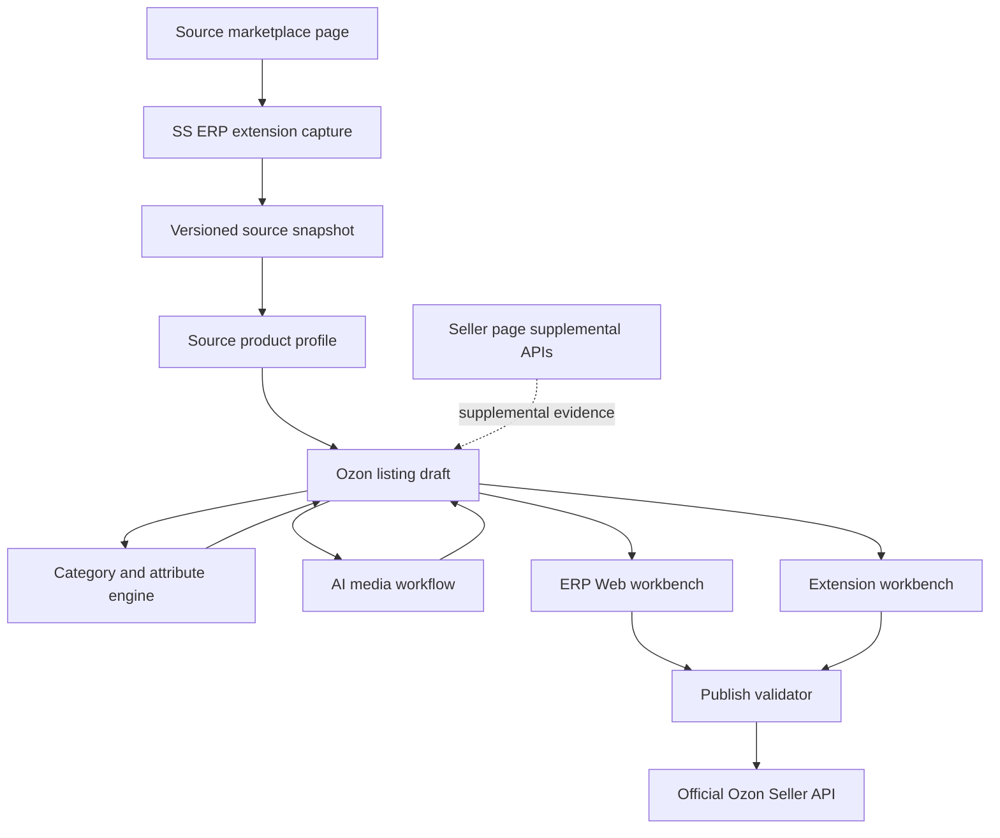
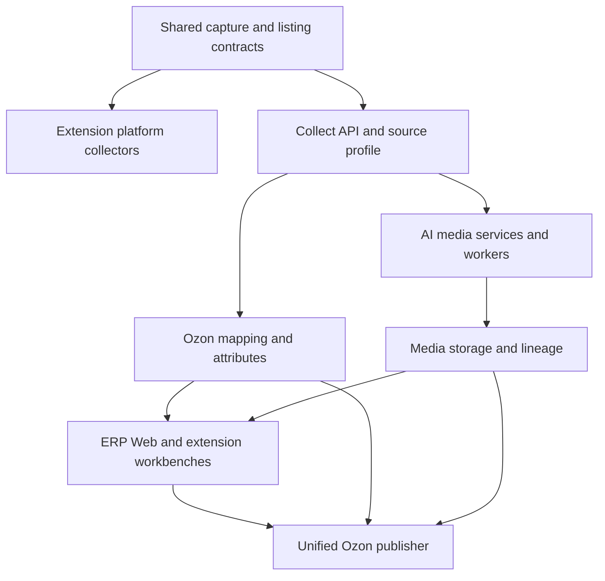
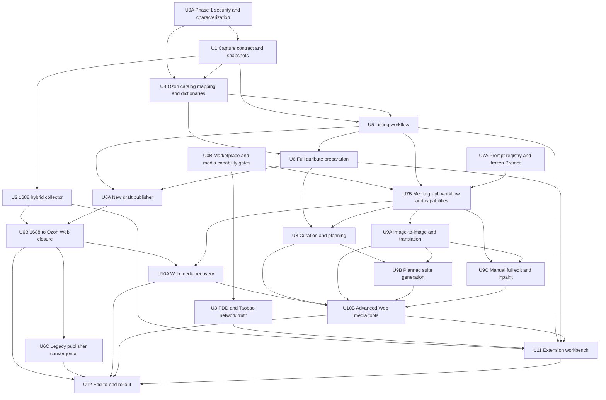

# Source Marketplace to Ozon AI Workflow Plan

## Overview

Build the useful end-to-end capability demonstrated by the reference Chrome extension into SS ERP and its existing extension without replacing SS ERP's stronger server-side foundations. The target workflow is:

```text
1688 / PDD / Taobao page capture
-> evidence-backed source product snapshot
-> source product profile
-> deterministic Ozon category and attribute preparation
-> AI image curation, vision, copy, image generation, translation, and editing
-> reviewable listing draft and pricing
-> official Ozon Seller API validation and publish
```

This plan extends the existing source-product-profile work rather than replacing it (see origin: `docs/plans/2026-06-26-001-feat-1688-ozon-source-profile-plan.md`). Units 1 and 2 of that plan are already implemented; its remaining diagnostics, copy-quality, readiness, and reuse decisions remain authoritative inputs here.

The central conclusion from the code comparison is that the reference extension is not a better overall architecture. It is a browser-heavy implementation with useful page fallbacks, image workflow ideas, and compact operator UI. SS ERP already has the better long-term system boundary: browser-only evidence acquisition in the extension, and durable orchestration, credentials, jobs, storage, validation, and Ozon publishing on the server.

## Current Delivery Status (2026-07-18)

This plan describes the full target program, not a claim that the source-to-Ozon workflow has shipped. The current branch contains completed-in-worktree Units 0A, 1, 2 and 5, the implemented-but-acceptance-pending Units 4, 6, 6A and 6B, plus the separate `text-to-image.base` Prompt foundation from Unit 7A. Together they establish the Phase 1 trust boundary, the evidence-backed Capture V2 snapshot contract, durable source-capture persistence, the 1688 hybrid collector, hardened Ozon catalog/mapping inputs, one owner-scoped resumable listing-draft ledger, server-owned product/per-SKU attribute preparation and validation, an immutable submit-once Ozon attempt/reconciliation boundary, and the first extension-to-ERP-Web review workflow. They do not yet complete Unit 0B, Unit 3, Unit 4 or Unit 6 acceptance, the real Ozon test-shop gates for Units 6A and 6B, Unit 7B, full R9-R12, or any later marketplace/media phase.

Status terms used below:

- **Implemented:** present before this plan or complete for the stated boundary.
- **Implemented in worktree:** code and tests exist locally but are not yet landed; acceptance findings may remain.
- **Partial:** useful foundations exist, but the target contract is not end-to-end.
- **Missing:** the target capability is not implemented.
- **Decision-blocked:** implementation depends on a product/provider choice that this plan records as a gate.

| Capability area | Current status | What exists now | What is still required |
|---|---|---|---|
| ERP auth, tenancy, queues, storage, official Ozon client | Implemented foundation | Server-side credentials, tenant-owned records, BullMQ jobs, `MediaAsset`, object storage, `/v3/product/import`, import polling and recovery paths | Extend the same authority and scopes to the new listing/media workflow; do not duplicate these systems |
| 1688 structured collection | Implemented in worktree for Units 2 and 6B | Current-offer-bound MAIN-world/inline evidence, bounded lazy-media warm-up, industry/PC/`next-table`, iframe, breadcrumb, category/video fallbacks, provenance, navigation guards, explicit completeness accounting and an exact extension-to-Web handoff | Real-site canaries and the live Ozon test-shop acceptance remain part of rollout |
| PDD and Taobao/Tmall collection | Partial at basic DOM/state level; network truth missing | Page globals and DOM normalizers | Allowlisted MAIN-world fetch/XHR evidence, sanitized real-response fixtures and optional user-triggered CDP fallback |
| Field-level truth and complete snapshots | Implemented in worktree for 1688 | Canonical field/SKU/media/packaging/category evidence, null semantics, estimation and missing reasons, per-stage counts, explicit truncation, deterministic 8 MiB transport budgeting, immutable versioned snapshots and paginated consumption by the listing workbench | Extend the same contract to PDD/Taobao and complete live-site acceptance |
| Ozon category and attribute engine | Implemented in worktree through Unit 6; acceptance pending | Tenant-scoped mapping history, server-owned source identity, current official catalog validation, complete dictionary pagination/cache policy, deterministic category candidates, normalized product/SKU attribute schemas, evidence-bound suggestions, strict validation and CAS-protected editing | Approve the real pilot benchmark, verify official open-dictionary and test-shop behavior, wire production AI attribute candidate generation, and complete the Unit 6A live test-shop gate |
| AI title and description | Partial | Fact-bound Russian drafts, cache, validation and quota | Durable staged workflow, versioned text templates, explicit candidate review and no default application to publish fields |
| Text-to-image | Partial | DashScope and OpenAI generation adapters, job persistence, stored outputs | Move into the common media operation/workflow and lineage contract; reconcile retries, cost, cancellation and recovery |
| Prompt registry and frozen job Prompt | Implemented in worktree for `text-to-image.base` only | Draft, validation, publish, rollback, CAS/sequence protection, admin UI, immutable history and frozen positive/negative Prompt consumed by the worker | Land and close acceptance; add meaningful fixture/capability tests, remaining template families, source/slot variables and all media operations |
| Image curation, vision, multi-reference generation, translation, editing and inpaint | Missing / decision-blocked | Feature flag and reference implementation research only | Provider capability matrix, media lineage, parent workflow, curation/vision, `qwen-mt-image`, edit/mask operations and server composition |
| Durable listing/media workbench | Implemented in worktree for the Unit 6B minimum closure; advanced media remains partial | Owner-scoped versioned listing drafts, exact Capture V2 handoff, immutable revisions/events/intents/attempts, CAS, resume/run states, blockers/warnings, category/attribute/copy/media/pricing review, revision-bound final confirmation, submit leases, UNKNOWN recovery and item-level reconciliation | Unit 6 acceptance, Units 6A/6B live test-shop gates, Unit 7B/10 advanced media lineage and the richer Unit 11 extension workbench |
| Extension security for the new workflow | Implemented in worktree for the Phase 1 boundary | Explicit device scopes, durable payload-bound command grants/receipts, replay-safe consumption, sender/origin separation and V2 legacy-write blocking | Apply the same authority to the final listing/media commands as those units are implemented |
| Cost, billing and operations | Partial; dark infrastructure implemented | Text usage, image daily limit, system status and audit; provider-neutral image reservation, dispatch fence, submission quarantine, settlement/release and manual-reconciliation states | Real provider/model prices, an operator reconciliation surface, workflow metrics/alerts and commercial charging only after internal-tool/SaaS and key-ownership decisions |

### Current Prompt Slice Boundary

The current worktree slice completes only these mechanics for the existing `text-to-image.base` path:

- versioned Prompt drafts, validation, PASS record, publish, rollback and immutable release history;
- optimistic/transactional concurrency protection for edits and releases;
- safe bootstrap from the legacy `ai_image_prompt` setting;
- resolved positive/negative Prompt, release, checksum and template snapshot frozen on new image jobs;
- worker preference for frozen Prompt values with legacy-job fallback;
- super-admin APIs and editor.

It does **not** provide a Provider capability matrix, durable input-asset relations, a media lineage graph, a parent workflow, image-to-image, multi-reference input, translation, editing, inpainting, curation, vision, slot planning, history recovery or an extension media workbench. The current template test checks syntax, rendering and compiled length; it is not yet a provider/model or structured-output quality gate. Only `text-to-image.base` is registered.

The Prompt editor's earlier browser checks cover save/PASS/publish/rollback and desktop/mobile layout for that slice only. Program-level verification through the current Unit 6 worktree records 1436 server tests passed with 62 skipped, 62 isolated PostgreSQL integration tests passed with all 47 migrations, workspace typecheck and production build passing, and lint at zero errors with 23 pre-existing warnings. Current generated Capture V2 artifacts and the prior source extension/package verification remain part of the earlier unit evidence. This evidence validates the implemented worktree units only; it is not end-to-end evidence for publication or any later phase.

## Executive Decision Matrix

| Area | Reference extension | SS ERP today | Decision |
|---|---|---|---|
| 1688 structured capture | DOM and inline-script heavy; direct `window` reads are unreliable from the isolated content world | MAIN-world bridge plus structured collector, DOM, JSON-LD, source profile, diagnostics | Keep SS ERP as primary; add selected reference DOM fallbacks |
| 1688 lazy media and unusual SKU layouts | Stronger explicit warm-up, industry table, PC SKU, `next-table`, iframe detail image fallbacks | Partial DOM fallbacks; no deliberate lazy-media warm-up | Adopt after characterization tests |
| PDD and Taobao price/SKU truth | MAIN-world fetch/XHR cache plus CDP network-first scratch tab | MAIN-world state plus DOM; no response-body capture or CDP | Add network evidence; keep CDP optional |
| Missing stock and packaging | Uses synthetic `999` stock and `500g / 300x200x100mm` in fallbacks | Collector/profile preserve some missing diagnostics, but current publish paths still inject default stock/dimensions/weight and a placeholder manufacturer | Remove every fabricated fallback and make missing facts explicit readiness blockers before the new workflow can publish |
| Collection data model | Extension-local `meta_info/global_data/sku_matrix` | Server source profile, standard attributes, metadata, storage | Extend SS ERP contract; do not replace it |
| Ozon category recommendation | Local text scoring, n-grams, synonyms, special-case penalties | Profile facts, official catalog, confirmation history, attribute coverage, risk filters | Add reference scorer as a recall signal, then rerank in ERP |
| Ozon attributes | Complete dynamic field model and editor concepts | Strong standard-field mapping and dictionary validation, but incomplete all-field editor | Add server-owned full attribute schema and editor |
| Ozon publish | Browser stores credentials and calls `/v3/product/import` | Server stores credentials and calls `/v3/product/import`, with durable jobs and repair paths | Keep SS ERP; consolidate duplicate publish builders |
| Seller login bridge | Supplemental seller analytics and variant lookup | Supplemental analytics, category reverse lookup, logistics, and CDN assistance | Keep separated from official write APIs |
| AI image generation | Multi-reference image generation and slot prompt plans in the extension | Working text-to-image MVP with server jobs and assets | Reuse ERP jobs; extend the contract for source assets and operations |
| Image translation | DashScope `qwen-mt-image` async task | Feature flag only | Implement server-side using persistent assets and resumable polling |
| Full-image edit | Provider edit request exists | Not implemented | Implement through the server capability contract |
| Masked inpainting | Prototype code exists but product flag is disabled | Not implemented | Reimplement and validate; do not copy as proven code |
| Prompt administration | Hardcoded templates distributed across client modules | Baseline had one editable but unused `ai_image_prompt`; the current uncommitted slice adds a versioned `text-to-image.base` registry and frozen job Prompt | Land the slice honestly, then extend the same mechanism to every curation/vision/slot/edit/translation template and capability test |
| Image persistence | Mixed temporary URLs and client state | `MediaAsset`, object storage, ownership checks | Make ERP assets the only durable source of truth |
| Extension UI | Full iframe workbench and client-side state | Existing popup, source costing panel, Ozon workbench, and one-click jobs | Add a source listing workbench using shared ERP APIs |
| Activation/license | Client activation code and HTTP license server | ERP authentication, users, quotas, and extension pairing | Do not adopt |

## Verified Corrections to Earlier Analysis

The following corrections are planning constraints, not optional interpretations:

| Earlier claim | Verified result | SS ERP implication |
|---|---|---|
| Ozon upload depends on `seller.ozon.ru` login state | False for the core upload. The reference extension calls the official API with `Client-Id` and `Api-Key`. | Keep official API writes on the ERP server; use seller login only for supplemental data. |
| Every image must pass through OSS | False. Both systems can use compatible public URLs; SS ERP already transfers or converts only when needed and preserves safe fallbacks. | Route AI outputs through ERP storage, but do not force every source URL through one storage path. |
| The reference main workflow contains an image phase | False. Image generation is a separate workflow; the main run state does not execute `IMAGE/IMAGE_DONE`. | Design an explicit media sub-workflow rather than copying unused enum values. |
| Product import uses `/v1/product/import` | False. Both systems use `/v3/product/import`. | Treat Ozon endpoint versions per operation, not as one global API version. |
| Reference local edit is production-ready | False. The feature flag is disabled. | Use the code as a protocol prototype only. |
| Shared gallery images are inherently a bug | Not established. Product-level shared galleries are valid for visually compatible variants. | Model product-level gallery, SKU hero, and optional SKU-specific gallery explicitly. |
| `debugger` is automatically disqualifying | Overstated. It is a sensitive permission with UX and review cost, not an automatic rejection. | Keep it optional and evidence-driven; do not put it in the default path without need. |

Ozon endpoints must remain operation-specific:

| Operation | Current SS ERP endpoint |
|---|---|
| Create/update product | `/v3/product/import` |
| Poll import task | `/v1/product/import/info` |
| Follow existing SKU | `/v1/product/import-by-sku` |
| Update prices | `/v1/product/import/prices` |
| Update stocks | `/v2/products/stocks` |
| Product info | `/v3/product/info/list` |
| Stock info | `/v4/product/info/stocks` |
| Product attributes | `/v4/product/info/attributes` |

These paths must be contract-tested against a sandbox/test shop before release because Ozon evolves endpoints independently.

## Ownership Model

The reference extension places most product-specific orchestration in the browser: collection, curation, prompt construction, provider calls, translation polling, state, Ozon payload construction, publishing, and UI. Its own backend is mainly activation/update/OSS policy support; AI and Ozon are third-party services. A precise line-count percentage would be misleading, but functionally it is a client-heavy system.

SS ERP should keep this responsibility split:

| Surface | Owns | Must not own |
|---|---|---|
| SS ERP extension | Page evidence, passive network evidence, optional user-triggered CDP fallback, SKU/image selection, mask drawing, quick review, task launch and status | AI/Ozon API keys, prompt compilation, category IDs invented by AI, durable workflow truth, final publish payload |
| ERP Web | Full review/edit workbench, admin prompt/provider settings, mapping governance, audit and recovery UI | Browser-only page access, duplicated client state machines |
| ERP API/services | Canonical capture validation, source profile, listing draft, category/attribute logic, prompt compilation, quotas, idempotency, provider routing, Ozon payload validation | DOM scraping or dependence on an open source-marketplace tab |
| ERP workers | AI calls, translation polling, storage, OCR checks, media transformations, retries, publish and repair jobs | User interaction state stored only in worker memory |
| Official Ozon API | Product, price, stock, attribute and import operations | Seller analytics and undocumented internal UI data |
| Seller page session | Supplemental analytics, reverse lookup, logistics and permitted auxiliary data | Core product creation or authoritative ERP state |

## Problem Frame

### Collection truth is incomplete and inconsistently represented

- SS ERP's 1688 collector has the stronger structured entry point, but it lacks some explicit DOM fallbacks and lazy-media handling from the reference extension.
- SS ERP's PDD and Taobao collectors can parse good structured state when it is present, but do not capture response bodies. Price and SKU completeness can therefore depend on DOM text.
- Several stages silently truncate data: large page globals, SKU arrays, image arrays, and server transfer lists use different limits.
- Top-level `price` currently mixes selected SKU price, minimum SKU price, range fallback, and conservative range maximum across platforms.
- A successful capture does not yet guarantee that every critical field records its source, confidence, completeness, or truncation.
- PDD currently turns unknown freight into zero in one fallback, and server numeric normalization can turn `null` into `0`; null/missing semantics are therefore not preserved end-to-end.
- Existing limits can silently reduce 1688 SKUs from 200 to 100, images to smaller transfer sets, and skip page objects over 500 KB without recording observed/submitted/persisted counts.

### AI media is a text-to-image MVP, not the requested feature set

- `AiImageJob.inputAssets` exists in Prisma but is not read or written by routes, repositories, workers, or providers.
- The OpenAI adapter only calls `/images/generations`; DashScope only calls text-to-image.
- There is no mask contract, image-to-image request, `qwen-mt-image` adapter, curation/vision workflow, or extension UI.
- `ai_image_prompt` is editable but unused. `feature_image_translate` is only a flag.
- Retry and cost fields do not match runtime behavior: stored retries default to three while the worker currently runs one attempt, and image cost is fixed to zero.
- Generated results are durable, but the current web workbench cannot list/recover jobs and requires users to paste target record IDs.
- AI title/description generation currently defaults to applying the generated draft into publish fields. It does not publish to Ozon immediately, but it violates the strict candidate-first review boundary and must default to review-only.

### Ozon mapping is strong but not complete

- SS ERP's candidate system is stronger than the reference extension because it combines source profile facts, official catalog entries, confirmed history, attribute coverage, and category risk filters.
- The reference scorer has useful cold-start recall from title, source category, features, SKU text, description, Chinese n-grams, synonyms, and entity-tail penalties.
- SS ERP currently fetches mainly the default-language category tree rather than merging official `DEFAULT` and `ZH_HANS` catalogs.
- Catalog refresh has no effective TTL; historical mappings are implicit in `supplyGoods.metadata` and may be shared across users without explicit governance.
- Attribute value fetching ignores `has_next`, so a partial dictionary can be cached for 30 days.
- Full Ozon attribute definitions are not exposed as one server-owned schema for all required/optional, dictionary/free-text, compliance, system, AI-suggestible, and manual-only fields.
- `collect.ts` and `listing.ts` have different payload-building rigor and should converge on one validated listing draft path.
- Category confirmation history is currently queried without a tenant condition. The confirmation route also accepts a client-supplied signature and category/type pair without recomputing the signature or validating the pair against the active official catalog.
- Current publish paths can synthesize default dimensions/weight, stock, and manufacturer values. Those paths cannot be reused by the target workflow until missing facts become explicit blockers.

## Requirements Trace

- **R1. Preserve stronger SS ERP foundations.** Existing server credentials, jobs, storage, source profile, Ozon API client, publish recovery, and tenant boundaries remain authoritative.
- **R2. Make collection evidence-backed.** Critical fields record source type/path, confidence, estimation status, completeness, and truncation.
- **R3. Improve 1688 without regressing truth.** Add useful lazy-media, category, SKU-table, iframe, and video fallbacks while keeping unknown facts null.
- **R4. Add trustworthy PDD/Taobao network capture.** Prefer validated network facts; use CDP only as an explicit optional fallback.
- **R5. Preserve complete product snapshots.** Persistence limits and UI preview limits are separate; truncation is explicit and recoverable.
- **R6. Create one durable listing workflow.** Collection, mapping, content, media, pricing, validation, and publishing resume from server state.
- **R7. Strengthen deterministic Ozon mapping.** Merge official bilingual catalogs, explicit mapping history, cold-start recall, attribute coverage, and human confirmation.
- **R8. Support complete Ozon attributes.** Build all-field schemas, dictionary paging/search, evidence, validation, and manual/AI/system ownership rules.
- **R9. Deliver complete AI media operations.** Curation, vision, prompt planning, text-to-image, image-to-image, full edit, masked inpaint, and image translation use persistent assets.
- **R10. Make prompts administrable and reproducible.** Versioned templates support draft/test/publish/rollback and every job stores the resolved prompt snapshot.
- **R11. Reuse one backend across ERP Web and extension.** Both clients operate on the same listing draft, media assets, task states, and APIs.
- **R12. Keep generated output reviewable.** AI results are candidates by default; no silent original-image overwrite or automatic publish of unvalidated fields.
- **R13. Keep official Ozon writes server-side.** Browser seller-session access remains supplemental and explicitly labeled.
- **R14. Provide observable, testable rollout.** Fixtures, contract tests, real-browser regression, provider sandboxes, metrics, flags, and rollback cover each risky boundary.
- **R15. Secure every extension and workflow command.** Reuse scoped extension-device sessions, validate sender/origin and tenant/shop ownership, authorize each operation, bind mutating commands to version/idempotency/nonce, reject replay, and keep account/provider/Ozon secrets out of extension messages and storage.

## Scope Boundaries

### In Scope

- 1688, PDD, Taobao/Tmall source product capture improvements.
- Canonical capture evidence and source product snapshot persistence.
- Ozon category catalog, source mapping, all-field attributes, dictionary validation, and unified publish preparation.
- AI image curation, vision, generation, translation, full edit, and masked inpainting.
- Admin prompt templates, provider capabilities, quotas/cost controls, and task audit.
- ERP Web and SS ERP extension workflow parity through shared APIs.
- Official Ozon Seller API publish and status/recovery integration.
- Extension-device scopes, message/command authentication, replay protection, actor audit and secret-boundary verification for the new workflow.

### Explicit Non-Goals

- Do not port the reference activation-code or HTTP license system.
- Do not store AI or Ozon provider keys in the extension.
- Do not clone the reference UI pixel-for-pixel or port its client state wholesale.
- Do not invent stock, shipping, package dimensions, weight, certification, warranty, material, or other missing facts.
- Do not treat a Cartesian SKU combination as confirmed inventory without evidence.
- Do not make AI directly choose arbitrary Ozon category/type IDs.
- Do not require every source image to pass through one OSS signer.
- Do not port disabled/dead PSD export, unused planner paths, or external editor dependencies unless separately justified.
- Do not replace SS ERP pricing, logistics, inventory, auth, quota, or Ozon client systems with reference-extension implementations.
- Do not use general account bearer tokens as the long-term authentication mechanism for new extension listing/media/publish commands when the existing scoped device-session pattern can be reused.

## Context and Research

### SS ERP patterns to preserve

- `extensions/ss-erp/content/page-bridge.js` reads page globals in MAIN world and returns structured state.
- `extensions/ss-erp/shared/collectors/source-product-core.js` contains the tested 1688 structured collector and diagnostics.
- `extensions/ss-erp/shared/collectors/pdd-product.js` and `marketplace-product.js` normalize PDD and Taobao/Tmall data.
- `apps/server/src/services/source-product-profile.ts` is the reusable, versioned source fact layer from the origin plan.
- `apps/server/src/services/product-content-ai.ts` demonstrates fact-bound prompts, output validation, caching, quotas, and prompt hashing.
- `apps/server/src/routes/ai-images.ts`, `services/ai-image-jobs.ts`, `workers/ai-image-generation.ts`, and `MediaAsset` provide the existing media-job foundation.
- `apps/server/src/services/ozon-category-catalog.ts`, `ozon-attribute-dictionary-cache.ts`, `ozon-client.ts`, and `routes/collect.ts` provide the current Ozon foundation.
- `extensions/ss-erp/content/ozon-panel.js`, `ozon-list-overlay.js`, and browser one-click listing jobs provide extension interaction and durable task patterns.

### Reference-extension patterns worth adapting

- `content/injector.js`: bounded lazy-media warm-up and validated PDD/Taobao network merge.
- `content/strategies/adapter_1688.js`: industry/PC/next-table SKU parsers, breadcrumbs, script category IDs, iframe/detail media.
- `content/pdd-page-bridge.js`, `content/taobao-page-bridge.js`: document-start MAIN-world fetch/XHR response caches.
- `services/collectors/*-cdp-network-scraper.js`: inactive scratch-tab CDP fallback with positive-evidence acceptance.
- `ui/modules/ozon/category-recommender.js`: cold-start category recall from multi-field n-grams and conflict penalties.
- `ui/modules/image-curation/`, `ui/modules/vision/`, and `ui/modules/image-generation/`: curation, visual evidence, slot plans, and multi-reference tasks.
- `services/clients/dashscope-client.js`: `qwen-mt-image` task creation and polling protocol.
- `services/providers/adapters/openai-compatible-image-*`: generation/edit endpoint selection and multipart image/mask requests.
- `ui/modules/image/preview-ai-edit.js`: source + mask + generated result concept, treated only as a prototype because the feature is disabled.

### Research boundary

No live marketplace, AI-provider, or Ozon API calls were made during planning. Local code establishes architectural and behavioral facts, but release work must verify current external contracts against test accounts and provider documentation.

## Key Technical Decisions

| Decision | Rationale | Rejected alternative |
|---|---|---|
| ERP is the workflow authority | Existing durable jobs, encrypted credentials, storage, tenancy, quotas, and Ozon recovery are stronger and reusable by both clients. | Port the extension's client-heavy state and direct provider calls. |
| Existing extension-device sessions secure privileged extension actions | The logistics subsystem already has pairing, short-lived scoped access tokens, refresh rotation, live-session/JTI checks and shop grants. Extending that pattern is safer than storing a general account token for the new workflow. | Invent a second license/token system or trust any message from an installed extension. |
| Capture stores evidence, not only normalized values | Platform fallbacks disagree; audit and safe automation require provenance and truncation. | Preserve one flattened payload with implicit confidence. |
| Passive MAIN-world network capture precedes optional CDP | It improves truth without adding a sensitive permission to every installation. CDP remains available when response bodies cannot otherwise be obtained. | Add mandatory `debugger` or trust DOM prices. |
| Category IDs remain deterministic and reviewable | Official catalog IDs, mappings, rules, and user confirmation are auditable; AI can suggest evidence but must not invent IDs. | Ask an LLM to return final category IDs. |
| One `OzonListingDraft` feeds all publish entry points | Current payload builders differ in validation rigor. A single draft and validator prevent surface-specific behavior. | Continue patching `collect.ts` and `listing.ts` separately. |
| Media uses an immutable asset/derivative graph | Original, generated, translated, edited, mask, and composed outputs need lineage, ownership, rollback, hashing, and caching. | Maintain parallel `originalUrl/currentUrl/exportUrl` client fields as truth. |
| A parent media workflow owns child jobs | Curation, vision, prompt planning, per-SKU hero, gallery, translation, and review have dependencies beyond one image job. | Add more status values to the current single image job. |
| Prompt templates are versioned records | The reference feature has many distinct templates; one unused string cannot support audit, rollback, or reproducibility. | Add many unrelated SystemConfig strings without versions. |
| Inpainting is enforced by server composition | The server can validate mask dimensions and guarantee unmasked pixels come from the source asset. | Trust browser-only Canvas composition or provider behavior. |
| Product-level and SKU-level media are explicit | Shared gallery is correct for compatible variants but wrong for structural/bundle differences. | Always share or always duplicate all gallery images. |
| AI output is candidate-first | Image and text models can hallucinate, corrupt identity, or render poor Cyrillic. Review and validation are required before application/publish. | Automatically replace originals and publish after generation. |
| First business closure is 1688 to Ozon through ERP Web | It validates the capture, truth, mapping, draft and official publish boundaries using the strongest existing collector before adding two more marketplace variants or advanced media. | Finish every horizontal subsystem before delivering one usable workflow. |

## High-Level Technical Design

This illustrates the intended approach and is directional guidance for review, not implementation specification. The implementing agent should treat it as context, not code to reproduce.



The durable workflow should expose stages rather than depend on a browser tab remaining alive:

```text
CAPTURING -> CAPTURED -> NORMALIZING -> NEEDS_CATEGORY_REVIEW
-> PREPARING_ATTRIBUTES -> PREPARING_CONTENT -> PREPARING_MEDIA
-> NEEDS_REVIEW -> READY_TO_PUBLISH -> PUBLISHING
-> PUBLISHED | PUBLISH_FAILED

Any active preparation stage may become PAUSED, RETRYABLE_FAILED, or CANCELLED.
Re-entry resumes from persisted completed steps and validates that its input hash is still current.
```

Directional capture envelope:

```json
{
  "captureVersion": "source-capture-v2",
  "platform": "1688",
  "sourceIdentity": { "productId": "...", "url": "..." },
  "sourceCategory": { "id": "...", "idPath": [], "path": [], "name": "..." },
  "facts": {},
  "fieldEvidence": {},
  "priceEvidence": [],
  "completeness": {},
  "truncation": [],
  "capturedAt": "..."
}
```

Each critical field evidence entry should distinguish `network`, `main_world`, `dom`, `script`, `derived`, and `manual`, include a source path and confidence, and state whether it was estimated. Unknown values remain null.

Directional media ownership:

```text
MediaAsset (immutable bytes/hash/owner)
  -> MediaTransformation (generate/translate/edit/inpaint/compose)
  -> ListingMediaAssignment
       product gallery slot
       SKU hero slot
       visual-compatible SKU group gallery slot
```

## System-Wide Impact



- **Contracts:** Extension, API, workers, Web UI, and publish builders must agree on capture version, listing draft version, media assignments, and stage transitions.
- **Persistence:** New snapshots, mappings, drafts, command grants/receipts, publish attempts, prompt versions, workflow steps, input asset relations and media lineage require migrations, immutable links and retention rules.
- **Caching:** Category catalogs, attribute definitions, dictionary pages, AI translations, prompt plans, and image translations need version-aware keys and invalidation.
- **Failure propagation:** Page capture failures remain diagnosable; AI/provider failures do not erase originals; Ozon failures preserve the exact submitted payload/task ID, and accepted-but-unrecorded submissions enter an explicit `UNKNOWN` reconciliation state.
- **Security:** All asset IDs are owner-scoped; remote fetches retain SSRF protections; provider and Ozon keys remain server-only; prompt templates cannot execute code.
- **Extension command boundary:** Runtime messages validate extension sender, tab/origin and allowlisted operation. Privileged server calls use the existing extension-device session with operation/shop scopes. Mutations carry draft version plus idempotency key; high-risk actions also use a short-lived, single-use server nonce so exact replay is stable and changed-payload replay is rejected.
- **Cost/performance:** Multi-SKU image suites can create many child jobs. Concurrency, per-workflow limits, budget reservation, cancellation, and deduplication must be enforced before provider calls.
- **Compatibility:** Existing collect records and image jobs remain readable; new features are additive and gated until backfills or compatibility adapters are ready.
- **Operations:** Provider latency, queue depth, failure codes, cost, translation residue, publish rejection, and collector completeness need metrics and support diagnostics.

## Feature Flag and Rollback Contract

`apps/server/src/services/source-workflow-feature-flags.ts` is the single evaluator for this program. SystemConfig supplies global defaults; tenant/shop/device allowlists are authenticated server data, not page input. Extension flags are returned only in a signed/authenticated ERP runtime response and cannot be enabled by MAIN-world or runtime message payloads. Every owner unit adds its flag, dual-read/shadow behavior and rollback test when the boundary is introduced.

| Key | Owner | Scope and default | Rollout / rollback behavior |
|---|---|---|---|
| `feature_source_capture_v2` | Unit 1 | Global default off; tenant allowlist | Legacy read plus V2 shadow-write first; rollback stops V2 writes while retaining readable snapshots |
| `feature_source_listing_workflow` | Unit 5 | Tenant default off | Creates versioned drafts only for allowed tenants; rollback returns entry UI to legacy records without deleting drafts |
| `feature_source_ozon_publisher_v2` | Unit 6A | Shop default off | New drafts/pilot shops only; enabled shops reject legacy write bypass; rollback stops new submits but preserves attempts/reconciliation |
| `feature_source_network_capture` | Unit 3 | Global default off; platform/tenant allowlist | Passive capture only; rollback returns to structured/DOM evidence and records degradation |
| `feature_ai_media_workflow_v2` | Unit 7B | Tenant default off | Migrates existing text-to-image history/lineage behind compatibility readers; rollback disables new parents but preserves assets/jobs |
| `feature_ai_media_image_to_image`, `feature_image_translate` | Unit 9A | Global capability plus tenant default off | Enabled only when exact provider/model contract passes; each operation rolls back independently |
| `feature_ai_media_suite` | Unit 9B | Tenant default off | Requires approved plan/cost preview; rollback leaves completed child assets reviewable |
| `feature_ai_media_edit`, `feature_ai_media_inpaint` | Unit 9C | Global capability plus tenant default off | Manual operations enabled independently; rollback leaves sources/masks/results readable |
| `feature_source_listing_web_media` | Units 10A/10B | Tenant default off with per-tool capabilities | History shell can remain enabled while advanced tools roll back independently |
| `feature_source_listing_extension_workbench` | Unit 11 | Tenant/device default off | Authenticated runtime config only; rollback keeps the Phase 1 deep link and disables the rich drawer |

A flag is removed only after compatibility readers are no longer needed, the observation window has passed, rollback records are archived, and the removal is covered by migration/documentation work. Unit 12 widens allowlists and removes mature flags; it does not invent the controls.

## Implementation Dependency Graph



## Implementation Units

- [x] **Unit 0A: Phase 1 Product, Security, and Characterization Gate**

**Goal:** Freeze only the decisions and trust boundaries required for the 1688-to-Ozon Web closure, persist replay-safe command authorization, and characterize current 1688/Ozon losses before changing shared contracts.

**Requirements:** R1-R3, R5-R8, R12-R15

**Dependencies:** None.

**Files:**
- Create: `scripts/fixtures/source-collect/1688/`
- Create: `scripts/extension-source-collector-contract.test.mjs`
- Modify: `apps/server/src/__tests__/collect-batch-upsert.test.ts`
- Modify: `apps/server/src/__tests__/collect-publish-helpers.test.ts`
- Modify: `apps/server/prisma/schema.prisma`
- Create: `apps/server/prisma/migrations/<timestamp>_add_extension_command_grants/migration.sql`
- Modify: `apps/server/src/lib/extension-device-auth.ts`
- Modify: `apps/server/src/services/extension-device-session.ts`
- Modify: `apps/server/src/services/extension-device-session-prisma.ts`
- Modify: `apps/server/src/routes/extension-device.ts`
- Create: `apps/server/src/services/extension-command-grants.ts`
- Create: `apps/server/src/routes/extension-command-grants.ts`
- Modify: `apps/server/src/config/system-config-schema.ts`
- Create: `apps/server/src/services/source-workflow-feature-flags.ts`
- Modify: `apps/web/src/components/extension-token-dialog.tsx`
- Modify: `extensions/ss-erp/shared/message-security/runtime-message-policy.js`
- Modify: `extensions/ss-erp/shared/logistics-rules/device-credential-manager.js`
- Create: `scripts/extension-source-workflow-security.test.mjs`
- Modify: `apps/server/src/__tests__/extension-device-auth.test.ts`
- Create: `apps/server/src/__tests__/extension-command-grants.test.ts`
- Create: `apps/server/src/__tests__/source-workflow-feature-flags.test.ts`
- Create: `docs/contracts/source-to-ozon-external-contracts.md`
- Create: `docs/security/source-listing-extension-threat-model.md`

**Approach:**
- Freeze the Phase 1 assumptions only: existing multi-tenant ERP, server-held Ozon credentials, 1688-first scope, one to three pilot Ozon categories, owner/admin-controlled device pairing, and minimum raw-snapshot/submitted-payload retention. Media Provider, suite/text and CDP choices move to Unit 0B and do not block Phase 1.
- Characterize 1688 collector-to-service-worker-to-`/api/collect/batch` field survival, limits and losses. Record current Ozon endpoints and fabricated publish defaults as failures to remove, not compatibility behavior to preserve.
- Extend paired device sessions with explicit grants. First-pilot policy: owner/admin grants scopes; capture/review can be granted separately; Ozon publish is never default and requires explicit owner/admin grant; global mapping promotion remains Web super-admin only. STAFF pairing/actor attribution remains disabled until a later approved role design rather than inheriting owner authority. Web publish is owner-only in Phase 1 and enforced server-side; STAFF may capture/review only where existing account RBAC allows it.
- Persist `ExtensionCommandGrant` and `ExtensionCommandReceipt` records. Bind a grant to session, owner, shop where applicable, operation, workflow/draft version, canonical request hash and expiry; atomically consume it and create the durable receipt. Exact replay returns the receipt; changed payload or expired/revoked grant conflicts.
- Validate runtime sender, tab/origin and allowlisted operation before issuing a server command. Disable or migrate legacy `publish-ozon-workbench-rows` and its endpoint when the new workflow flag is enabled so account-token fallback cannot bypass scope/nonce checks.
- Keep channels distinct: MAIN-world/`window.postMessage` may submit sanitized page evidence only and never carries a command grant or triggers publish. High-risk commands originate from extension-owned UI/service worker after an explicit user action and are bound to that trusted context server-side.
- Introduce flags and compatibility rules at the first changed boundary, including legacy read, V2 write/shadow mode and rollback. Provider/Ozon secrets and reusable account credentials never enter new workflow storage, runtime messages, logs or support bundles.
- Characterize `null`, zero and missing through collector, service worker, API, Prisma metadata and source profile.
- Treat existing unit tests as parser tests, not proof of real-browser behavior.

**Execution note:** Add characterization and authorization coverage before modifying legacy collectors or enabling the new publish path.

**Test scenarios:**
- A 1688 fixture with more than 100 SKUs reports exactly where current truncation occurs.
- Unknown freight, stock, weight and dimensions remain distinguishable from explicit zero through every serialization boundary.
- A forged sender, wrong origin, unauthorized shop/scope, revoked session, expired grant and changed-payload replay are rejected fail-closed across process restart and multiple API instances.
- A MAIN-world/page message can submit only bounded evidence; attempts to carry a grant or invoke confirm/publish are rejected even when relayed through a valid content script.
- Exact replay returns one persisted receipt without a second provider/Ozon call.
- Pairing does not grant publish by default; owner/admin grant and revocation propagate to the device; unsupported STAFF pairing cannot acquire owner scope.
- The legacy one-click publish message cannot bypass device scope, command grant, draft version or idempotency.
- Extension storage/message/log scans contain no AI key, Ozon key or reusable account credential for the new workflow.

**Verification:** Phase 1 can start with measured 1688/Ozon behavior and a persistent, revocable, least-privilege extension command boundary, without waiting for advanced media or PDD/Taobao decisions.

**Implementation evidence (2026-07-14):** The approved Phase 1 assumptions, external boundaries, retention floors and threat model are recorded under `docs/contracts` and `docs/security`. Device sessions now use explicit source/listing/media scopes; publish is never a UI default; root or child STAFF cannot acquire owner command authority. `ExtensionCommandGrant` and `ExtensionCommandReceipt` persistence, immutable database constraints, strict command resolution and contextual rollout are implemented. Legacy Ozon writes are blocked for matching V2 shops at direct routes, one-click job creation/queue transition, worker start/final request and the collect publisher while existing Ozon task reconciliation remains available. A real isolated PostgreSQL schema ran the two-client issuance/consume tests successfully for five consecutive runs after fixing nested SQLSTATE retry handling. The server suite passes 1131 tests with 51 skips; the opt-in PostgreSQL test is separately proven rather than counted as an executed full-suite test. Static/VM extension security contracts pass, and the 236-SKU/null-zero fixtures record the current 200/100 SKU and 30/50/20 image losses. Those measured V1 losses are not accepted behavior: complete persistence and null/zero evidence remain Unit 1 work.

- [ ] **Unit 0B: Independently Closable Marketplace and AI Media Capability Gates**

**Goal:** Resolve stage-specific external contracts before PDD/Taobao network capture or paid media operations begin.

**Requirements:** R4, R9, R10, R14

**Dependencies:** None. The marketplace sub-gate must close before Unit 3; the media sub-gate must close before Units 7B-9C. Either sub-gate can close and unblock its route independently, and neither blocks Units 1-6B.

**Files:**
- Create: `scripts/fixtures/source-collect/pdd/`
- Create: `scripts/fixtures/source-collect/taobao/`
- Create: `scripts/fixtures/ai-media-evaluation/`
- Create: `scripts/sandbox/ai-media-provider-contract.mjs`
- Create: `docs/contracts/source-marketplace-network-contracts.md`
- Create: `docs/contracts/ai-media-provider-matrix.md`

**Approach:**
- Capture sanitized PDD/Taobao/Tmall response fixtures and decide Chrome Web Store versus controlled enterprise CDP distribution from measured passive-capture gaps.
- Freeze the first edit-capable generation model and `qwen-mt-image` translation model from sandbox evidence, not provider family names.
- Record operation support, reference/mask limits, prompt/size limits, sync/async result forms, cancellation, actual cost, input transport and maximum provider fetch duration.
- For each storage backend, decide whether the provider receives bytes/multipart, a staged provider upload or a signed public GET URL whose TTL exceeds submission and polling. A localhost/private asset is never assumed reachable by a cloud provider.
- Freeze the default suite and visible-text policy plus evaluation thresholds for identity consistency, Russian readability and Chinese-text residue.

**Test scenarios:**
- PDD/Taobao response fixtures preserve product identity and exclude cookies, authorization headers and unrelated raw bodies.
- The selected model passes real generation/edit/translation sandbox contracts with its exact request shape and result form.
- Local, object-storage and Ozon-CDN assets each use an explicitly supported input transport; an expiring signed URL remains valid for the documented provider window.
- Fixed media evaluation fixtures meet the approved identity, Russian text and residue thresholds before a capability is enabled.

**Verification:** Each sub-gate has its own acceptance record: Unit 3 can begin with the marketplace record even if media remains undecided, and Units 7B-9C can begin with the media record even if CDP remains undecided.

**Implementation evidence (2026-07-17):** A media capability foundation is present but the media sub-gate remains open. `ai-image-provider-capabilities.ts` distinguishes local-test, adapter-characterized and future sandbox-verified evidence; job creation rejects unregistered provider combinations before quota reservation and the worker revalidates operation/reference/mask rules before submission with typed permanent errors. The executable contracts load the TypeScript registry and validate three secret-free threshold-policy scaffolds plus their range/direction/manual-review semantics. These policies are not media fixtures or quality results. Provider adapter characterization covers current request/result behavior and paid IMAGE_TO_IMAGE rejection, but no paid call, exact advanced-operation model acceptance, transport/cost evidence, real image evaluator or rollout activation was performed. The marketplace sub-gate now has six synthetic PDD/Taobao schema/identity/price fixtures and sanitizer checks; it remains open until real sanitized page/network captures, miss-rate evidence and the CDP distribution decision are recorded.

- [x] **Unit 1: Versioned Capture Contract and Complete Snapshot Persistence**

**Goal:** Introduce an evidence-backed capture envelope and remove silent loss between extension and server.

**Requirements:** R2, R5, R6

**Dependencies:** Unit 0A; origin-plan source profile service.

**Files:**
- Create: `packages/shared/schemas/source-product-capture-v2.schema.json`
- Create: `packages/shared/src/source-product-capture.ts`
- Modify: `packages/shared/src/index.ts`
- Create: `scripts/generate-source-capture-contract.mjs`
- Create: `extensions/ss-erp/shared/contracts/source-product-capture-v2.js`
- Modify: `extensions/ss-erp/shared/collectors/source-product-core.js`
- Modify: `extensions/ss-erp/content/collect-content-script.js`
- Modify: `extensions/ss-erp/background/service-worker.js`
- Modify: `extensions/ss-erp/shared/adapters/local-adapter.js`
- Modify: `extensions/ss-erp/shared/adapters/cloud-adapter.js`
- Modify: `apps/server/prisma/schema.prisma`
- Create: `apps/server/prisma/migrations/<timestamp>_add_source_capture_snapshots/migration.sql`
- Create: `apps/server/src/services/source-capture.ts`
- Modify: `apps/server/src/routes/collect.ts`
- Modify: `apps/server/src/services/source-product-profile.ts`
- Create: `apps/server/src/__tests__/source-capture.test.ts`
- Modify: `scripts/extension-1688-collector-core.test.mjs`
- Modify: `scripts/extension-pdd-collector.test.mjs`
- Modify: `scripts/extension-marketplace-collector.test.mjs`

**Approach:**
- Separate display values from evidence records and define unambiguous price roles such as selected SKU, SKU minimum, ladder tier, displayed range, and conservative fallback.
- Use one JSON Schema as the runtime contract source, generate the TypeScript type and plain-JavaScript validator consumed by the static `importScripts` extension, and fail packaging/tests when generated artifacts drift. Unit 1 migrates 1688; Unit 3 adapts PDD/Taobao to the same envelope.
- Define evidence consistently as value, source type/path, confidence, estimation flag, missing reason, observed time and parser version. Apply it to product fields, every SKU/variant, packaging row, price role, image/media record and source category, not only top-level scalar fields.
- Store capture version, source category ID/path, field evidence, completeness, estimation flag, and per-stage `observed/captured/submitted/persisted/displayed` counts.
- Record every truncation with stage, field, limit, reason and recoverability. Preview pagination may be bounded; the canonical snapshot may not be silently sliced.
- Persist large canonical snapshots separately from UI-oriented item metadata, keyed by owner, platform, product ID, capture hash, and version.
- Support chunked or compressed snapshot submission if real fixture sizes exceed the current request envelope; never conflate preview limits with persistence limits.
- Adapt legacy payloads into V2 on the server so existing extension versions continue to work.
- Submit V2 capture through a `capture:write` device session when launched by the extension; Web account sessions remain valid only for Web-originated operations. Feature flags support shadow-write/dual-read and rollback from the first migration.

**Test scenarios:**
- Unknown stock, freight, weight, and dimensions remain null and include missing evidence.
- Explicit zero stock/free freight remains zero while `null` remains unknown after extension, API, Prisma and profile round trips.
- A 236-SKU capture persists all 236 rows while the UI summary may show the first page.
- A page bridge skips an oversized candidate only after recording its field, observed size, limit, fallback and recoverability.
- Replaying the same capture hash is idempotent; a changed page payload creates a new snapshot version.
- Legacy payloads still create a source profile but are labeled with incomplete provenance.
- A snapshot rejected for size/version leaves the previous valid capture intact.
- Contract generation is deterministic, the extension validator rejects malformed V2 before submission, and CI/package verification detects schema/type/validator drift.

**Verification:** Any listing fact can be traced to source evidence, and no array is silently sliced without a persisted truncation record.

**Implementation evidence (2026-07-14):** `source-product-capture-v2.schema.json` is the single contract source and deterministically generates the shared TypeScript runtime and classic extension validator; package/build checks fail on drift. The 1688 collector now emits native V2 evidence for facts, SKUs, prices, media, packaging, source category, completeness, role-specific stage counts and explicit truncations, preserving null versus zero and all 236 fixture SKUs. Paired extensions submit only the canonical capture/hash/byte envelope through a `capture:write` device session and a payload-bound `SOURCE_CAPTURE` grant; fallback is allowed only before grant issuance for unpaired or explicitly disabled rollout states. The API supports `shadow_write`, `dual_read` and `v2_only`, rejects oversized legacy batches instead of slicing, and atomically reuses one owner/platform/product projection during legacy shadow migration. PostgreSQL stores immutable canonical JSONB snapshots with per-subject versions, exact-hash idempotency, provenance/profile/audit columns and a bounded legacy preview. A fresh isolated schema applied all 42 migrations and passed 56 real PostgreSQL tests across eight files, including distinct-hash concurrency, 236-SKU persistence versus a 100-SKU preview, grant/session/JTI/scope invalidation, late-failure rollback and retry, legacy two-client convergence and tenant isolation. The full server suite passes 1172 tests with 56 opt-in skips; workspace typecheck and production build pass; lint has zero errors and 23 pre-existing warnings; extension verification passes 183 checks with three existing permission warnings, and both cloud/local packages build successfully.

- [x] **Unit 2: 1688 Hybrid Collector Enhancements**

**Goal:** Add the reference extension's useful 1688 page fallbacks behind SS ERP's MAIN-world structured core.

**Requirements:** R3, R5

**Dependencies:** Units 0A and 1.

**Files:**
- Modify: `extensions/ss-erp/content/page-bridge.js`
- Modify: `extensions/ss-erp/content/collect-content-script.js`
- Modify: `extensions/ss-erp/shared/collectors/source-product-core.js`
- Create: `extensions/ss-erp/shared/collectors/1688-dom-fallback.js`
- Modify: `extensions/ss-erp/manifest.json`
- Modify: `scripts/extension-1688-collector-core.test.mjs`
- Modify: `scripts/extension-source-price-extraction.test.mjs`
- Create: `scripts/extension-1688-real-page-fixtures.test.mjs`

**Approach:**
- Preserve priority: MAIN-world structured data, targeted inline data, known SKU tables, trusted attribute combinations, then explicit incomplete status.
- Add bounded lazy-media warm-up with conditional waiting and restoration of the user's original scroll position.
- Add industry table, PC SKU, next-table coordinate, same-origin detail iframe, breadcrumb/JSON-LD/script category ID, and DOM video fallbacks.
- Retain sold-out SKUs with stock zero. Unknown stock remains null.
- Mark Cartesian combinations as derived and not confirmed inventory; do not generate unstable IDs from time.

**Test scenarios:**
- Structured `skuModel` wins over conflicting DOM rows.
- Industry, PC, and next-table fixtures reconstruct SKU labels, prices, stock, and images with evidence paths.
- A derived combination is labeled derived and cannot satisfy confirmed-stock readiness.
- Lazy warm-up times out without preventing capture and restores scroll position.
- No packaging data produces a diagnostic, never reference defaults.
- Breadcrumb and source category ID survive through `/api/collect/batch` into the snapshot/profile.

**Verification:** 1688 fixture coverage improves without changing known facts into estimates or regressing existing source-profile tests.

**Implementation evidence (2026-07-14):** The page bridge now binds structured and targeted-inline evidence to the current 1688 offer, rejects nested foreign offers, keeps bounded inline-video evidence and records every limit. The content script guards offer identity across warm-up, bridge, validation and return boundaries; canonical DOM packaging and main-media capture are separated from legacy preview limits and emit legal truncation/count rows. The hybrid fallback adds bounded lazy-media warm-up, industry/PC/`next-table` SKU families, same-origin detail iframes, breadcrumb/category and video evidence while preserving sold-out zero, unknown/negative stock as `null`, arbitrary SKU dimensions and derived-row provenance. Capture V2 keeps real `main_world`/`script`/`dom` evidence, contributor-accurate SKU paths, stable collision-resistant SKU keys, role-specific media transport ledgers, schema-bound arrays and deterministic sub-8 MiB submission budgeting without silent slicing. Independent Unit 2 acceptance found no remaining blocker. Focused checks pass for 40 real-page fixtures, 26 legacy 1688 core cases, 8 page-bridge bounds, Capture V2/contract regressions and DOM main-media limits; the full server suite passes 1173 tests with 56 skipped, workspace typecheck/build and generated-contract checks pass, lint has zero errors, and source/cloud/local extension verification passes.

- [ ] **Unit 3: PDD and Taobao/Tmall Network-Truth Layer**

**Goal:** Capture trusted SKU and price evidence when page globals are incomplete.

**Requirements:** R2, R4, R14

**Dependencies:** Units 0B and 1.

**Files:**
- Create: `extensions/ss-erp/content/source-network-page-hook.js`
- Create: `extensions/ss-erp/content/source-network-bridge.js`
- Create: `extensions/ss-erp/shared/collectors/pdd-network-normalizer.js`
- Create: `extensions/ss-erp/shared/collectors/taobao-network-normalizer.js`
- Modify: `extensions/ss-erp/shared/collectors/pdd-product.js`
- Modify: `extensions/ss-erp/shared/collectors/marketplace-product.js`
- Modify: `extensions/ss-erp/content/collect-content-script.js`
- Modify: `extensions/ss-erp/background/service-worker.js`
- Modify: `extensions/ss-erp/manifest.json`
- Create: `scripts/extension-source-network-capture.test.mjs`
- Create: `scripts/fixtures/source-collect/pdd/README.md`
- Create: `scripts/fixtures/source-collect/taobao/README.md`
- Modify: `scripts/extension-pdd-collector.test.mjs`
- Modify: `scripts/extension-marketplace-collector.test.mjs`

**Approach:**
- Inject a document-start MAIN-world observer that transparently clones only allowlisted fetch/XHR response bodies and stores bounded sanitized candidates.
- Label this source `page_observed_network`, not an absolute server truth. Preserve response signature, product identity and cross-evidence while discarding cookies, headers and unrelated/raw response bodies.
- Accept network candidates only when product identity, SKU rows, positive prices, and image/title evidence pass platform-specific validation.
- Merge network facts field-by-field; never replace stronger data with a weaker response merely because it arrived later.
- Correct PDD unknown freight versus free freight and lower DOM-derived confidence.
- Correct Taobao price-unit ambiguity by using field semantics and explicit evidence rather than a global integer threshold.
- Define CDP as a separately gated fallback using optional permission and user action only if passive capture fails in real-page regression.
- Do not mark the unit complete from hand-authored objects alone. Completion requires sanitized response fixtures captured from each supported PDD and Taobao/Tmall page family and real-browser evidence that the allowlist still observes those responses.

**Test scenarios:**
- Network payload for the wrong product ID is rejected.
- Complete `sku2info` prices repair DOM rows; partial or zero-price data does not.
- PDD response must contain title, SKU, main image, and a positive price before it becomes trusted.
- Unknown freight remains null while explicit free shipping becomes zero with `free=true`.
- Network observer failure leaves MAIN-world/DOM capture operational and records the degradation.
- Optional CDP denial does not fail the base extension workflow.

**Verification:** PDD/Taobao fixtures demonstrate trusted SKU-level prices without requiring `debugger` in the default path.

**Implementation slice (2026-07-17):** The bounded PDD/Taobao/Tmall projection modules, isolated policy bridge, platform normalizers, SPA identity checks, TTL/byte budgets and lifecycle contracts are present. The production manifest intentionally does not register the MAIN observer until the ERP policy-signature sync and dynamic registration path exist; network rows remain `page_observed_network`/untrusted and only a bounded `extractionDiagnostics.networkCapture` summary is persisted. Sanitized real response fixtures and browser canaries are still required before this unit can be marked complete.

- [ ] **Unit 4: Ozon Catalog, Mapping, and Dictionary Foundation**

**Implementation status (2026-07-15):** Catalog/mapping/dictionary services, persistence, rollout flags, server-owned confirmation, Web conflict handling, and benchmark metric code are implemented. Final acceptance remains blocked on the explicitly `pending_review` pilot fixture in `docs/contracts/ozon-category-recommendation-pilot-benchmark.json`: real pilot shop/category IDs, human labels, catalog revision, and approved thresholds are still `UNKNOWN` and have not been fabricated.

**Goal:** Harden the existing Ozon foundation before new AI and extension surfaces depend on it.

**Requirements:** R1, R7, R8, R13

**Dependencies:** Units 0A and 1; server-owned signatures bind to the canonical snapshot/profile and therefore cannot be finalized in parallel with Unit 1.

**Files:**
- Modify: `apps/server/src/services/ozon-client.ts`
- Modify: `apps/server/src/services/ozon-category-catalog.ts`
- Modify: `apps/server/src/services/ozon-category-local-rules.ts`
- Modify: `apps/server/src/services/ozon-attribute-dictionary-cache.ts`
- Create: `apps/server/src/services/ozon-attribute-definition-cache.ts`
- Create: `apps/server/src/services/source-ozon-category-mapping.ts`
- Modify: `apps/server/src/routes/collect.ts`
- Modify: `apps/server/prisma/schema.prisma`
- Create: `apps/server/prisma/migrations/<timestamp>_add_ozon_mapping_and_attribute_cache/migration.sql`
- Modify: `apps/server/src/__tests__/ozon-category-catalog.test.ts`
- Modify: `apps/server/src/__tests__/ozon-attribute-dictionary-cache.test.ts`
- Modify: `apps/server/src/__tests__/collect-publish-helpers.test.ts`
- Create: `apps/server/src/__tests__/collect-ozon-category-confirmation.test.ts`
- Create: `apps/server/src/__tests__/ozon-category-recommendation-benchmark.test.ts`

**Approach:**
- Fetch and merge official `DEFAULT` and `ZH_HANS` category trees by category/type ID; use AI translation only for official gaps.
- Add catalog TTL/version/disabled-entry handling and finite-concurrency refresh.
- Replace implicit cross-item history with an explicit, auditable mapping model including scope, source category ID/path, confirmations, rejections, status, catalog version, and reviewer.
- Make tenant-private mapping the default. Candidate history queries must include owner scope; only a separately audited super-admin action may promote a reviewed mapping into a global baseline.
- Ignore client-supplied category signatures and display names as authority. Recompute the signature from the owned canonical snapshot/profile, require an owned `shopId`, validate category/type against the current non-disabled official catalog/version, and record actor/reviewer.
- Add the reference n-gram scorer as one recall channel, then rerank with exact mapping history, source profile facts, official search text, attribute coverage, and risk rules.
- Preserve Ozon pagination metadata and page attribute dictionaries until `has_next=false`; support server-side value search for large dictionaries and cache only records marked complete with page count/cursor/catalog version. A partial refresh may use only a previously verified complete stale cache or fail.
- Cache attribute definitions with catalog/version context.
- Treat missing official attribute definitions as blocking for new domestic-source products, with narrowly documented exceptions for validated clone/follow flows.
- Establish a human-labeled pilot-category Top-K benchmark and minimum recall/unsafe-category thresholds; UI percentages alone are not acceptance evidence.
- Add read/write flags and catalog/mapping compatibility rules in this unit; do not defer first rollout controls to Unit 12.

**Test scenarios:**
- Bilingual tree rows merge without AI overwriting an official Chinese name.
- Expired/disabled catalog entries cannot be auto-selected.
- Tenant/admin/global mapping scopes do not leak implicitly across users.
- Tenant A confirmation never influences tenant B; an unreviewed tenant mapping never appears in global history.
- A forged signature, display name, expired catalog version, disabled category or category/type pair absent from the active official catalog is rejected.
- A dictionary with more than one page is fully fetched before cache commit; partial failure uses a clearly labeled complete stale cache or fails.
- Cold-start n-gram recall adds a candidate but cannot override a stronger confirmed safe mapping without reranker evidence.
- The labeled pilot set meets the approved Top-K threshold and records unsafe-category false positives separately.

**Verification:** Catalog, mapping and dictionary inputs are complete, tenant-safe, versioned and auditable before a draft validator or publisher consumes them.

- [x] **Unit 5: Durable Ozon Listing Draft and Workflow State**

**Implementation status (2026-07-15):** Complete for the durable listing-workflow foundation. This does not mean V2 Ozon publication or the rich extension workbench is complete.

**Goal:** Create one resumable server workflow that all ERP and extension surfaces operate on.

**Requirements:** R6, R11, R12, R13

**Dependencies:** Unit 1 for the draft/workflow skeleton; Unit 4 before category validation or publish submission is enabled.

**Files:**
- Create: `packages/shared/src/ozon-listing-draft.ts`
- Modify: `packages/shared/src/index.ts`
- Create: `apps/server/src/services/ozon-listing-draft.ts`
- Create: `apps/server/src/services/source-listing-workflow.ts`
- Create: `apps/server/src/routes/source-listing-workflows.ts`
- Modify: `apps/server/src/routes/listing.ts`
- Modify: `apps/server/src/routes/collect.ts`
- Modify: `apps/server/prisma/schema.prisma`
- Create: `apps/server/prisma/migrations/<timestamp>_add_source_listing_workflows/migration.sql`
- Create: `apps/server/src/__tests__/source-listing-workflow.test.ts`
- Create: `apps/server/src/__tests__/source-listing-workflow-routes.test.ts`

**Approach:**
- Persist stage, completed-step hashes, blockers, warnings, selected category, attribute values, text drafts, media assignments, pricing, validation report, and publish task IDs.
- Make `ownerUserId`, owned `shopId`, `sourceCaptureSnapshotId` and selected SKU keys first-class draft identity. The snapshot relation is immutable with restrictive deletion; a shop or SKU-set change creates a new draft version and invalidates catalog, attributes, price, validation and any publish command grant.
- Store AI title/description as candidates by default. Generation must not update `publishTitleRu` or `publishDescriptionRu` until an explicit reviewed apply action records actor, draft version and source candidate.
- Use optimistic versioning so two clients cannot silently overwrite each other's draft.
- Recompute downstream readiness when source capture, category, prompt template, media assignment, pricing, or Ozon catalog versions change.
- Model pause, cancellation, retryable failure, permanent failure, and manual-review states explicitly.
- Preserve existing browser one-click/listing job compatibility through adapters while migrating to the draft service.
- Emit mandatory actor audit events for category confirmation, AI candidate apply, manual fact confirmation and final publish intent, independent of optional verbose audit settings.
- Add the draft feature flag, dual-read/shadow-write mode and compatibility reader in this unit so the migration can roll back without waiting for Unit 12.

**Test scenarios:**
- Refreshing Web or closing the extension does not lose progress.
- A stale client update receives a conflict and can reload the newer draft.
- Changing category invalidates attribute validation but does not delete reviewed media assets.
- Changing source capture hash marks content/media plans stale and preserves prior outputs for comparison.
- Cross-shop asset/category/credential IDs are rejected; changing the target shop invalidates prior validation and command grants without mutating the original snapshot.
- Retried publish reuses the same validated draft version and does not create duplicate offers.
- Generating AI copy leaves publish fields unchanged; explicit review/apply updates them once and preserves the original candidate for audit/rollback.

**Verification:** ERP Web resumes the canonical server workflow, and extension-originated legacy entry points resolve/shadow-write the same owner/shop/source/SKU identity. The server API exposes one identical stage/blocker/candidate/output state to both clients; rendering that state in a rich extension drawer is Unit 11.

**Implementation evidence:**
- Added owner/shop/source-snapshot/SKU-scoped workflows, immutable draft revisions, mandatory actor events, publish intents, recoverable and terminal run states, server-owned context/category validation, and optimistic CAS.
- Added a server-only validation-result transition so Unit 6 can advance a fully checked draft to `READY_TO_PUBLISH`; clients cannot self-declare validity. Terminal workflows reject every ordinary mutation, and manual facts require an explicit JSON value.
- Web resumes the durable draft and serializes shop/SKU identity changes against the latest server revision. Category confirmation and legacy source-page publication freeze and recheck item/shop/workflow context.
- Legacy collect, listing, and browser one-click paths shadow-write exact durable coverage without changing their payload authority. Missing, ambiguous, over-500-SKU, or partial projections are explicit failures; metadata truthfully records `publishPayloadSource: legacy`.
- Source-page publication now requires a current server-projected category confirmation and rechecks official catalog revision, canonical source evidence, mapping scope/id and transition before any Ozon call.
- Persistence is covered by migrations `20260715160000_add_source_listing_workflows`, `20260715170000_harden_source_listing_workflow_consistency`, and `20260715180000_align_source_listing_workflow_limits`. The main database is current at 47 migrations.
- Verification passed: server `1325 passed / 62 skipped`; isolated PostgreSQL `6 passed`; workspace typecheck and production build passed; Lint has 0 errors and 24 pre-existing warnings; the Web source-workflow contract passed.

**Scope boundary:** `recordPublishIntent` records only a frozen local intent and never submits to Ozon. The current publish payload remains legacy-owned. Unit 6 supplies the complete attribute/readiness validator, Unit 6A supplies the immutable V2 publisher and reconciliation loop, and Unit 11 supplies the rich extension workbench.

- [ ] **Unit 6: Full Ozon Attribute Schema, Suggestions, and Validation**

**Implementation status (2026-07-15):** The normalized server-owned attribute schema, evidence-backed source suggestions, guarded AI-candidate acceptance contract, authoritative product/SKU validation, frozen suggestion provenance, bounded mutation APIs, and ERP Web attribute editor are implemented in the worktree. The unit remains unchecked because its official pilot acceptance is incomplete.

**Goal:** Prepare every relevant Ozon field with explicit system, source, AI, manual, dictionary, and compliance ownership.

**Requirements:** R7, R8, R12

**Dependencies:** Units 4 and 5.

**Files:**
- Create: `apps/server/src/services/ozon-attribute-schema.ts`
- Create: `apps/server/src/services/ozon-attribute-suggestions.ts`
- Create: `apps/server/src/services/ozon-attribute-validation.ts`
- Create: `apps/server/src/services/source-evidence-trust.ts`
- Create: `apps/server/src/services/source-listing-sku-identity.ts`
- Create: `apps/server/src/services/source-listing-workflow-source-context.ts`
- Create: `apps/server/src/services/source-listing-json-limits.ts`
- Create: `apps/server/src/services/ozon-attribute-suggestion-provenance.ts`
- Create: `apps/server/src/services/source-listing-workflow-attributes.ts`
- Modify: `apps/server/src/services/product-content-ai.ts`
- Modify: `apps/server/src/routes/source-listing-workflows.ts`
- Modify: `packages/shared/src/ozon-listing-draft.ts`
- Create: `apps/web/src/components/source-listing/ozon-attribute-editor.tsx`
- Modify: `apps/web/src/app/(dashboard)/collect/source/page.tsx`
- Create: `apps/server/src/__tests__/ozon-attribute-schema.test.ts`
- Create: `apps/server/src/__tests__/ozon-attribute-suggestions.test.ts`
- Create: `apps/server/src/__tests__/ozon-attribute-validation.test.ts`

**Approach:**
- Convert official definitions into one normalized schema covering type, cardinality, required state, dictionary, system field, SKU dimension, media field, compliance sensitivity, and editor behavior.
- Prove the generic schema on the one to three Phase 1 pilot categories and every required field they expose. Expanding fixture breadth across all catalog categories is Phase 1B/rollout work, not a blocker for the first product closure.
- Classify value policy explicitly as `STRICT_DICTIONARY`, `OPEN_DICTIONARY`, or `FREE_TEXT`; treat unknown policy as strict until the official definition proves otherwise.
- Preserve existing standard mapping for brand, color, size, material, gender, and season as high-confidence evidence.
- Let AI suggest only eligible factual fields from the source profile and visual evidence; forbid estimates for certification, warranty, hazard, legal, manufacturing, dimensions, weight, and other compliance facts.
- Store each value with evidence, source, confidence, dictionary match status, and manual review state.
- Resolve dictionary IDs on the server and reject unsupported values before payload construction.
- Remove current default `500g/100mm`, stock and random-manufacturer fallbacks from all new-workflow paths. Unknown or unsupported facts remain null and are classified as an Ozon import blocker, inventory-activation blocker, costing/auto-pricing blocker or warning according to the affected operation; explicit manual confirmation supplies evidence without rewriting the source snapshot.

**Test scenarios:**
- A source color resolves to a valid dictionary ID; a strict color miss is omitted and blocks readiness rather than falling back to text.
- Free-text fields accept validated Russian text; dictionary-only fields never accept invented text.
- Open-dictionary behavior follows the official definition and never uses `dictionary_value_id: 0` as an unreviewed escape hatch.
- Compliance fields remain manual/blocked even when an AI response supplies a plausible value.
- Multi-select and numeric fields preserve their actual type and cardinality.
- Category change rebuilds schema and retains only compatible reviewed values.
- Missing manufacturer/weight/dimensions block product import only when required by the active Ozon contract; unknown stock blocks stock activation, and unknown freight blocks trusted costing/auto-pricing rather than automatically blocking an otherwise valid product draft.

**Verification:** The listing draft can explain who supplied every attribute and whether Ozon will accept it before publish.

**Implementation evidence (2026-07-15):**
- Official definitions are normalized with type, cardinality, ownership, SKU scope, readiness impact and fail-closed `STRICT_DICTIONARY` / explicitly proven `OPEN_DICTIONARY` / `FREE_TEXT` policies.
- Suggestions require positive-confidence, non-estimated evidence. AI candidates cannot establish compliance, legal, manufacturing, weight or dimension facts. Strict dictionary values are canonicalized server-side and never fall back to ID zero.
- Product and per-SKU validation report exact field paths and operation-specific readiness. Unknown package, stock and freight facts remain null; derived SKU rows cannot establish inventory, while trusted observed zero stock remains valid.
- Canonical SKU identity includes product-only handling, legacy-alias normalization and real-SKU collision protection. Product and individual SKU values support CAS-protected `SET` and `CLEAR`.
- Final audit hardening gives canonical keys precedence over colliding legacy aliases, rejects NFKC-colliding canonical rows, permits one atomic snapshot-plus-SKU identity replacement, requires actual numeric manual package facts, and shares the 500-character evidence-item boundary across route and domain validation.
- Applied suggestions freeze candidate/hash, schema revision, source snapshot/hash, draft revision and bounded evidence. JSON mutation inputs enforce per-value and aggregate byte/depth/node limits and preserve `__proto__` as inert data.
- ERP Web renders server-canonical product/SKU fields, global blockers, dictionary/boolean controls, ten-row SKU pagination, save/clear actions and authoritative validation after reload.
- Verification passed: the Unit 6 focused baseline passed `85` tests and the final four-file audit regression passed `62/62` after six additional boundary cases; full server `1436 passed / 62 skipped`; PostgreSQL integration `62 passed` on isolated schema `logistics_test_unit6_20260715` with all 47 migrations. Workspace typecheck/build passed, and the final Web changes separately passed Web TypeScript, targeted ESLint, production build and the static contract. Full lint has 0 errors and 23 pre-existing warnings. Desktop 1440 px and mobile 390 px browser QA passed product/SKU save and clear, canonical alias resume, overflow and console checks.

**Acceptance boundary:** Keep Unit 6 unchecked until the Unit 4 human-reviewed pilot benchmark is approved, official open-dictionary behavior is verified, production AI attribute candidate generation is wired, and the relevant contract is probed against a real Ozon test shop. Unit 6A publication and reconciliation are implemented separately but retain their own live test-shop gate.

- [ ] **Unit 6A: Versioned Ozon Draft Publisher and Publish Attempts**

**Goal:** Submit only an immutable, validated draft through a recoverable Ozon boundary without assuming external exactly-once behavior.

**Requirements:** R6-R8, R12-R15

**Dependencies:** Units 4-6.

**Implementation status (2026-07-15):** Implemented in the worktree with acceptance pending. The owner-only V2 routes, production compiler, immutable publish-attempt/event ledger, submission lease and heartbeat, non-retrying Ozon submit, startup/periodic reconciliation worker, UNKNOWN/manual resolution flow, feature gate, offline sandbox probe and runbook are present. Existing terminal or in-flight attempts replay before mutable compilation; PREPARED attempts revalidate current catalog/schema/media authority and must reproduce the frozen hashes before their first Ozon call. Batch recovery queries use bounded projections rather than materializing frozen payload blobs, and transient reconciliation failures preserve the latest item evidence. A trusted Ozon task response whose normal completion loses its database/lease race is recovered with bounded retries and proof bound to the original attempt, worker, epoch and SHA-256 lease-token hash; mismatched task responses, prior provider evidence and resolved/rejected states fail closed. No live Ozon write was made and `feature_source_ozon_publisher_v2` remains off.

**Files:**
- Modify: `apps/server/prisma/schema.prisma`
- Create: `apps/server/prisma/migrations/<timestamp>_add_ozon_publish_attempts/migration.sql`
- Create: `apps/server/src/services/ozon-listing-publisher.ts`
- Create: `apps/server/src/workers/ozon-publish-reconciliation.ts`
- Modify: `apps/server/src/index.ts`
- Modify: `apps/server/src/routes/source-listing-workflows.ts`
- Create: `apps/server/src/__tests__/ozon-listing-publisher.test.ts`
- Create: `apps/server/src/__tests__/ozon-publish-attempt-prisma.test.ts`
- Create: `apps/server/src/__tests__/ozon-publish-reconciliation.test.ts`
- Create: `scripts/sandbox/ozon-source-listing-contract.mjs`
- Create: `docs/runbooks/ozon-source-listing-sandbox.md`

**Approach:**
- Build the payload only from one owned draft version, its immutable snapshot, active catalog/schema versions, reviewed values and selected media. Persist an immutable `OzonPublishAttempt` with full payload JSON/hash, draft version, catalog version, idempotency key, actor, target shop, offer IDs, state, task ID and item errors.
- Model `PREPARED -> SUBMITTING -> SUBMITTED | UNKNOWN | REJECTED`. If Ozon may have accepted a request but the response/task ID was lost, enter `UNKNOWN`; never auto-resubmit until offer/task reconciliation or explicit audited operator resolution proves it safe.
- Give `SUBMITTING` a durable lease/heartbeat. Register a startup/periodic reconciler in the server worker bootstrap so stale attempts move into reconciliation/`UNKNOWN` rather than remaining stuck or retrying blindly after a process crash.
- Treat the local idempotency key as a submit-once guard, not proof that Ozon provides exactly-once. Persist state before the external call and update it transactionally after the response.
- Gate this publisher independently. For an enabled pilot shop, legacy write entry points immediately reject or route through the same draft/scope/grant boundary so they cannot bypass security. Non-pilot shops keep their old behavior until Unit 6C shadow comparison and staged migration pass.
- Enforce Phase 1 Web publish as owner-only on the server; UI hiding is not authorization. Later STAFF publish requires a separately modeled account permission and audit decision.
- Keep sandbox execution opt-in and isolated from normal CI using a test-shop credential, reserved offer prefix, cleanup/archival policy and explicit operator confirmation.

**Test scenarios:**
- The same validated draft/idempotency key creates one attempt and returns its persisted result; changed payload conflicts.
- Ozon accepts the request but the response times out before local task persistence; the attempt becomes `UNKNOWN` and automatic retry is blocked until reconciliation.
- The process dies after Ozon acceptance but before the local state update; stale `SUBMITTING` is discovered after restart, becomes reconciliation-required and is never automatically resubmitted.
- Server startup and the periodic scan both claim stale attempts safely across multiple instances without processing the same lease twice.
- A STAFF Web session and a device without explicit publish grant receive 403 even when they know the draft/attempt IDs.
- A stale draft, changed shop/SKU set, expired catalog/schema or invalid command grant cannot submit.
- Full payload and item-level errors remain available for repair/audit without mutating the prior attempt.
- The opt-in sandbox submits a reserved offer, polls its task and records cleanup/archival without exposing credentials.

**Verification:** The new draft path has a single authoritative publisher and an explicit recovery state for every external-call window before any legacy entry point is migrated.

**Implementation evidence (2026-07-15):** The publisher/domain/repository/persistence/reconciliation regression passed, full server passed `1637 / 64 skipped`, the focused closure/security suite passed `124/124`, the isolated PostgreSQL concurrency, diagnostic-preservation and late-acknowledgement recovery suite passed `2/2` against `logistics_test_unit6a_taskid_20260715`, and the offline sandbox contract passed `7/7`. The combined listing/publisher gate now requires the same rollout revision and `listingStage=v2_only`; mismatched or unavailable policy fails closed in both V2 and legacy entry points. Exact attempt recovery exposes up to 100 bounded item results/errors with total/truncation metadata and `offerTrace` for canonical SKU/offer mapping. Workspace typecheck, Prisma validation, production build and Lint (`0 errors`, `23` pre-existing warnings) passed. The local `public` database is current at all `50` migrations.

**Acceptance boundary:** Keep Unit 6A unchecked until an explicitly confirmed reserved-prefix probe succeeds against a real Ozon test shop, its import result and cleanup/archive evidence are retained, and the pilot-shop rollout decision is approved. Until then the feature flag stays off and Unit 6B must not claim a production publishing closure.

- [ ] **Unit 6B: 1688 to Ozon ERP Web Minimum Business Closure**

**Goal:** Prove one usable, reviewable 1688-to-Ozon workflow before adding PDD/Taobao variants or advanced AI media.

**Requirements:** R1-R3, R5-R8, R12-R15

**Dependencies:** Units 0A, 1, 2, 4, 5, 6 and 6A. This unit deliberately does not depend on Unit 0B or Units 3 and 7-11.

**Implementation status (2026-07-15):** Implemented in the worktree with acceptance pending. The compact extension-to-Web handoff, exact Capture V2 pagination, owner/shop/SKU-scoped draft create/resume, product-only capture support, category confirmation, exact product/SKU attribute editor, reviewed Russian copy, source-media internalization and lineage, strict per-SKU RUB pricing, whole-draft readiness/freshness, revision-bound final confirmation, publish-attempt history/polling and manual UNKNOWN recovery are wired. Once V2 is selected, the workbench does not silently fall back to a legacy write. No live Ozon write was made and the publisher flag remains off.

**Files:**
- Modify: `apps/web/src/app/(dashboard)/collect/source/page.tsx`
- Create: `apps/web/src/components/source-listing/source-listing-workbench.tsx`
- Modify: `apps/web/src/lib/source-listing-readiness.ts`
- Create: `apps/web/src/lib/source-listing-workflow.ts`
- Create: `apps/server/src/routes/source-listing-publisher.ts`
- Create: `apps/server/src/services/source-listing-media-import.ts`
- Create: `apps/server/src/services/source-listing-media-import-prisma.ts`
- Create: `apps/server/prisma/migrations/20260715210000_add_source_original_media_assets/migration.sql`
- Create: `apps/server/prisma/migrations/20260715211000_add_source_original_media_lineage/migration.sql`
- Modify: `extensions/ss-erp/content/collect-content-script.js`
- Modify: `extensions/ss-erp/background/service-worker.js`
- Create: `scripts/extension-source-workflow-handoff.test.mjs`
- Create: `scripts/web-source-listing-workbench.test.mjs`
- Create: `scripts/web-source-listing-workflow-client.test.mjs`
- Create: `scripts/web-1688-ozon-listing-closure.test.mjs`
- Create: `apps/server/src/__tests__/source-to-ozon-minimum-closure.integration.test.ts`

**Approach:**
- After device-authenticated capture, show an extension CTA/deep link that opens the captured record in ERP Web. The user selects an owned target shop and SKU set, creates the draft, resolves each blocker in context, and later resumes it from the source list or direct workflow URL.
- Present capture completeness, null/missing facts, category confirmation, full required attributes, reviewed title/description, selected original media, pricing, readiness and publish result in one task flow.
- Display category candidates as unconfirmed choices with official path, evidence source, mapping scope, coverage/risk and reasons. Show required/blocking attributes first, optional fields collapsed and SKU dimensions grouped.
- Reuse original/public-compatible source images for this first closure; validate redirect count, DNS/IP on every hop, private/reserved addresses, response size and MIME before server fetch. Verify Ozon can read the URL and transfer temporary/authenticated/hotlink-protected assets to owned storage while preserving the original source URL and hash.
- Require explicit review for category, AI copy, manual facts and final publish. Submit only the immutable validated draft version through the unified publisher.
- Preserve Ozon task ID, exact submitted payload hash, item-level errors and retry/repair state.

**Test scenarios:**
- A sanitized 1688 product with more than 100 SKUs preserves its complete canonical snapshot while Web paginates the preview.
- Missing freight/stock/weight/dimensions remain unknown and appear in the correct operation-specific readiness gate rather than becoming zero/default values.
- Each unknown blocks only the affected Ozon import, inventory activation or trusted-costing gate and offers an explicit manual-evidence path.
- A user can confirm an active official category, resolve strict dictionary attributes, review copy/media/pricing and submit the exact validated draft to a test shop.
- Reload resumes the same draft and Ozon task; a stale tab receives a version conflict instead of overwriting review decisions.
- Tenant, STAFF scope and idempotency tests prevent cross-user reads, unauthorized publish and duplicate import.
- SSRF tests cover private and DNS-rebinding targets, redirects, oversized bodies, MIME mismatch and unavailable/expiring source URLs.
- Ozon item-level rejection is attached to the exact field/SKU and can be corrected without rebuilding the capture.

**Verification:** One pilot tenant can repeatedly take an evidence-complete 1688 product from an explicit extension-to-Web handoff to a recoverable Ozon test-shop import without invented facts, pasted IDs, client-held Ozon credentials or advanced media dependencies.

**Implementation evidence (2026-07-15):** The offline closure covers exact handoff, owner-scoped recovery, product-only captures, category/attribute/copy/media/pricing review, whole-draft validation, immutable attempts and canonical error mapping without network access or a real Ozon write. SKU-specific source media cannot be widened to product scope or reassigned to another SKU. Final confirmation refreshes and binds the exact displayed revision; a concurrent draft change fails closed. Full server passed `1637 / 64 skipped`, focused closure/security passed `124/124`, the credential/catalog/cache regression passed `86/86`, workspace TypeScript passed, and Lint passed with `0 errors / 23` pre-existing warnings. Prisma is valid and current at `50` migrations. Extension/Web closure contracts and production build passed. Browser QA created and resumed a fresh local workflow, confirmed a current catalog candidate, rendered exact product/SKU attributes, and verified desktop 1440x1000 plus mobile 390x844 with no console errors, horizontal overflow or interactive overlap. Category-less drafts no longer mount the attribute editor or issue expected `409` requests. Publishing remained disabled, no attempt was created, the QA draft was cancelled through its API, temporary catalog/cache fixtures were removed, and both listing/publisher flags were restored off. A stale encrypted shop credential found during QA now stays unused on authoritative cache hits and returns a safe typed `503` if an Ozon fetch actually requires it, including through catalog refresh wrappers and stale-cache fallback.

**Acceptance boundary:** Keep Unit 6B unchecked until a real 1688 page is captured through the paired extension, current official catalog/dictionary data are used, a reserved-prefix V2 import is explicitly approved and completed against an Ozon test shop, task polling and item-level repair/reload are demonstrated, cleanup/archive evidence is retained, and the pilot rollout is approved. Local seeded QA and offline provider stubs are implementation evidence, not production acceptance.

- [ ] **Unit 6C: Legacy Publish Entry-Point Convergence**

**Goal:** Retire duplicate `collect.ts`, `listing.ts`, browser one-click and extension publish behavior only after the new publisher proves equivalent or intentionally stricter.

**Requirements:** R1, R6-R8, R13-R15

**Dependencies:** Unit 6B.

**Files:**
- Modify: `apps/server/src/routes/collect.ts`
- Modify: `apps/server/src/routes/listing.ts`
- Modify: `apps/server/src/workers/browser-one-click-listing.ts`
- Modify: `extensions/ss-erp/background/service-worker.js`
- Modify: `extensions/ss-erp/shared/message-security/runtime-message-policy.js`
- Modify: `apps/server/src/__tests__/collect-publish-helpers.test.ts`
- Modify: `apps/server/src/__tests__/listing-browser-one-click-job.test.ts`
- Modify: `apps/server/src/__tests__/browser-one-click-listing-worker.test.ts`
- Create: `apps/server/src/__tests__/ozon-publisher-entrypoint-parity.test.ts`

**Approach:**
- Shadow-build the new immutable draft payload beside each legacy builder and record sanitized field-level differences without changing production output.
- Classify every difference as an intentional stricter rule, compatibility transform or defect; require approval before switching that entry point.
- Migrate entry points one at a time behind independent flags. After migration, legacy extension messages cannot fall back to a general account token or bypass draft version, device scope, command grant and publish attempt state.
- Keep dual-read compatibility for existing jobs/drafts and a documented rollback until the observation window closes.

**Test scenarios:**
- The same reviewed draft produces an equivalent payload across Web, `collect.ts`, `listing.ts`, one-click worker and extension adapter, except for approved stricter blockers.
- Legacy fabricated dimensions/weight/stock/manufacturer values appear as shadow differences and never enter the new payload.
- Disabling a migrated entry-point flag restores the old reader without deleting new snapshots, drafts or attempts.
- Legacy runtime messages cannot publish after account-token fallback is disabled and must satisfy the same device/nonce/idempotency contract.

**Verification:** Every production publish entry point either uses the single publisher or remains explicitly flagged legacy with measured differences and a removal date; no hidden bypass exists.

**Implementation evidence (2026-07-15, shadow-comparison slice):** A pure `ozon-publisher-entrypoint-parity/v1` comparator now canonicalizes Ozon request wrappers and item ordering, treats attribute/value collections as sets while preserving image order, aligns traced SKU identities, and emits only bounded hashes, safe paths, presence/types and classifications. It never retains titles, descriptions, attribute values, image URLs, offer IDs, error text or credentials; unknown field names are redacted and reports stop at 100 deterministic rows. Only an exact `MATCH` is switch-eligible. Known legacy defaults (`500g`, `100x100x100mm`, stock `999`, generated manufacturer placeholders and the `100/120 CNY` fallback) are classified as intentional stricter migration evidence but remain switch-ineligible until an approval store exists; arbitrary title, price, image/order or unknown differences are defects.

The compile-only observer loads the exact owner/shop/draft-version/revision pointers and invokes `createOzonListingProductionCompileAdapter` directly. It has no publisher, publish-intent, attempt or Ozon-submit dependency. Typed compiler blockers and unavailable authority become sanitized `V2_BLOCKED`/`NOT_COMPARABLE` reports, and observation or diagnostic-recorder failures cannot interrupt the authoritative legacy path. `collect.ts` observes both finalized `/v3/product/import` and `/v1/product/import-by-sku` payloads before the unchanged Ozon call, rechecks rollout after main-path observation, records reports in successful SyncJob payloads, and attributes browser one-click/extension forwarding exactly once at the converged collect boundary. Structured server logs retain the bounded report and a hashed owner/shop/draft scope; no real Ozon write was used for verification.

Focused parity, route, browser-worker, compatibility, security and rollback coverage passed `116/116`; the full server suite passed `1662 / 64 skipped`. Workspace TypeScript, Prisma validation and production build passed. Lint remained `0 errors / 23` pre-existing warnings. Development services were restored on ports `3000/3001` after the build.

**Implementation evidence (2026-07-16, durable observation and approval slice):** Sanitized parity reports are now stored as expiring observations, complete differences are grouped into durable subjects, and every approval, rejection or revocation appends an immutable CAS decision. PostgreSQL independently enforces exact compiler contracts, separate observation/subject versus comparator contract versions, fixed difference-row JSON, append-only observations, database-owned observation counts/windows and the prohibition on approving defect evidence. Retention can delete observation rows without mutating durable subjects or decision snapshots, drains up to 10 bounded 1,000-row batches and schedules a short continuation when backlog remains. Approval writes require both super-admin authorization and a live `account_session`; typed or untyped legacy extension Bearer tokens fail closed. Old approvals cannot be replayed as successful after a later revocation, and review actions remain evidence only: no approval state is connected to a rollout flag or Ozon call.

The focused parity persistence/API/retention regression passed `64/64`; the isolated PostgreSQL suite passed `7/7` after all `53` migrations were applied from baseline, including a controlled observation-insert versus approval interleaving that forced SERIALIZABLE retry and retained the exact post-insert decision snapshot. The full server suite passed `1715 / 71 skipped`; workspace TypeScript, Prisma validation and production build passed; Lint remained `0 errors / 23` pre-existing warnings. Migration 53 was applied to the local `public` schema, the temporary integration schema was removed, services were restored on `3000/3001` with DB/Redis healthy, and the listing workflow, publisher and extension workbench flags remain off.

**Implementation evidence (2026-07-16, independent entry-point control-plane slice):** Five independent stages now default to `off` for the collect writer, listing batch writer, listing import-by-SKU writer, browser one-click origin and extension origin. The decision service is policy-only and has a static dependency guard against Ozon clients, publishers, attempts, compilers, import functions and route writers. It strictly reads raw persisted stages so corrupt values cannot fall back to `off`, requires matching listing/publisher policy revisions, blocks inconsistent mixed capabilities, and returns V2 only for an exact ready-evidence revision, state version and SHA-256 evidence hash. Missing adapters, database/config errors, invalid evidence and revision drift all fail closed.

Physical writers and origin channels are separate types. Direct traffic can use the three real writers; browser one-click can only combine with the collect writer; origin stages are a secondary cap and cannot raise writer authority. `EXTENSION_ADAPTER` has no physical writer mapping and therefore cannot produce any write authority until its grant/receipt adapter is explicitly implemented. The shared parity entry-point contract now includes `LISTING_IMPORT_BY_SKU`; no new control-plane code is wired to an Ozon call or changes production output.

The focused rollout/parity suite passed `111/111`; two independent reviews found no remaining P0-P2 after fail-closed fixes. The full server suite passed `1775 / 71 skipped`; workspace typecheck, production build, Prisma validation/status and Lint (`0 errors`, `23` pre-existing warnings) passed. The local database remains current at `53` migrations. All five entry-point stages are stored as `off`, and the listing workflow, publisher V2 and extension workbench master flags remain `false`.

**Implementation evidence (2026-07-16, readiness gate and super-admin CAS slice):** The independent stages now have a durable PostgreSQL readiness gate, immutable evaluations and transitions, exact evidence-attempt provenance, retention validity, advisory fencing and SERIALIZABLE approval. TypeScript remains the canonical metrics/blocker/hash contract, while PostgreSQL independently rechecks every condition capable of authorizing `READY`. Approval performs a fresh live evaluation and appends the evaluation, gate update and transition atomically; evidence drift, expiry, concurrent stage/gate changes and idempotency-key reuse fail closed. Protected stage rows use revision CAS and an exact immutable transition requirement: `off -> v2` is forbidden, the extension boundary cannot enter `v2`, and `shadow -> v2` requires an exact current READY gate binding. Emergency rollback to `shadow` or `off` remains available without granting write authority.

The super-admin API exposes bounded gate/evaluation/transition history, readiness preview, approval, revocation and stage transition operations under `/api/admin/ozon-publisher-rollout`. Every route requires authentication, super-admin status and a typed live `account_session`; anonymous, normal-admin, extension and legacy-token access fail before service dispatch. Request bodies and opaque cursors are strict, mutation operations are idempotent and audited, and public DTO projection prevents repository-only fields from leaking. The admin domain, Prisma repository and route have static dependency guards against Ozon clients, publishers and publish attempts, and remain disconnected from all physical writers.

All `60` migrations replayed successfully in a fresh isolated schema. The PostgreSQL gate suite passed `7/7`, including evidence approval, expiry, advisory-fence concurrency, real Prisma preview/approve/replay/stage/revoke and restoration to `off@0`. The focused readiness/admin regression passed `68/68`; the full server suite passed `1879 / 78 skipped`; workspace typecheck and production build passed; Lint remained `0 errors / 23` pre-existing warnings. The local `public` schema is current at `60` migrations, all five stages remain `off@0`, both listing-workflow and publisher-V2 master flags remain `false`, and services are healthy on `3000/3001`.

**Implementation evidence (2026-07-16, readiness-window provisioning slice):** A live super-admin account session can now idempotently provision a rollout gate for an exact writer, origin and rollout revision through `POST /api/admin/ozon-publisher-rollout/gates`. Provisioning binds the current evidence-policy hash, control-config hash and guard contract, starts the observation denominator at creation time, and always creates `NOT_READY@0`; it cannot modify a stage or grant write authority. Repeating the same exact request returns the existing gate, while reusing a rollout revision after its authorized control snapshot drifts fails with a typed conflict so historical evidence cannot be silently reinterpreted. Provisioning is audited and keeps the domain, Prisma and HTTP adapters behind static dependency guards that exclude Ozon clients, publishers, attempts and route writers.

The focused provisioning/domain/route regression passed `36/36`; the full server suite passed `1884 / 78 skipped`; server TypeScript and production build passed. All five stages remain `off@0`, both publishing master flags remain `false`, and API/Web services remain healthy on `3001/3000`.

**Implementation evidence (2026-07-16, recorder linkage slice):** Shadow parity observations now optionally create a live recorder attempt bound to the exact gate, writer/origin, rollout revision, scope hash, request/payload hash and item count. The attempt uses database transaction time and cannot be backdated. Once the sanitized observation is stored, a recorder outcome links its observation ID, record key and report hash; difference-subject state snapshots are captured for later readiness validation. Missing gates fail closed by skipping recorder creation without interrupting the authoritative legacy path, while recorder/observation failures remain diagnostic and never alter the Ozon request or response.

The observation contract carries the nullable `eligibleAttemptKey` foreign key, and the Prisma recorder is wired only into the parity observer; no publish client or writer imports were added. Recorder, parity observer, observation persistence and readiness regressions passed `27/27`; the full server suite passed `1886 / 78 skipped`; server TypeScript, focused lint and production build passed. Rollout stages and publishing flags remain disabled, with API/Web services healthy.

**Implementation evidence (2026-07-16, legacy draft identity contract slice):** Added a strict server-owned draft identity contract covering `supplyGoodsId`, `draftId`, `draftVersion`, `revision` and `skuKey`. Both `/listing/batch` and `/listing/ozon/import-by-sku` now resolve the current source-listing compatibility snapshot and, whenever that workflow stage is not `off`, require exact unique references matching the prepared draft and selected SKU set before constructing an Ozon request. Stale revisions, unknown goods, duplicate/incomplete coverage and unselected SKUs fail with typed `409` responses before any Ozon client call. The exact references and compatibility metadata are retained in the resulting `SyncJob` payload for recovery and audit. With the workflow stage `off`, the old compatibility behavior remains unchanged.

The identity contract regression and listing compatibility tests passed `27/27`; server TypeScript and focused lint passed. Route-level pilot tests for each enabled-stage identity failure mode remain part of the next test slice; no rollout stage or publishing flag was changed.

**Implementation evidence (2026-07-16, route identity and extension grant-resolution slice):** Enabled-stage HTTP tests now prove that missing or stale draft identities fail before Ozon client construction, while an exact import-by-SKU identity proceeds and persists the references with the task. Browser one-click jobs derive draft references from their server-prepared workflow pointers and source rows, retain them through job payload reloads, and forward them to the collect boundary after worker restart.

`OZON_PUBLISH` command-grant resolution now requires an active owner-scoped Ozon shop, exact workflow ID, draft version, revision, recorded publish-intent ID, ordered selected-SKU set and enabled publisher rollout. Stale or malformed bindings fail closed before grant issuance. Local and cloud extension adapters can request this scoped grant with device credentials; they do not expose it through a generic account-token fallback. The dedicated device publish consumer/receipt endpoint is intentionally still absent, so this slice cannot submit an Ozon request. Focused listing, worker, command-grant and extension adapter tests passed `77/77`; server TypeScript passed and all rollout stages remain off.

**Implementation evidence (2026-07-16, scoped grant consumption slice):** Added the dedicated device endpoint `POST /api/extension-device/ozon-publish/execute`. It requires the device `listing:publish` scope, an allowed shop, a grant header, and the exact workflow/draft/idempotency/command binding used at issuance. The grant store is consumed exactly once; replay returns the existing receipt without invoking the publisher. Successful execution completes a `SUCCEEDED` receipt, executor errors complete a `FAILED` receipt, and missing executors fail closed. The endpoint is wired to the existing source listing publisher only behind the existing rollout and draft gates; all defaults remain disabled. Local/cloud adapters now expose grant request and execution methods without placing tokens in JSON bodies. Route, replay, receipt and adapter contract tests passed; full server suite passed `1901 / 78 skipped`, TypeScript and server build passed.

The execute endpoint now re-runs the authoritative command resolver immediately before grant consumption, so rollout disablement, draft revision changes, publish-intent revocation or SKU selection changes invalidate an already-issued grant. The grant is not consumed when this live recheck returns stale, forbidden or unavailable.

Recorder failures now append an explicit `FAILED` outcome with a bounded failure code instead of leaving an ambiguous incomplete attempt. This keeps readiness coverage metrics and operational diagnosis separate: a failed observation remains counted as a completed failure and blocks `READY`, while the legacy Ozon path continues unaffected. Full server regression passed `1903 / 78 skipped`; focused recorder/observer tests passed `9/9`.

**Review fixes (2026-07-16):** Pre-push review found and fixed three readiness/security defects. Repeated identical payloads previously reused one deterministic recorder operation key and could not accumulate the required attempt denominator; every shadow invocation now receives a unique, transaction-retry-stable attempt identity. Listing SKU validation previously derived its selected set from the client request; it now uses the workflow adapter's server-owned `selectedSkuKeys`. Recorder attempts previously expired after 30 days, which could never satisfy a 14-day observation window plus 30-day rollback-retention requirement; expiry is now 45 days. Extension publish failure receipts also no longer retain or return raw executor error messages. Focused review regression passed `85/85`, TypeScript and focused lint passed.

**Implementation evidence (2026-07-16, listing writer decision and shadow-wiring slice):** The post-`50cc36b` worktree now injects the exact rollout/readiness decision into `/listing/batch` and `/listing/ozon/import-by-sku`, generalizes parity recording to their `LISTING_BATCH/DIRECT` and `LISTING_IMPORT_BY_SKU/DIRECT` gates, and rechecks the decision immediately before an external call. Invalid or unavailable stage/config/readiness, revision drift and a `V2` decision without an explicit physical adapter fail before an Ozon client call. Shadow diagnostics use the exact legacy payload that remains authoritative; observation failure records a bounded failure where possible but does not change the legacy response. This slice is not part of the already deployed `50cc36b` release until it completes review, push and environment promotion.

**Remaining acceptance boundary:** Keep Unit 6C unchecked. Exact route identity coverage and the extension `OZON_PUBLISH` grant/consume/replay/receipt boundary are implemented. The collect writer, browser-one-click origin and extension execution boundary still need the independent production rollout decision enforced at their physical write boundary. The two listing writers still need a real multi-draft V2 adapter with per-draft idempotency, immutable attempts, reconciliation and response compatibility before either can switch to V2. Real parity observations, the 14-day window, review of every non-MATCH subject, a controlled Ozon test-shop import and an accepted-but-unrecorded recovery test remain pending. Legacy removal dates are `UNSCHEDULED`; each must be set to a concrete date no earlier than 30 days after that entry point's verified V2 switch. Unit 6B real 1688/Ozon test-shop acceptance also remains pending.

- [ ] **Unit 7A: Prompt Registry and Frozen Text-to-Image Prompt**

**Status:** The `text-to-image.base` registry, release/CAS controls and frozen job snapshot are landed and deployed. Acceptance remains partial because Unit 0B provider/model output-quality evidence and the operation-specific templates/validators from Units 7B-9C are not complete.

**Goal:** Land the reusable version/release mechanism and reproducible Prompt snapshot for the existing text-to-image path.

**Requirements:** R10, R12, R14

**Dependencies:** None for landing the existing syntax/render/snapshot mechanism. Unit 0B is required before adding provider-specific PASS semantics, but Unit 7A never blocks Unit 6B.

**Files:**
- Modify: `apps/server/prisma/schema.prisma`
- Create: `apps/server/prisma/migrations/20260714143000_add_ai_prompt_job_snapshot/migration.sql`
- Create: `apps/server/prisma/migrations/20260714150000_add_ai_prompt_template_registry/migration.sql`
- Create: `apps/server/src/services/ai-prompt-templates.ts`
- Create: `apps/server/src/services/ai-prompt-template-registry.ts`
- Create: `apps/server/src/services/ai-prompt-template-prisma.ts`
- Create: `apps/server/src/routes/admin-ai-prompt-templates.ts`
- Modify: `apps/server/src/routes/ai-images.ts`
- Modify: `apps/server/src/services/ai-image-jobs.ts`
- Modify: `apps/server/src/repositories/ai-image-job-repository.ts`
- Create: `apps/web/src/components/admin/ai-prompt-template-editor.tsx`
- Modify: `apps/web/src/app/(dashboard)/admin/settings/page-client.tsx`
- Create: `apps/server/src/__tests__/ai-prompt-templates.test.ts`
- Create: `apps/server/src/__tests__/ai-prompt-template-registry.test.ts`
- Create: `apps/server/src/__tests__/ai-prompt-template-prisma.test.ts`
- Create: `apps/server/src/__tests__/ai-image-prompt-resolution.test.ts`
- Create: `apps/server/src/__tests__/admin-ai-prompt-templates.test.ts`

**Approach:**
- Preserve the implemented draft, validation, PASS, publish, rollback, immutable history, concurrency CAS/sequence and legacy bootstrap behavior.
- Preserve job-time freezing of resolved positive/negative Prompt, release/checksum and template snapshot; workers consume frozen values and legacy jobs retain fallback.
- Keep platform safety policy outside editable admin content and retain super-admin-only management.
- Before landing, define what `PASS` means for this template: fixture rendering and size validation; Unit 0B adds provider/model sandbox evidence before that capability is enabled. A syntax/length-only check must not be represented as output-quality proof.
- Treat all additional curation/vision/slot/edit/translation template keys as Unit 7B/8/9 work rather than claiming they exist in this slice.

**Test scenarios:**
- Publish/rollback affects new jobs only; old jobs keep the exact frozen Prompt and remain reproducible.
- Concurrent edit/publish and concurrent releases cannot publish untested content or rewrite a published revision.
- Legacy free-form configuration bootstraps safely even with unsupported placeholder syntax.
- Provider/model prompt limits and required sample variables fail before a PASS record is issued.
- API, editor and runtime never expose resolved safety policy or secret configuration to unauthorized users.

**Verification:** The current worktree slice is code-reviewed, landed and truthfully labeled as one-template Prompt infrastructure, not as the complete media workflow.

- [ ] **Unit 7B: Media Asset Graph, Parent Workflow, Provider Capabilities, and Listing-Copy Prompt Templates**

**Status:** First lifecycle slice implemented and acceptance-verified in the post-`1a96b9f` worktree: feature-gated `IMAGE_TO_IMAGE` parent workflows, ordered relational frozen inputs, child attempts, immutable events and media lineage, owner/context authority, list/detail/cancel/retry/review/apply APIs, cancellation-safe fake execution, actor-audited application and contextual collect history. Provider capability preflight, listing-copy template foundations, multi-reference persistence and the dark cost lifecycle are also implemented. Unit 7B remains incomplete until real paid provider/model and price evidence, listing-copy execution/candidate persistence, an operator reconciliation surface and the remaining media acceptance gates land.

**Implementation slice (2026-07-17):** Provider capability preflight and versioned `listing-copy.title`/`listing-copy.description` candidate-only Prompt templates are now present. JSON facts are bounded/canonicalized, compiled Prompt limits are enforced at preview/test/runtime, frozen snapshots record output mode and schema version, and the admin API uses explicit secret-free DTOs. No text Provider execution, candidate persistence/application, cost settlement, multi-reference support or real provider evidence is claimed by this slice.

**Implementation slice (2026-07-17, Unit 7B media-boundary continuation):** The disabled media boundary now accepts either the legacy single `sourceAssetId` or an ordered `references` list. References are owner-, kind-, snapshot- and hash-checked before persistence; relation inputs and the compatibility job JSON both freeze ordinals and content hashes, and the worker forwards them in the frozen order. The local fake capability accepts at most four references so the contract is executable without enabling a paid provider. A provider-neutral cost ledger persists one owner/job-scoped reservation and append-only, idempotent charge, release, reconciliation-required and reconciled terminal events with database checks and immutable settlement rows. Existing text-to-image and single-reference jobs remain compatibility-readable.

**Implementation slice (2026-07-18, Unit 7B cost lifecycle hardening):** Paid-provider dispatch is now fenced before the HTTP call and persisted on every job, including legacy jobs without a parent workflow. Definite 4xx rejection releases the reservation even when cancellation races with the response; 408/409/425/429, 5xx, network/timeout, a returned paid result without a recoverable identity, worker interruption after dispatch and Provider-ID conflicts enter `SUBMISSION_UNCERTAIN` or `RECONCILIATION_REQUIRED` without automatic resubmission. Provider identities are bounded scalar strings, OpenAI body/header request IDs are preserved, late identities upgrade quarantined jobs atomically, cancellation uses the actual cancelling actor, and manual `SETTLED`/`RELEASED` reconciliation restores backend and Web retry eligibility without exposing full cost records. BullMQ permits one recovery-only redelivery; a persisted fence prevents that redelivery from calling the Provider again. The migration conservatively marks active paid jobs from older workers and splits constraint validation from the strong-lock migration. Isolated release deploys build before a short Worker/API quiesce; the in-place staging deploy quiesces before rewriting `dist`; every supported path migrates while provider execution is stopped and restores the current services on failure. All 77 migrations replayed from zero in isolated schema `ai_media_test_20260718_unit7b_final2`; the real PostgreSQL ledger/workflow suites, 2,062 server tests, workspace type checks, production build and preflight pass. This remains dark infrastructure: the media workflow still uses the zero-cost fake capability, existing text-to-image creation does not yet reserve real provider prices, no paid Provider/model or tenant rollout was enabled, and no commercial charge is claimed.

**Implementation slice (2026-07-18, Unit 7B operator reconciliation):** A super-admin account-session-only queue now exposes bounded evidence for `SUBMISSION_UNCERTAIN` and `RECONCILIATION_REQUIRED` reservations without returning Prompt, request fingerprints, idempotency keys or raw Provider responses. Each row carries a server-generated evidence hash over reservation and job acceptance state; operator `SETTLED`/`RELEASED` decisions require that hash, the expected status, explicit cost/units where charged, a single-line evidence reason and a UUID request key. The service rechecks evidence and exact idempotent replay inside one Serializable transaction, so late Provider identity, job-state drift or concurrent charge/release returns `409` and cannot append a second terminal settlement. The admin operations page provides the review and confirmation surface, including an insecure-HTTP-compatible UUID fallback for the domestic environment. A dedicated safe runner creates an isolated `ai_media_test_*` schema, replays all 78 migrations, runs the real ledger/workflow concurrency suites and drops the schema in `finally`. This surface remains dark and cannot create a task, call a Provider, activate a tenant, charge a commercial account or write to Ozon.

**Goal:** Upgrade the media domain before adding more provider operations.

**Requirements:** R9, R10, R11, R12, R15

**Dependencies:** Units 0B, 5 and 7A.

**Files:**
- Modify: `apps/server/prisma/schema.prisma`
- Create: `apps/server/prisma/migrations/<timestamp>_add_ai_media_workflows/migration.sql`
- Modify: `apps/server/src/services/ai-image-jobs.ts`
- Modify: `apps/server/src/repositories/ai-image-job-repository.ts`
- Create: `apps/server/src/services/ai-media-workflow.ts`
- Create: `apps/server/src/services/ai-media-assets.ts`
- Create: `apps/server/src/services/ai-cost-ledger.ts`
- Create: `apps/server/src/services/ai-image-provider-capabilities.ts`
- Modify: `apps/server/src/services/ai-prompt-template-registry.ts`
- Modify: `apps/server/src/services/product-content-ai.ts`
- Modify: `apps/server/src/routes/ai-images.ts`
- Create: `apps/server/src/__tests__/ai-media-workflow.test.ts`
- Create: `apps/server/src/__tests__/ai-media-assets.test.ts`
- Create: `apps/server/src/__tests__/ai-cost-ledger.test.ts`
- Create: `apps/server/src/__tests__/ai-image-provider-capabilities.test.ts`
- Modify: `apps/server/src/__tests__/ai-prompt-template-registry.test.ts`
- Modify: `apps/server/src/__tests__/product-content-ai.test.ts`
- Modify: `apps/server/src/__tests__/ai-image-routes.test.ts`

**Approach:**
- Add parent media workflows, child step/job relations, owner-scoped input assets, immutable transformations, slot assignments, prompt snapshots, and provider task state.
- Enforce media immutability at persistence/storage boundaries: content hash and storage key cannot be overwritten, transformations and listing assignments retain restrictive lineage, and retention/orphan cleanup cannot delete referenced originals or reviewed derivatives.
- Treat current `inputAssets` JSON as a compatibility field and move durable inputs to relations with asset role and SKU key.
- Declare and test the selected pilot provider/model capabilities from Unit 0B: operations, reference/mask limits, dimensions, prompt limits, input transport, signed-URL lifetime, sync/async result forms, cancellation and cost. Routes reject unsupported combinations before reservation or submission.
- Extend Unit 7A's registry with `listing.title` and `listing.description` because their parser/validator already exists. Store template release/checksum, compiled Prompt, variables/profile hash and candidate output on every text draft.
- Do not pre-publish curation/vision/slot/edit/translation templates without a consumer validator. Unit 8 registers its structured planning templates, Unit 9A its generation/translation templates, and Unit 9C its edit/inpaint templates with their adapters and schemas.
- Keep non-removable platform safety constraints separate from editable admin templates and per-task user additions.
- Save compiled Prompt, complete variable snapshot, template checksum/version, provider/model, source asset hashes, evidence/slot inputs and operation parameters on every child job.
- Persist `AiCostReservation` and append-only `AiCostSettlement` records before paid calls: tenant, actor and workflow ownership; currency and rounding; maximum reservation; exactly-once settlement; failure/cancellation release; unknown-provider-result reconciliation; and provider-actual variance. Commercial charging remains deferred.

**Test scenarios:**
- Users cannot reference another owner's source or mask asset.
- An unsupported operation/provider combination fails before quota/cost reservation.
- Publishing a prompt version affects new jobs only; old jobs remain reproducible and rollback restores the prior active version.
- Missing template variables and malformed structured output schemas are rejected during template test/publish.
- Listing title/description template changes create new candidates with reproducible profile/template hashes and never mutate already reviewed drafts.
- Parent cancellation and worker restart preserve submitted provider task IDs, completed child outputs, remaining budget and resumable step state.
- Cost reservation/settlement/release is idempotent across retry, cancellation and worker restart.
- A provider-accepted request with unknown local result keeps one reservation in reconciliation state and cannot settle or reserve twice on retry.
- Referenced media cannot be overwritten or deleted; orphan cleanup removes only unreferenced expired assets.
- Existing text-to-image jobs remain readable and applicable.

**Verification:** Admins can inspect, test, publish, and roll back each built-in prompt while every media job is reproducible from stored inputs.

- [ ] **Unit 8: Image Curation, Vision Evidence, and Slot Planning**

**Goal:** Turn collected images and source facts into a safe, structured media plan before expensive image generation.

**Requirements:** R9, R10, R12

**Dependencies:** Units 6 and 7B.

**Files:**
- Create: `apps/server/src/services/ai-image-curation.ts`
- Create: `apps/server/src/services/ai-image-vision.ts`
- Create: `apps/server/src/services/ai-image-prompt-plan.ts`
- Create: `apps/server/src/workers/ai-media-planning.ts`
- Modify: `apps/server/src/services/ai-text.ts`
- Modify: `apps/server/src/services/ai-prompt-template-registry.ts`
- Create: `apps/server/src/__tests__/ai-image-curation.test.ts`
- Create: `apps/server/src/__tests__/ai-image-vision.test.ts`
- Create: `apps/server/src/__tests__/ai-image-prompt-plan.test.ts`

**Approach:**
- Run deterministic URL/dimension/aspect/duplicate rules first, then optional multimodal curation with strict JSON normalization and deterministic fallback.
- Register curation, vision and slot-planning templates only alongside their versioned JSON schemas/normalizers and fixed evaluation fixtures; a template cannot publish without its consumer validator.
- Mark each source image as keep/reject/manual, translate/skip/unknown, identity/context/detail, and possible long-image sequence.
- Vision analysis receives bounded selected images and must leave unverifiable facts empty.
- Build SKU hero slots plus configurable gallery goals. Share gallery only within a visual-compatibility group; split by structure, capacity, bundle, packaging, or other identity-changing dimensions.
- Compile prompts only from verified source/profile/attribute/vision evidence and safe Russian labels.

**Test scenarios:**
- Hallucinated candidate IDs from model JSON are discarded and deterministic fallback still returns a valid plan.
- Duplicate, tiny, decorative, extreme-aspect, and unsupported images are rejected with reasons.
- A color-only variant group shares gallery slots; a different bundle count creates a separate group.
- Vision output cannot promote an unsupported material or dimension into verified facts.
- Prompt planning failure leaves a recoverable rule-based plan and does not block manual media selection.
- The fixed curation/vision evaluation set meets approved keep/reject, product-identity and unsupported-fact thresholds before model planning is enabled.

**Verification:** Every planned image has references, a goal, safety constraints, evidence, ownership level, and acceptance checks before provider execution.

- [ ] **Unit 9A: Provider Operations for Image-to-Image and Image Translation**

**Goal:** Prove the two highest-value derived-image operations on the common media contract before suite automation or mask editing.

**Requirements:** R9, R10, R12, R14, R15

**Dependencies:** Unit 7B. Unit 8 is not required for manual source selection and single-operation execution.

**Files:**
- Modify: `apps/server/src/services/ai-image-providers.ts`
- Modify: `apps/server/src/workers/ai-image-generation.ts`
- Modify: `apps/server/src/services/ai-image-jobs.ts`
- Create: `apps/server/src/services/ai-image-translation.ts`
- Create: `apps/server/src/workers/ai-image-translation.ts`
- Modify: `apps/server/src/services/ai-prompt-template-registry.ts`
- Modify: `apps/server/src/services/image-storage.ts`
- Modify: `apps/server/src/services/source-image-transfer.ts`
- Modify: `apps/server/src/routes/ai-images.ts`
- Modify: `apps/server/src/__tests__/ai-image-providers.test.ts`
- Modify: `apps/server/src/__tests__/ai-image-worker.test.ts`
- Create: `apps/server/src/__tests__/ai-image-translation.test.ts`

**Approach:**
- Migrate existing text-to-image into the provider-neutral operation contract, then add single/multi-reference image-to-image and `qwen-mt-image` translation as explicit operations.
- Register generation/edit-reference and translation-domain/terminology templates only with their adapter validation and operation-specific variables.
- Switch OpenAI-compatible requests between generation JSON and edit multipart only when the selected model capability contract permits it; implement provider-specific DashScope references without assuming common URL fields.
- Implement translation create/poll as resumable workflow steps. Persist provider task ID before polling and download every successful result immediately into owned storage.
- Deliver inputs according to Unit 0B's verified transport contract. Signed GET URLs must outlive the provider fetch/poll window; otherwise stage/upload bytes through a provider-supported channel. Never send localhost/private URLs to a cloud provider.
- Cache translation by source asset hash, languages, model, prompt/terminology version and relevant parameters.
- Reconcile database `maxAttempts`, BullMQ attempts, cancellation, budget reservation, actual cost and storage backend context.

**Test scenarios:**
- Text-to-image sends no source images; image-to-image requires one or more owned source assets within the model limit.
- Provider request encoding matches the selected model's verified generation/edit contract; unsupported combinations fail before quota reservation.
- Translation resumes polling after worker restart and never relies on a provider temporary URL after completion.
- Translation failure preserves the original and marks `UNTRANSLATED`; it is not counted as success or silently applied.
- Cancellation before provider submission spends no budget; cancellation after submission records provider state and cannot auto-apply a result.
- Storage fallback does not select an Ozon-CDN backend without required shop context.
- Local, object-storage and Ozon-CDN assets each reach the provider through their declared transport, including signed-URL expiry and cancellation boundaries.

**Verification:** A user can manually select owned source assets, run recoverable image-to-image or translation, review the candidate and recover it after reload/worker restart with accurate lineage and cost.

- [ ] **Unit 9B: Planned Suite Generation**

**Goal:** Expand an approved curation/slot plan into a bounded, resumable product/SKU image suite.

**Requirements:** R9, R10, R12, R14, R15

**Dependencies:** Units 8 and 9A.

**Files:**
- Modify: `apps/server/src/services/ai-image-providers.ts`
- Modify: `apps/server/src/workers/ai-image-generation.ts`
- Modify: `apps/server/src/routes/ai-images.ts`
- Create: `apps/server/src/__tests__/ai-image-suite.test.ts`

**Approach:**
- Expand approved SKU hero and gallery slot plans into bounded child jobs with preflight count/cost, deduplication, concurrency limits and selective retry.
- Persist references, provider output, OCR/quality diagnostics, task IDs, compatibility group, slot assignment, cost and failure state for every child.

**Test scenarios:**
- A one-hero/seven-gallery plan previews exact job count and maximum cost before any provider submission.
- Successful child assets survive retry of failed siblings and are never regenerated unless explicitly requested.
- Cancelling a parent stops unsubmitted children while preserving completed/reviewed assets and submitted provider state.

**Verification:** Planned suites create persistent, owner-scoped, reviewable candidates with accurate cost, compatibility grouping, slot assignment and selective recovery.

- [ ] **Unit 9C: Manual Full-Image Edit and Masked Inpainting**

**Goal:** Let a user edit one selected source/candidate without requiring curation or suite planning and without modifying originals or unmasked pixels.

**Requirements:** R9, R10, R12, R14, R15

**Dependencies:** Units 0B, 7B and 9A's provider-neutral operation/worker execution. Manual edit does not depend on Unit 8 or 9B.

**Files:**
- Modify: `apps/server/src/services/ai-image-providers.ts`
- Modify: `apps/server/src/services/ai-image-jobs.ts`
- Modify: `apps/server/src/workers/ai-image-generation.ts`
- Create: `apps/server/src/services/ai-image-compositor.ts`
- Modify: `apps/server/src/routes/ai-images.ts`
- Modify: `apps/server/src/services/ai-prompt-template-registry.ts`
- Create: `apps/server/src/__tests__/ai-image-edit.test.ts`
- Create: `apps/server/src/__tests__/ai-image-compositor.test.ts`

**Approach:**
- Register full-edit and masked-edit templates only with the verified edit adapter and mask/input validator.
- Support full-image edit and masked inpaint as distinct operations with owned immutable source/mask assets, raw provider output and unapplied final candidate.
- Validate source/mask dimensions and mask semantics, then use Sharp to compose final inpaint output so every unmasked pixel comes from the original.
- Persist original, mask, raw output, final composite, prompt/input snapshot, quality diagnostics, cost and failure state.

**Test scenarios:**
- Full edit runs from a manually selected owned asset without a curation plan and cannot replace an original automatically.
- Inpaint requires a same-size valid mask; malformed, cross-owner and inverted-semantic masks fail before spend.
- Pixel comparison proves every unmasked final pixel equals the source asset.
- Retry/cancel preserves original, mask, raw output and prior reviewed candidate.

**Verification:** Manual full edit and inpaint are independently usable, reproducible and pixel-safe before planned suite automation is enabled.

- [ ] **Unit 10A: ERP Web Media History, Recovery, and Candidate Review**

**Status:** The first collect-context slice is implemented in the post-`1a96b9f` worktree. The Images tab resolves the owned current capture, internalizes a selected `SOURCE_ORIGINAL`, restores workflow history after remount, supports cancel/pre-submit retry/review and applies only an approved output to that exact collect context. Unit 10A remains incomplete until cursor pagination, second-session/browser acceptance, listing-draft/SKU contexts, submitted-provider reconciliation and broader candidate comparison/rollback are implemented.

**Goal:** Remove pasted target IDs and in-memory-only job state as soon as the parent media workflow exists.

**Requirements:** R6, R9-R12, R15

**Dependencies:** Units 6B and 7B. It does not depend on Units 8 or 9A-9C.

**Files:**
- Modify: `apps/server/src/routes/ai-images.ts`
- Modify: `apps/server/src/__tests__/ai-image-routes.test.ts`
- Modify: `apps/web/src/app/(dashboard)/collect/source/page.tsx`
- Modify: `apps/web/src/app/(dashboard)/image-processing/page.tsx`
- Refactor: `apps/web/src/components/ai-image-workbench.tsx`
- Create: `apps/web/src/lib/ai-media-workflow.ts`
- Create: `scripts/web-ai-media-recovery.test.mjs`

**Approach:**
- Open media tools from an owned listing draft and selected product/SKU context rather than a typed target ID.
- List parent workflows and child jobs from the server; resume after reload, retry/cancel eligible steps, compare candidates and explicitly apply/rollback without losing prior outputs.
- Show stable task state, cost reservation/actuals and failure reason while hiding provider keys and raw sensitive responses.

**Test scenarios:**
- Reload and a second browser session show the same running/completed workflow and review decisions.
- Failed child jobs retry individually while successful reviewed output remains unchanged.
- A stale/cross-owner target cannot be opened or applied.
- Changing a source snapshot or Prompt marks affected output stale and requires intentional acceptance/regeneration.

**Verification:** Existing text-to-image and future operations have contextual history, recovery and candidate review before advanced media UI begins.

- [ ] **Unit 10B: ERP Web Curation, Translation, Suite, and Edit Tools**

**Goal:** Add each advanced media tool to Unit 10A's stable workflow shell as its backend capability becomes available.

**Requirements:** R6, R8-R12, R15

**Dependencies:** Unit 10A; translation/image-to-image slice depends on 9A, curation/slot UI on 8, suite UI on 9B, and full-edit/mask UI on 9C. One slice need not wait for unrelated later slices.

**Files:**
- Create: `apps/web/src/components/source-listing-workbench/media/`
- Modify: `apps/web/src/lib/source-listing-workflow.ts`
- Modify: `apps/web/src/lib/source-listing-readiness.ts`
- Create: `scripts/web-source-listing-media-workbench.test.mjs`
- Modify: `scripts/web-source-listing-readiness.test.mjs`

**Approach:**
- Add source-image curation, product/SKU compatibility groups and slot assignment with evidence/reasons.
- Add reference selection, translation status, generation variants, before/after comparison and selective suite retry when their operations are enabled.
- Add full edit and a fixed-dimension mask editor with pointer/mouse/touch, undo/redo and explicit candidate apply/rollback only after Unit 9C.
- Show compact blockers/progress and required fields first; open detailed tools only for the active stage. Append is the safe default and replacement/publish require confirmation.

**Test scenarios:**
- Users can inspect why media/translation readiness is blocked and which evidence/slot a candidate uses.
- A completed operation slice works even when unrelated advanced operations remain disabled.
- Mask editor maintains dimensions and does not shift/overlap on desktop or mobile.
- Prompt/category/source changes mark only affected plans/assets stale; reviewed siblings remain available.
- Publish cannot start while the applicable hard blockers remain.

**Verification:** Advanced tools arrive incrementally on one recoverable shell instead of as a late all-or-nothing workbench rewrite.

- [ ] **Unit 11: SS ERP Extension Source Listing Workbench**

**Goal:** Add the reference extension's useful on-page workflow experience while keeping all durable logic in ERP.

**Requirements:** R3, R4, R6, R8, R9, R11, R12, R13, R15

**Dependencies:** Units 2, 3, 5, 6 and the stable APIs exercised by Units 6B, 10A and the enabled slices of 10B. The Phase 1 extension-to-Web CTA already exists in Unit 6B; this unit adds the richer in-page workbench later.

**Files:**
- Create: `extensions/ss-erp/content/source-listing-workbench.js`
- Create: `extensions/ss-erp/content/source-listing-workbench.css`
- Create: `extensions/ss-erp/shared/erp-adapter/listing-workflow-client.js`
- Create: `extensions/ss-erp/shared/erp-adapter/source-workflow-device-session.js`
- Modify: `extensions/ss-erp/content/collect-content-script.js`
- Modify: `extensions/ss-erp/content/source-costing-panel.js`
- Modify: `extensions/ss-erp/background/service-worker.js`
- Modify: `extensions/ss-erp/pages/popup.js`
- Modify: `extensions/ss-erp/manifest.json`
- Create: `scripts/extension-source-listing-workbench.test.mjs`
- Modify: `scripts/verify-extension-package.mjs`

**Approach:**
- Extend the existing context-aware primary action into a source listing drawer/workbench rather than adding an unrelated second extension or a button wall.
- After capture, create/open the ERP workflow and show the same server stage, candidates, blockers, media slots, task progress, and publish result as Web.
- Support quick SKU/image selection, prompt additions, media generation/translation, candidate review, and mask upload; use backend APIs for all execution.
- Authenticate through the scoped extension-device session from Unit 0A. Do not persist a general account token for new listing/media/publish actions; enforce capture/listing/media/publish scopes and shop grants server-side.
- The extension can confirm tenant-private choices but can never promote a global mapping. Require a fresh high-risk command grant bound to device, owner, shop, workflow/draft version, operation and payload hash before Ozon publish; exact replay uses its durable receipt and changed-payload replay conflicts.
- Keep admin template/provider settings and very dense mapping governance in ERP Web, with deep links from the extension.
- Recover state after service-worker suspension or tab closure from the server workflow ID.
- Make optional CDP permission an explicit degraded-mode action only if Unit 3 proves it necessary.

**Test scenarios:**
- 1688/PDD/Taobao pages show the correct primary action and do not inject on unsupported pages.
- Service-worker restart and source-tab navigation do not lose the workflow.
- Extension and Web edits conflict safely through draft version checks and converge after reload.
- Provider/Ozon keys never appear in extension storage, logs, or messages.
- Revoked devices, reused refresh tokens, expired command nonces, wrong shops and missing operation scopes fail closed without falling back to a legacy account token.
- User can launch, pause, retry, review, and publish without the source page remaining open after capture.
- Optional debugger denial leaves a clear partial-capture diagnostic and an ERP review path.

**Verification:** The extension provides functional workflow parity for common repeated actions while sharing state, validation, jobs, and publish behavior with ERP Web.

- [ ] **Unit 12: End-to-End Validation, Rollout, and Operational Readiness**

**Goal:** Prove the complete workflow safely and release it incrementally.

**Requirements:** R1-R15

**Dependencies:** The shared harness and metrics contract begin with Unit 0A and each phase adds its own acceptance slice. Final rollout completion depends on Units 0A-11; earlier phase tests do not wait for all later units.

**Files:**
- Create: `scripts/e2e/source-to-ozon-workflow.spec.mjs`
- Create: `apps/server/src/__tests__/source-to-ozon-workflow.integration.test.ts`
- Modify: `apps/server/src/config/system-config-schema.ts`
- Modify: `apps/web/src/app/(dashboard)/admin/settings/page-client.tsx`
- Modify: `docs/extension-development.md`
- Modify: `docs/PROJECT-OVERVIEW.md`
- Create: `docs/runbooks/source-to-ozon-ai-workflow.md`

**Approach:**
- Verify and operate the independent flags introduced by each owning unit for capture V2, publisher migration, domestic network capture, media operations, Web tools and extension workbench. Unit 12 widens rollout; it is not the first place core boundaries receive a flag.
- Pilot with one test tenant/shop and curated products before widening providers/platforms.
- Record collector completeness, field evidence source, queue latency, provider error/cost, translation residue, manual-review rate, Ozon validation errors, publish success, and rollback events.
- Add support diagnostics that export sanitized workflow/capture summaries without secrets or full user images.
- Define rollback to prior collector, manual media selection, and existing publish path while preserving new records.

**Test scenarios:**
- Full 1688, PDD, and Taobao captures reach one validated draft with source evidence and no invented logistics facts.
- Text-to-image, multi-reference generation, translation, full edit, and masked inpaint each persist and recover from worker restart.
- Every planned media slot retains source references, visual-compatibility group, goal, safety constraints, acceptance checks and deterministic/manual fallback.
- Web and extension can hand off the same workflow without lost review decisions.
- Ozon sandbox/test shop accepts the final `/v3/product/import` payload and task polling records the result.
- Feature rollback disables new entry points without making existing drafts/assets unreadable.
- Tenant isolation, provider budget, cancellation, and remote-image SSRF checks pass integration coverage.
- Cross-tenant mapping, cross-device access, scope bypass, nonce expiry/reuse, changed-payload idempotency conflict and extension secret scans pass security coverage.

**Verification:** A pilot user can repeat the source-to-Ozon workflow across supported platforms with measurable completeness, recoverable failures, and no client-held provider/Ozon secrets.

## Phased Delivery and Acceptance Gates

The units above define ownership and tests; delivery is intentionally vertical. A phase is complete only when its observable business outcome passes the stated gate. Starting later phases in parallel is acceptable, but they must not be reported as completing an earlier business closure.

| Phase | Included work | Business outcome | Exit gate |
|---|---|---|---|
| 0A. Phase 1 gate | Unit 0A | 1688/Ozon scope, pilot categories, retention, roles and durable command security are explicit; current losses are measured | Null/zero/truncation fixtures pass; owner/admin scope grants and durable command receipts reject bypass/replay; no media/CDP decision blocks Phase 1 |
| 1A. 1688 to Ozon minimum closure | Units 1, 2, 4, 5, 6, 6A and 6B | One real 1688 product becomes an evidence-backed, reviewed, recoverable Ozon draft and test-shop import in ERP Web | No silent truncation/fabricated facts; tenant-safe category confirmation; complete pilot dictionaries/schema; uncertain Ozon submission recovery; reload/security/SSRF checks pass |
| 1B. Catalog breadth and legacy convergence | Unit 6C plus broader Unit 4/6 fixtures | More categories and existing publish entry points reuse the proven contracts without a flag-day rewrite | Pilot Top-K/category thresholds hold; shadow differences are approved; legacy routes migrate one by one with rollback and no account-token bypass |
| 2. PDD and Taobao/Tmall truth | Marketplace portion of Unit 0B, Unit 3 and the corresponding Unit 12 slice | The same draft flow accepts validated page-observed network evidence from PDD and Taobao/Tmall | Sanitized real-response fixtures and real-browser canaries pass; passive capture works or an explicit degraded/CDP path is documented |
| 3. Durable media foundation | Media portion of Unit 0B, Units 7A/7B and 10A | Existing text-to-image and listing-copy Prompts use an owner-scoped workflow with history, lineage, cost and capabilities | Provider/input transport matrix enforced before spend; owned assets and child state survive reload/restart; Prompt subset is labeled accurately; no pasted target IDs |
| 4. Image-to-image and translation | Unit 9A plus its Unit 10B slice | User can select references, generate a derived candidate and translate through `qwen-mt-image` | Exact pilot models/transports pass sandbox contracts; temporary URLs are internalized; polling/retry/cancel/cost/candidate review pass |
| 5. Curation and planned suites | Units 8, 9B and their Unit 10B slices | Source images become explicit product/SKU plans and bounded suites | Deterministic fallback, compatibility grouping, slot evidence, job/cost preview, evaluation thresholds and selective retry pass |
| 6. Manual full edit and masked inpaint | Unit 9C plus its Unit 10B slice | User can edit one selected asset without requiring a suite and without corrupting original/unmasked pixels | Same-size mask validation, server composition pixel tests, immutable originals and explicit apply/rollback pass |
| 7. Extension workbench and broad rollout | Units 11 and final Unit 12 rollout | Common repeated actions are available on source pages using the same server workflow and security boundary | Device grants/receipts, service-worker recovery, Web/extension parity, pilot metrics and feature rollback pass |

Unit 7A may be reviewed and landed independently because its current text-to-image slice already exists, but it is not a Phase 1 exit condition. The recommended execution order deliberately puts Phase 1A before PDD/Taobao and advanced media. That is the shortest path to prove the full system boundary and prevents months of horizontal infrastructure work from being mistaken for a usable replication.

## Open Questions

### Resolved During Planning

- **Should the reference 1688 collector replace SS ERP?** No. SS ERP's MAIN-world structured core remains primary; selected DOM/media fallbacks are added behind it.
- **Should AI choose Ozon category IDs?** No. AI can enrich evidence or search text, but official IDs are selected by deterministic candidates and review.
- **Should extension and ERP implement separate AI workflows?** No. They share server jobs, assets, workflow state, and validation.
- **Should reference activation/OSS signing be copied?** No. ERP auth, quotas, and object storage already cover these responsibilities.
- **Should generated Russian text be placed later with Canvas?** No for AI-generated listing images: the provider produces one raster containing composition and text. Canvas/Sharp is used for watermarking or enforced mask composition, not for recreating the reference generation behavior.
- **Is JSON transport evidence of a two-step text overlay?** No. JSON structures planner decisions, slot metadata, source references, provider options, async task IDs, and machine validation. The final generated image remains a raster.

### Product Decisions to Confirm Before Execution

- **Product mode:** Is this an internal operator tool or the existing multi-tenant SaaS product? Planning assumption: extend the existing multi-tenant ERP and preserve tenant isolation/audit even if the first pilot is internal; defer commercial charging until validated.
- **Credential ownership:** Are AI keys platform-managed, tenant BYOK, or mixed? Planning assumption: Ozon remains server-held per shop; first-pilot AI credentials are platform-managed encrypted SystemConfig; a tenant BYOK secret model is a later explicit scope. The extension never holds either key type.
- **First release boundary:** Is v1 strictly 1688 to Ozon? Planning assumption: yes. PDD and Taobao/Tmall are Phase 2 so they reuse a proven snapshot/draft/publisher boundary.
- **Default media package:** Is the desired default one SKU hero plus seven gallery images, or a lower-cost preset with configurable expansion? Recommendation: configurable presets, with a lower-cost default until quality/cost data is available.
- **Visible text policy:** Should generated images default to concise Russian text, no visible text, or per-slot policy? Recommendation: per-slot policy with no-text SKU identity hero unless Russian copy materially helps.
- **CDP distribution:** Must the extension target Chrome Web Store, controlled enterprise distribution, or both? Recommendation: store build without mandatory `debugger`; optional enterprise/debug build only if passive capture cannot meet truth targets.
- **Mapping scope:** Should confirmed source-category mappings be tenant-only, administrator-approved global, or layered? Recommendation: tenant mapping plus separately reviewed global baseline, never implicit cross-user sharing.
- **Extension density:** Should every advanced editor live inside the page drawer or should dense admin/governance tools deep-link to ERP Web? Recommendation: full common workflow in the extension, with prompt/provider/mapping administration in Web.
- **Launch providers:** Which exact image generation/edit model and translation model are supported in the first pilot? Recommendation: one OpenAI-compatible edit-capable provider plus DashScope `qwen-mt-image`, then expand through capability tests.

Execution was approved on 2026-07-14 using the planning assumptions above as pilot defaults, so the document is now `status: active`. Unit 0A converts the Phase 1 defaults into tested contracts; Unit 0B resolves the later marketplace/media choices at their actual dependency boundary. Any change to these defaults must update this decision record rather than silently changing behavior.

### Deferred to Implementation Discovery

- Exact allowlisted PDD/Taobao response signatures after collecting sanitized real-page fixtures.
- Whether passive MAIN-world capture is sufficient to avoid CDP for each supported page variant.
- Exact OCR implementation after Unit 0B fixes acceptance thresholds for Chinese residue and Cyrillic readability.
- Snapshot compression/chunk size after measuring real large-SKU payloads.
- Long-term media retention after storage/cost review; Unit 0A still fixes a minimum raw snapshot and submitted-payload audit period before Phase 1.

## Risks and Mitigations

| Risk | Impact | Mitigation |
|---|---|---|
| Marketplace page/API changes | Collector silently loses fields | Fixture corpus, field evidence, completeness thresholds, real-browser canaries, no false success |
| Mandatory `debugger` permission | User distrust, review friction, debug banner | Passive MAIN-world capture first; optional permission and explicit action only |
| Large SKU/image payloads | Memory, message, request, and database pressure | Snapshot sizing, chunk/compression measurement, bounded previews, explicit counts and quotas |
| AI changes product identity or invents claims | Bad listing and policy risk | Verified facts, immutable originals, curation, acceptance checks, review, per-slot policy |
| Poor Russian raster text | Low conversion or misleading image | OCR/quality checks, no-text fallback, manual review, provider/model quality metrics |
| Prompt injection from source text | Model follows supplier instructions | Treat source as data, fixed platform guardrails, structured variables, output validation |
| Temporary provider URLs expire | Broken listing images | Download every successful output into owned storage before applying |
| Inpaint modifies unmasked pixels | Product corruption | Server mask validation and deterministic Sharp composition with pixel tests |
| Category/catalog drift | Invalid attributes or rejected publish | Bilingual versioned catalog TTL, stale draft invalidation, sandbox contract checks |
| Partial dictionary cache | Invalid dictionary IDs | Full pagination, complete-cache markers, value search, stale complete fallback only |
| Implicit mapping leakage | One tenant's decision affects another | Explicit scoped mapping records and admin-reviewed global promotion |
| Client-supplied category confirmation | Mapping history poisoning or invalid IDs | Server-recomputed signature, owned shop, current official catalog validation, actor audit and tenant-private default |
| Fabricated publish defaults | False stock/logistics/manufacturer facts reach Ozon | Remove defaults from the unified publisher; null/missing facts affect only the applicable import/inventory/costing gate and require explicit manual evidence |
| Extension account token or command replay | Cross-scope actions after page/device compromise | Reuse short-lived device sessions, operation/shop grants, sender validation, nonce/idempotency and refresh-reuse revocation |
| Ozon accepts but local task persistence fails | Blind retry can create another external task | Persist `SUBMITTING/UNKNOWN`, full payload and reconciliation state before allowing a retry; local idempotency is not treated as external exactly-once |
| Provider cannot reach an input asset | Translation/edit fails after spend or signed URL expires | Capability matrix includes input transport/fetch window; stage bytes or issue sufficiently long signed URLs; never pass localhost/private URLs |
| Multi-SKU media cost explosion | Unexpected provider spend | Plan preview, job count/cost estimate, budget reservation, concurrency and cancellation |
| Two UI clients race | Lost review decisions | Optimistic versioning, conflict responses, server event/state authority |
| Migration/feature rollback | Existing jobs/drafts become unreadable | Additive schema, compatibility readers, independent flags, reversible entry points |
| Prompt PASS is mistaken for output quality | Bad templates reach all new jobs | Separate syntax/fixture/capability validation from provider sandbox smoke and record exactly which checks passed |

## Success Criteria

- 1688 uses SS ERP structured facts first and gains the selected reference fallbacks without synthetic defaults.
- PDD/Taobao SKU-level prices are accepted only from validated evidence, with a documented degraded path.
- Captured and persisted counts are visible; no critical array truncation is silent.
- Every published category, attribute, price, stock, packaging fact, and image can be traced to evidence or manual confirmation.
- Missing stock, freight, manufacturer, weight and dimensions remain null and block only the affected import, inventory or trusted-costing gate; no publish path injects a synthetic fallback.
- All Ozon publish entry points use the same validator/payload builder and the official API boundary.
- Every Ozon submit has an immutable attempt with full payload, actor, draft/catalog version and a recoverable `UNKNOWN` state for the accepted-but-unrecorded window.
- ERP can run text-to-image, image-to-image, full edit, masked inpaint, and `qwen-mt-image` translation with durable outputs.
- Admins can edit, test, publish, and roll back each prompt template; jobs retain resolved snapshots.
- Product-level and SKU-level image assignments are explicit and reviewable.
- Every generated slot retains source references, visual-compatibility group, goal, safety constraints, acceptance checks and deterministic/manual fallback.
- AI title/description and media outputs remain candidates until an actor explicitly applies them to a versioned draft.
- ERP Web and extension resume the same workflow after reload, service-worker suspension, or tab closure.
- No AI/Ozon provider key is stored in extension state or exposed to page scripts.
- New extension workflow actions use scoped device sessions; wrong scope/shop, revoked session, nonce replay and changed-payload idempotency conflict fail closed.
- Command grants and exact-replay receipts remain valid across restart/multiple instances, while publish is never granted by default and global mappings remain Web-super-admin only.
- Pilot external contract tests pass against selected AI providers and an Ozon test shop before general rollout.

## Target Delivery Checklist (2026-07-16)

This checklist is the execution baseline for the remaining work. A completed implementation slice is not a production acceptance claim. No rollout stage or publishing master flag may be enabled until the corresponding evidence and approval items are complete.

### Track A: Evidence And Rollout Control

| Task | Status | Completion evidence | Blocking condition |
|---|---|---|---|
| Versioned parity report and bounded observation persistence | Done | Persistence/API/retention tests and migration replay | None |
| Immutable readiness gate, evaluation, approval, revoke and stage CAS | Done | PostgreSQL gate suite, admin route tests, 60-migration replay | None |
| Gate provisioning for exact writer/origin/revision | Done | Idempotency and control-drift tests | None |
| Recorder attempt/outcome linked to live shadow observations | In progress | Collect direct/browser linkage is deployed dark; listing batch/import-by-SKU linkage is implemented in the post-`50cc36b` worktree | Collect/browser/extension physical enforcement and real observation traffic remain pending |
| Real 14-day observation window | Pending | At least 100 eligible attempts, 100 valid observations, 25 scopes, 7 UTC days, latest evidence under 24h | Cannot approve from fixtures |
| Super-admin review of every non-MATCH subject | Pending | Immutable APPROVE/REJECT decisions with notes | Any defect or unreviewed difference blocks READY |
| Stage promotion `off -> shadow -> v2` | Pending | Approved evaluation plus exact gate binding | Keep all stages `off` until external acceptance |

### Track B: Exact Legacy Entry-Point Identity

| Task | Status | Completion evidence |
|---|---|---|
| `/collect/publish-ozon` shadow payload and item trace | Partially done | Existing parity observer and recorder; verify production rows |
| `/listing/batch` carries exact draft ID, draft version, revision and SKU trace | Done | Contract schema, owner-scoped preparation and stale/conflict HTTP tests |
| `/listing/ozon/import-by-sku` carries exact draft/SKU identity | Done | Exact success path and pre-Ozon failure tests |
| `/listing/batch` production decision and shadow recorder wiring | Implemented in post-`50cc36b` worktree | Exact writer/origin gate, bounded parity observer and final pre-call decision recheck; not yet deployed |
| `/listing/ozon/import-by-sku` production decision and shadow recorder wiring | Implemented in post-`50cc36b` worktree | Exact writer/origin gate, endpoint compatibility comparison and final pre-call decision recheck; not yet deployed |
| Browser one-click preserves identity through queue/retry | Done | Job payload and worker-forwarding tests |
| Extension `OZON_PUBLISH` grant/receipt adapter | Done for control boundary | Device-scoped grant issue/consume/replay/receipt path implemented; real publish remains disabled until rollout evidence and external acceptance |
| Collect/browser/extension physical rollout enforcement | Pending | The physical writer/origin must consume the independent rollout decision immediately before its external write |
| Multi-draft V2 adapters for listing writers | Pending | Per-draft publish intent/idempotency, immutable attempts, reconciliation and compatible response projection |
| Legacy fallback removal dates and rollback readers | Documented, unscheduled | `docs/runbooks/source-to-ozon-ai-workflow.md`; removal cannot occur earlier than 30 days after each verified V2 switch |

### Track C: Real External Acceptance

| Task | Status | Completion evidence |
|---|---|---|
| 1688 real-page capture through paired extension | Pending | Raw snapshot, completeness counts, source provenance and no synthetic facts |
| Current Ozon catalog/dictionary validation | Pending | Versioned catalog snapshot and strict dictionary IDs |
| Ozon test-shop import with reserved pilot prefix | Pending | Real task ID, polling, item-level errors and repair/reload evidence |
| Accepted-but-unrecorded reconciliation test | Pending | `SUBMITTING/UNKNOWN` recovery without duplicate external submit |
| AI provider capability tests | Pending | Selected text/image/edit/translation provider matrix and cost/quality results |
| Media output storage and URL expiry checks | Pending | Owned storage URL, reload, expiry and retry tests |

### Track E: AI Media First Lifecycle Slice

| Task | Status | Completion evidence | Remaining boundary |
|---|---|---|---|
| Parent workflow and child attempt persistence | Acceptance-verified in post-`1a96b9f` worktree; cost/multi-reference boundary continued on `20260717` slice | Prisma models, owner-scoped API/service tests, bounded serializable conflict recovery, ordered frozen references, fake capability preflight, append-only cost reservation/settlement migration and idempotency tests | Paid-provider wiring, real pricing evidence and tenant activation remain pending |
| Authoritative source input and output lineage | Acceptance-verified in post-`1a96b9f` worktree | Composite ownership FKs, row-locked provenance checks, frozen-input snapshot validation, immutable workflow/job/asset/event/lineage triggers, RESTRICT job/asset lifecycle and PostgreSQL tamper tests | Multi-reference and mask roles remain disabled |
| Fake `IMAGE_TO_IMAGE` lifecycle | Acceptance-verified in post-`1a96b9f` worktree | Zero-cost provider, cancellation/provider-ID races, same/different-key retry races, concurrent apply, actor-audited APPLIED event and exact reviewed-context application | No real edit provider is enabled |
| Contextual collect Images-tab history | Acceptance-verified in post-`1a96b9f` worktree | No pasted target ID, exact current-snapshot authority, source/candidate comparison, latest-request loading guard, CAS-safe save/apply, reload recovery, approve/apply/save persistence, flag-off history, desktop/mobile no-overflow and no-console-error browser checks | Listing-draft/SKU contexts and richer comparison remain pending |
| Tenant rollout and deployment darkness | Acceptance-verified in post-`1a96b9f` worktree | Global kill switch plus explicit owner allowlist; create/internalize/retry fail closed; reusable local/VPS verifier rejects enabled, malformed or non-empty rollout state | Pilot activation remains prohibited until external acceptance |
| Verification gate | Passed locally | 1962 server tests passed / 80 skipped, workspace typecheck and production build passed, lint 0 errors with 23 pre-existing warnings, 68-migration status current, fresh-schema PostgreSQL integration and focused executable Web contracts passed | Re-run deployment checks after commit on each target |
| Real provider operation | Pending | Unit 0B capability/input-transport/cost evidence | Paid/provider calls remain prohibited in this slice |

### Track D: Review, Dark Deployment And Later Activation

The disabled code/schema release may be reviewed and dark-deployed before external acceptance so migrations and read-only diagnostics can be proven. Feature activation and any Ozon write remain blocked by Tracks A-C.

Commit `50cc36b` completed review, push and disabled deployment to local ERP, domestic VPS and international VPS. All five stages remained `off@0`, both publishing master flags remained `false`, and no real Ozon or image write was executed. Environment evidence and rollback constraints are recorded in `docs/runbooks/source-to-ozon-ai-workflow.md`.

1. Freeze the target commit and generate a diff-focused security/code review.
2. Run full server/Web/extension tests, Prisma validation, migration status and production builds.
3. Verify all stages remain `off`, publishing flags remain `false`, and no test created a real publish attempt unexpectedly.
4. Push the reviewed commit to the configured remote; do not push before review findings are resolved.
5. Deploy in order: local ERP, domestic VPS, international VPS. Each environment gets its own migration/status check and health verification.
6. Run read-only smoke tests first, then provider sandbox tests, then controlled Ozon test-shop publish only on the explicitly approved environment.
7. Record environment, commit SHA, migration level, feature flags, test-shop IDs, task IDs and rollback command in the release evidence.

### Explicit Non-Goals For The Next Slice

- Do not enable any rollout stage or publisher master flag.
- Do not connect readiness approval to an Ozon write path.
- Do not run a real Ozon publish during local implementation or code review.
- Do not deploy to VPS before the review and push gates are explicitly reached.
- Do not treat seeded PostgreSQL fixtures as real observation-window acceptance.

## Sources and References

- Origin plan: `docs/plans/2026-06-26-001-feat-1688-ozon-source-profile-plan.md`
- Architecture: `docs/PROJECT-OVERVIEW.md`
- Extension boundary: `docs/extension-development.md`
- SS ERP collection: `extensions/ss-erp/content/collect-content-script.js`, `shared/collectors/*.js`, `apps/server/src/routes/collect.ts`
- SS ERP AI media: `apps/server/src/routes/ai-images.ts`, `services/ai-image-*.ts`, `workers/ai-image-generation.ts`
- SS ERP Ozon: `services/ozon-client.ts`, `ozon-category-catalog.ts`, `ozon-attribute-dictionary-cache.ts`
- SS ERP extension security: `apps/server/src/lib/extension-device-auth.ts`, `apps/server/src/services/extension-device-session.ts`, `extensions/ss-erp/shared/message-security/runtime-message-policy.js`
- Reference collection: `content/strategies/adapter_1688.js`, `content/*-page-bridge.js`, `services/collectors/*-cdp-network-scraper.js`
- Reference media: `ui/modules/image-curation/`, `ui/modules/vision/`, `ui/modules/image-generation/`, `ui/modules/image/preview-ai-edit.js`
- Reference translation/provider adapters: `services/clients/dashscope-client.js`, `services/providers/adapters/openai-compatible-image-*`
